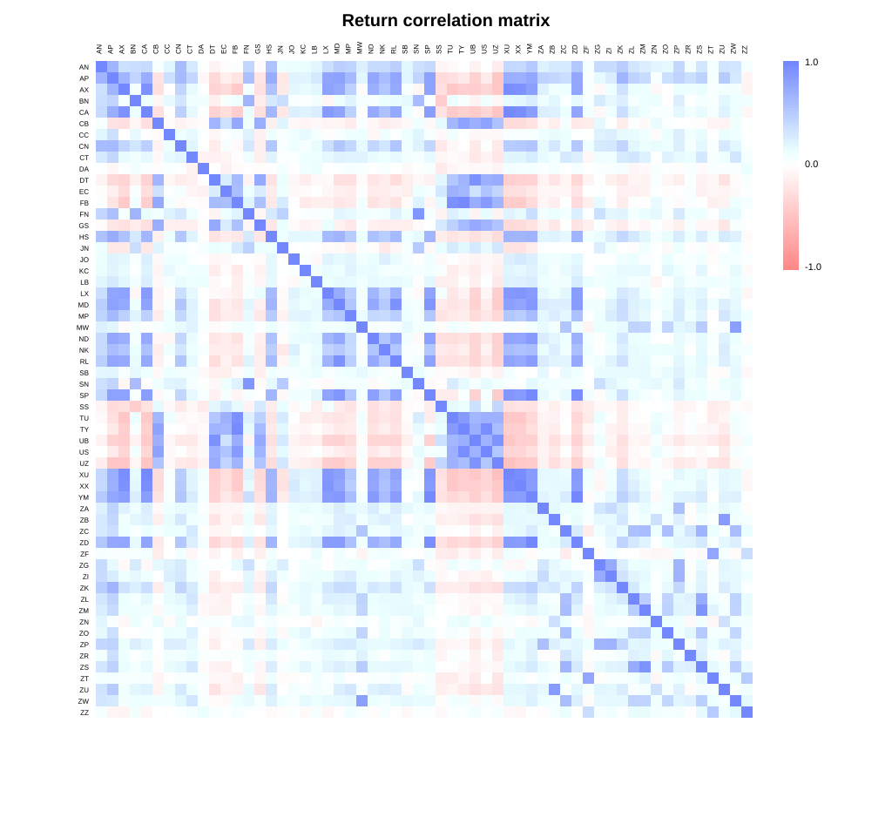
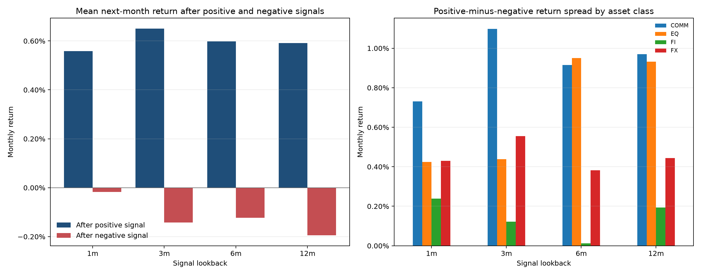
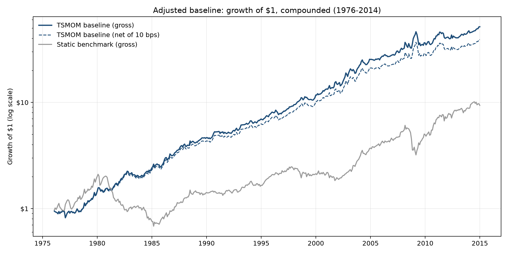
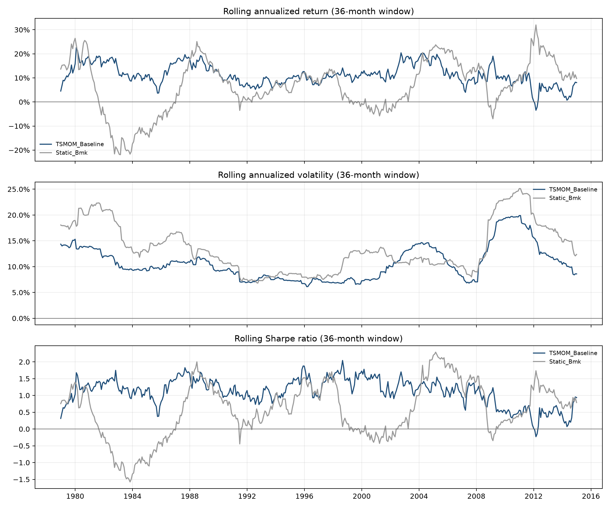
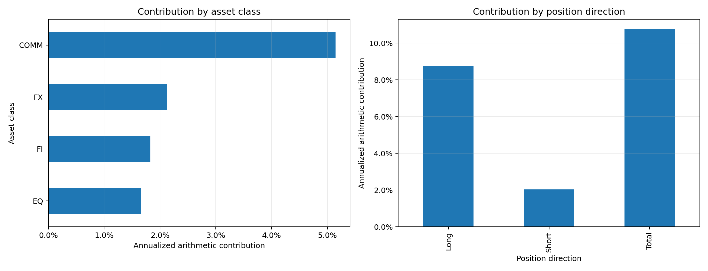
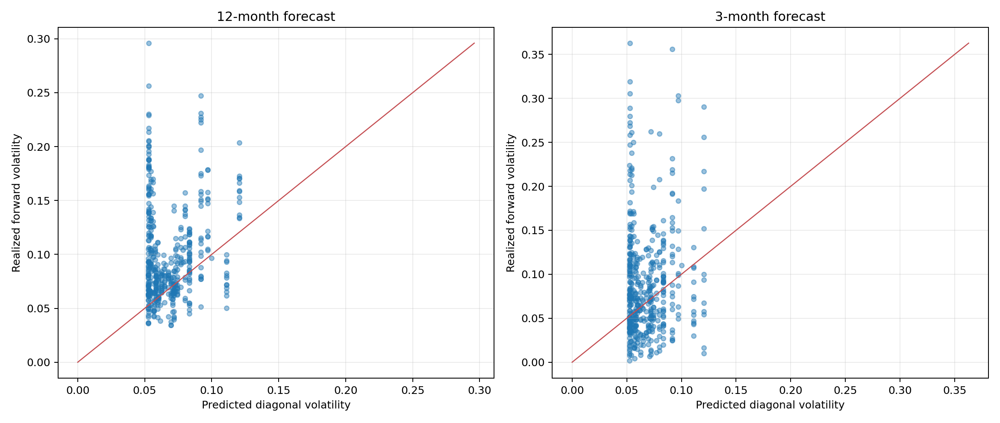
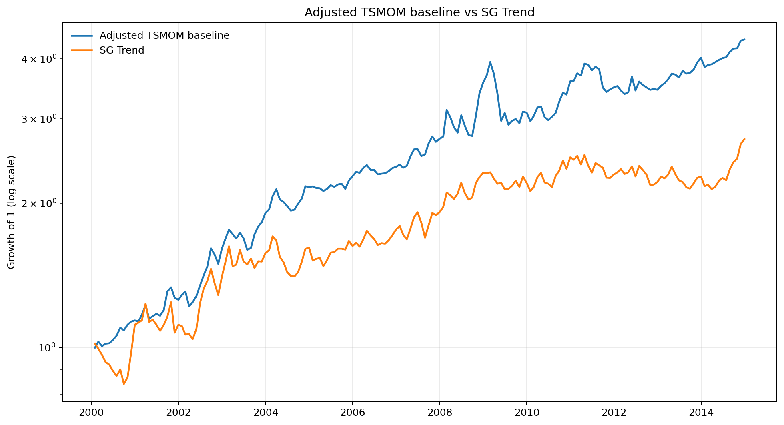

# Midterm Report: Futures Time-Series Momentum

## EDA: what we know about the data

The project uses monthly returns for 58 futures markets from January 1969 to December 2014. The universe contains 26 commodity, 14 equity-index, 10 fixed-income, and 8 FX series. `analysis_eda.py` checks coverage, missing values, outliers, cross-market correlations, and agreement between the supplied monthly returns and returns recomputed from daily closing prices.

### Methodology and assumptions

- The supplied matrix contains 552 month-end rows and 20,987 non-missing instrument-month observations.
- Series have different start dates. The longest contains 551 returns, while the shortest contains 75. Missing history is retained rather than backfilled.
- An observation is flagged as an outlier when it falls outside three times the instrument-level interquartile range or has an absolute robust z-score above five. Flagging is diagnostic; observations are not automatically removed.
- Daily files are converted to month-end close-to-close returns and compared with the supplied monthly file where both are available.
- Descriptive Sharpe ratios use a zero risk-free rate.

### Key results

| Data check | Result | Interpretation |
| --- | ---: | --- |
| Instruments | 58 | Broad multi-asset futures universe |
| Monthly rows | 552 | January 1969–December 2014 |
| Non-missing observations | 20,987 | Panel is unbalanced because markets begin at different dates |
| Flagged outliers | 126 | Large commodity moves require care but are economically plausible |
| Daily/monthly overlapping checks | 14,974 | Most reconstructed returns agree closely with the supplied data |
| Median instrument-level maximum recomputation difference | 0.0000% | Strong overall agreement |
| Largest instrument-level maximum difference | 4.70% for RL | This series should be reviewed before final conclusions |

Absolute returns show much stronger persistence than raw returns. Across instruments, mean lag-one autocorrelation is 18.4% for absolute returns but only 6.2% for raw returns. This supports time-varying volatility estimation, while the weaker raw-return autocorrelation suggests that the momentum signal should be assessed directly against future returns.

The data are suitable for a diversified trend-following study, but the unequal histories, large commodity observations, and remaining reconstruction discrepancies should remain visible in robustness checks.

## Backtest strategy construction

The main strategy is the adjusted baseline implemented in `strategy_backtest_adj.py`. It is a monthly time-series momentum strategy with a 12-month signal, expanding-window instrument volatility, inverse-volatility scaling, and equal allocation across eligible instruments. The backtest runs from January 1976 through December 2014.

### Methodology

For instrument $i$ at month $t$, the signal is

$$
s_{i,t}=\operatorname{sign}\left(\sum_{k=0}^{11} r_{i,t-k}\right).
$$

Annualized volatility is estimated from all available returns through month $t$, subject to at least 36 valid monthly observations:

$$
\hat\sigma_{i,t}=\operatorname{Std}(r_{i,1:t})\sqrt{12}.
$$

The preliminary instrument position is

$$
p_{i,t}=s_{i,t}\frac{0.40}{\hat\sigma_{i,t}},
$$

and the portfolio divides these positions equally across the eligible markets. Positions formed using information through month $t$ earn returns in month $t+1$. The strategy rebalances monthly.

### Main assumptions

- The 40% parameter scales each instrument before diversification. It is not a 40% portfolio volatility target.
- The risk model is diagonal: instrument variances are estimated, while all cross-instrument covariances are assumed to be zero.
- Expanding volatility treats historical realized volatility as a proxy for future volatility.
- Missing realized returns for held positions are filled with zero.
- There are no leverage or position caps, margin constraints, financing costs, contract-specific spreads, or explicit futures roll costs.
- Transaction costs are tested separately at 0, 5, 10, and 25 basis points per one-way change in target weight.
- The static benchmark is always long and uses the same instrument-level volatility scaling and eligibility logic.

This construction avoids the original classroom backtest's full-sample volatility look-ahead. It does not yet use covariance-aware portfolio risk or a portfolio-level volatility target.

## Backtest results and analysis

We evaluate the baseline in five steps. First, we test whether past returns contain a usable momentum signal. Second, we ask whether that signal produces attractive portfolio-level performance after volatility scaling and plausible transaction costs. Third, we identify which markets and positions generate the returns. Fourth, we examine the risks created by those positions and test whether the diagonal risk model forecasts them accurately. Finally, we compare the strategy with external benchmarks and common factors. This sequence separates signal quality, portfolio construction, return sources, risk measurement, and benchmark-relative value.

### Is there evidence that the momentum signal predicts returns?

Before evaluating the portfolio, we test the economic premise of the strategy: markets with positive past returns should subsequently outperform markets with negative past returns. We examine raw-return autocorrelation and then test the actual trading rule at 1-, 3-, 6-, and 12-month lookbacks. For each horizon, the signal is formed using information available before the next monthly return. Results are summarized across instruments, asset classes, and time periods.

Because futures returns within the same month may be correlated, statistical significance is based on the monthly equal-weighted signed return with Newey–West HAC standard errors. Absolute- and squared-return autocorrelations are also examined to determine whether volatility is persistent enough to support backward-looking volatility estimates.

| Lookback | Positive-minus-negative next-month return | Directional hit rate | Annualized signed return | Vol-scaled Sharpe | HAC t-stat, vol-scaled |
| ---: | ---: | ---: | ---: | ---: | ---: |
| 1 month | 0.58% | 52.8% | 5.16% | 0.57 | 3.61 |
| 3 months | 0.79% | 53.5% | 7.68% | 0.77 | 4.10 |
| 6 months | 0.72% | 54.0% | 7.32% | 0.72 | 3.73 |
| 12 months | 0.79% | 54.4% | 7.43% | 0.86 | 4.51 |

All four horizons have positive return spreads and hit rates above 50%. The 12-month signal has the highest hit rate and volatility-scaled Sharpe, supporting its use in the baseline. The 3-month signal is also strong, so the evidence does not imply that one horizon is uniquely effective. This motivates a later multi-horizon enhancement.

These tests establish that the signal has predictive content. The next question is whether that modest predictability survives portfolio aggregation, volatility scaling, drawdowns, and trading costs.

### Does the signal produce attractive portfolio performance?

We next evaluate the fully constructed 12-month TSMOM portfolio from January 1976 through December 2014. The always-long static futures portfolio provides a simple benchmark using the same eligible universe and instrument-level volatility scaling. This comparison asks whether changing position direction with the momentum signal adds value beyond passive exposure to the futures universe.

The evaluation covers compounded growth, average return, realized volatility, Sharpe ratio, drawdowns, turnover, and net performance under several transaction-cost assumptions. Signal timing checks confirm that weights formed at month $t$ are applied only to returns at month $t+1$.

| Metric | TSMOM baseline | Static benchmark |
| --- | ---: | ---: |
| CAGR | 10.64% | 5.91% |
| Annualized mean return | 10.77% | 6.82% |
| Annualized volatility | 11.15% | 14.52% |
| Sharpe ratio, RF = 0 | 0.97 | 0.47 |
| Maximum drawdown | -26.03% | -67.54% |
| Monthly hit rate | 64.1% | 60.0% |
| Annual turnover | 7.24 | 0.41 |

The baseline materially outperforms the static benchmark, with higher return, lower volatility, and a much smaller maximum drawdown. This suggests that the signal adds value beyond static futures exposure. Its main implementation weakness is turnover. At 10 bps per one-way weight change, CAGR declines to 9.85% and Sharpe to 0.90; at 25 bps, CAGR is 8.68% and Sharpe is 0.81. Performance remains favorable under the tested costs, but these generic assumptions exclude market-specific spreads, roll costs, financing, and liquidity effects.

Average gross exposure is 3.13, with a maximum of 4.60. Average net exposure is +0.84 and ranges from -2.50 to +4.24. The strategy therefore uses substantial implicit leverage and has a long bias on average. Strong total performance alone does not reveal whether the result is diversified, so we next decompose it by market, asset class, direction, time, and market regime.

### Where do the returns come from?

Return attribution tests whether the headline performance is broad or dependent on a small part of the universe. We decompose the baseline's arithmetic return by instrument, asset class, long versus short positions, decade, major drawdown event, and S&P 500 futures proxy bull/bear regime. Instrument contributions reconcile to the portfolio return, so the decomposition is consistent with the preceding performance analysis.

| Source | Annualized mean contribution | Share of baseline mean return |
| --- | ---: | ---: |
| Commodities | 5.15% | 47.8% |
| FX | 2.13% | 19.8% |
| Fixed income | 1.83% | 17.0% |
| Equity indices | 1.66% | 15.4% |
| Long positions | 8.74% | 81.2% |
| Short positions | 2.03% | 18.8% |

All four asset classes and both position directions contribute positively, which supports the economic breadth of the strategy. Returns are nevertheless concentrated in commodities and long positions. Lumber and gold are the largest individual contributors, while soybeans and orange juice detract most. The positive short-side contribution indicates that the strategy is doing more than capturing a general long-asset premium, although the long side remains dominant.

The strategy remains profitable in the S&P 500 futures proxy regimes: annualized mean return is 10.26% in bear regimes and 11.13% in bull regimes. Bear-regime volatility is higher, at 12.60% versus 8.33% in bull regimes. Returns are also positive in every reported decade, although annualized mean return falls to 7.57% in 2010–2014. This stability is encouraging, but the concentration in commodities and long positions leads directly to the next question: how much risk is concentrated in the same sources, and does the current risk model measure it correctly?

### What risks does the strategy take, and does the model forecast them?

We first use the baseline's diagonal model to attribute predicted variance across instruments and asset classes. Under this model, commodities account for 62.7% of average predicted variance, followed by FX at 15.9%, fixed income at 11.0%, and equities at 10.4%. The average effective number of instrument risk positions is 39.6, but the average effective number of asset-class risk positions is only 2.35. The portfolio is therefore diversified across individual contracts but much less diversified across common asset-class risks.

Risk attribution describes the model's internal view of risk; it does not show whether that view is accurate. We therefore compare each formation-date prediction with the realized volatility of the same weights held fixed over the following 12 months. A three-month horizon serves as a robustness check. This test isolates risk forecasting from subsequent signal and weight changes.

| Forecast horizon | Predicted volatility | Realized volatility | Mean error | Predicted-realized correlation | Realized exceeds forecast |
| ---: | ---: | ---: | ---: | ---: | ---: |
| 12 months | 6.82% | 9.78% | +2.96% | 0.13 | 74.8% |
| 3 months | 6.79% | 8.87% | +2.08% | 0.08 | 54.6% |

The current risk model materially understates subsequent risk and has little linear forecasting power. At the primary 12-month horizon, realized volatility exceeds the prediction in nearly three quarters of observations and exceeds it by more than 25% in 50.4% of observations. The zero-covariance assumption is a likely source of underestimation because same-direction exposures can be correlated. This result provides the strongest direct case for the proposed covariance-aware enhancement and portfolio-level volatility targeting.

Having assessed the strategy on its own terms, we finally ask whether it behaves like an established trend-following benchmark and whether conventional factors explain its returns.

### How does the baseline compare with SG Trend and common factors?

The static benchmark shows whether momentum improves on passive futures exposure over the full backtest. SG Trend provides a second, external comparison with a professional trend-following index. Because SG Trend data begin in January 2000, this comparison uses the common January 2000–December 2014 sample. We compare raw and volatility-matched returns, drawdowns, rolling statistics, correlation, and HAC regressions.

| Metric, 2000–2014 | TSMOM baseline | SG Trend |
| --- | ---: | ---: |
| Annualized mean return | 10.72% | 7.75% |
| CAGR | 10.37% | 6.90% |
| Annualized volatility | 12.83% | 14.60% |
| Sharpe ratio, RF = 0 | 0.84 | 0.53 |
| Maximum drawdown | -26.03% | -17.66% |

The baseline has higher return and Sharpe than SG Trend over the overlap, but it also experiences a deeper maximum drawdown. The two series have a correlation of 0.62. A raw-return regression estimates a beta of 0.54 and annualized alpha of 6.52% with a HAC t-statistic of 2.48. The common variation is consistent with shared trend exposure, while the remaining difference may reflect the baseline's instrument set, simple signal, risk scaling, omitted fees, and lack of portfolio-level risk targeting. SG Trend may use different markets, fees, risk targets, and index rules, so the comparison is descriptive rather than a claim of replication or superiority.

We then test whether standard equity factors explain the baseline. The joint regression uses monthly excess baseline returns and all six factors together, with Newey–West HAC standard errors using three lags.

| Joint six-factor term | Annualized alpha or beta | HAC t-statistic | p-value |
| --- | ---: | ---: | ---: |
| Alpha | 7.20% | 2.27 | 0.023 |
| Mkt-RF | 0.004 | 0.05 | 0.964 |
| SMB | -0.005 | -0.06 | 0.949 |
| HML | -0.222 | -1.71 | 0.087 |
| Mom | 0.286 | 5.17 | &lt;0.001 |
| RMW | 0.184 | 1.76 | 0.078 |
| CMA | 0.218 | 1.31 | 0.189 |

The joint model explains 28.0% of baseline variance. Momentum is the only clearly significant positive factor exposure, while the market and size betas are close to zero. The positive joint-model alpha indicates that the six equity factors do not fully explain the strategy over 2000–2014. However, they are incomplete for a diversified futures strategy, so the residual should not automatically be interpreted as manager skill. A later analysis should include futures-relevant trend, carry, value, duration, USD, and commodity factors.

Together, the benchmark and factor results support the central conclusion from the earlier sections: the baseline captures a meaningful trend effect, but its simplified risk model, implicit leverage, concentration, implementation assumptions, and incomplete factor controls leave clear room for improvement.

## Key findings

1. **The baseline has a credible momentum signal.** All tested lookbacks predict next-month returns, and the 12-month signal has a 54.4% directional hit rate with a statistically strong vol-scaled return.
2. **Historical performance is strong and broad.** The baseline earns a 10.64% CAGR and 0.97 Sharpe ratio from 1976–2014. Every asset class, both long and short positions, and every reported decade contribute positively.
3. **Diversification is uneven.** Commodities generate 47.8% of mean return and 62.7% of diagonal risk. The effective number of asset-class risk positions is only 2.35.
4. **The risk model is the clearest weakness.** Twelve-month realized volatility averages 9.78% against a 6.82% prediction, and forecast-realized correlation is only 0.13.
5. **Turnover matters.** The strategy remains attractive at the tested costs, but the assumptions are generic and omit several implementation costs.
6. **The strategy resembles, but does not replicate, SG Trend.** Their correlation is 0.62, while the baseline has higher return and Sharpe but a deeper maximum drawdown over the overlapping sample.
7. **Recent performance is weaker.** The 2010–2014 annualized mean return of 7.57% is below earlier decades, motivating stability and out-of-sample testing.

## Next steps: enhancing the model

1. **Add covariance-aware portfolio risk.** Estimate expanding, rolling, EWMA, and shrinkage covariance models. Start with shrinkage toward the diagonal because 58 instruments and limited early history can make the sample covariance unstable.
2. **Introduce portfolio-level volatility targeting.** Scale the whole portfolio to a common annual target using ex-ante covariance risk. Apply leverage and scaling caps, and report target breaches.
3. **Separate risk-model and leverage effects.** First compare diagonal and covariance risk estimates at comparable exposure. Then add dynamic portfolio volatility targeting as a separate experiment.
4. **Improve asset-class diversification.** Test equal asset-class risk budgets or limits on class-level risk shares, especially for commodities.
5. **Combine signal horizons.** The 3-, 6-, and 12-month signals are all informative. Use a predetermined multi-horizon average and assess whether it improves stability rather than selecting the best full-sample lookback.
6. **Use faster volatility estimates.** Compare expanding volatility with rolling and EWMA estimates, particularly around volatility regime changes.
7. **Strengthen implementation assumptions.** Add instrument-specific cost estimates, futures roll costs, financing, liquidity constraints, leverage caps, and volatility floors.
8. **Validate enhancements out of sample.** Use walk-forward evaluation with parameters fixed before each test window. Compare predicted and realized risk, turnover, drawdowns, and performance by decade and asset class.
9. **Expand factor analysis.** Add economically relevant futures factors such as equity, duration, USD, commodity, carry, value, and trend factors. The current equity-factor set is incomplete.
10. **Resolve remaining data issues.** Review the RL recomputation difference and test whether flagged outliers materially affect signals, volatility estimates, and results.
