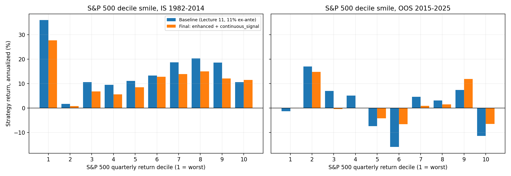

# Combined strategy: in-sample selection, out-of-sample evaluation

**Final combination:** `enhanced + continuous_signal`. All numbers are net of Lecture 11: 2 bps + 4 rolls/yr (Lecture 11
slides 17-19, exact turnover formula) unless stated; Lecture 8 model, $1bn is in
`cost_convention_comparison.md`.

## Baseline alignment (Lecture 11 slides 21 and 30)

`Baseline` = Lecture 11 slide 21 taken literally: binary 12-month signal, 1/(12-month vol)/N with no floor,
whole book scaled each month to an **11% ex-ante** volatility target using the 6-month-half-life EWMA
covariance forecast, no leverage cap, monthly rebalance. On monthly data the forecast runs hot: realized IS vol
is about 12.5% rather than 11%, and turnover and leverage are above slide 21. An alternative replica that scales
to 10% on trailing 36-month realized vol (`slide_baseline_realized`) matches slide-21 turnover (13.42) exactly and
is reported alongside. The choice of the literal version as the official baseline was made after both versions'
OOS results had been seen. Slide 30 uses daily data
(21-business-day returns) and ends Jun 2025; we use monthly returns through May 2025, so OOS levels are
not expected to match exactly.

| | Slide 21 IS | Baseline IS | Final IS | Slide 30 OOS | Baseline OOS | Final OOS |
|---|---:|---:|---:|---:|---:|---:|
| Avg net return | 11.1% | 15.4% | 11.4% | 3.0% | 0.5% | 0.9% |
| Std | 9.9% | 12.5% | 10.1% | 9.5% | 12.6% | 7.5% |
| Sharpe | 1.13 | 1.23 | 1.13 | 0.31 | 0.04 | 0.12 |
| Turnover | 13.42 | 21.80 | 10.84 | 30.46 | 43.70 | 15.30 |
| T-costs | 0.59% | 0.90% | 0.45% | — | 1.75% | 0.60% |
| Leverage | 4.00 | 5.75 | 2.92 | 7.94 | 10.97 | 3.69 |
| #Names | 39.5 | 41.9 | 39.6 | 56.3 | 56.1 | 56.1 |
| Imbalance | 1.30 | 2.03 | 0.93 | 2.70 | 4.30 | 0.88 |

## Protocol

- In-sample (IS) = Jan 1976 - Dec 2014; out-of-sample (OOS) = Jan 2015 - May 2025
  (`MonthlyReturns_FullSample.xlsx`).
- Forward stepwise from `enhanced`: each round adds the candidate with the highest IS net Sharpe if it
  improves the current IS net Sharpe by at least 0.05. Net = Lecture 11: 2 bps + 4 rolls/yr. An earlier
  run selected with the Lecture 8 model at $1bn and chose the same combination.
- The selection ran on returns truncated at Dec 2014, so no 2015+ value was available to it. The OOS run
  was done once afterwards; the script asserts the IS numbers are identical with and without 2015+ data.
- All component parameters are those fixed in their original scripts on pre-2015 data; nothing was tuned
  here. Each rule is re-implemented on the monthly data and the enhanced construction, not on the
  `economic_trend.py` shared baseline (12-month vol with a 1% floor).
- Pipeline order (fixed in advance): core -> sleeves blended at 20% each and re-targeted to 10% with the
  EWMA covariance (4x gross, 2x scale caps) -> turning point -> half-short -> net cap -> smoothing ->
  4x gross cap -> execution (band_25 or monthly full rebalance).
- `continuous_signal` (Lecture 11 slide 24) was added as a candidate after the OOS results of the other
  components had been seen, prompted by the gap to the Lecture 11 baseline. Its specification
  (clip(12-month return / annual EWMA vol, -1, 1), one variant, no grid) was fixed before it was run.
- Three baselines are reported: `slide_baseline` (official, literal Lecture 11 slide 21: 11% ex-ante
  target), `slide_baseline_realized` (alternative replica: 10% on 36-month realized vol) and `baseline` (Lecture 6 course baseline from the midterm: expanding vol,
  40%/vol, 1/N, no portfolio target).
- Rebalance frequency was not a candidate: weekly/daily trading needs daily closes after 2014, which are
  not available here, so it cannot be tested out of sample.

## Stepwise selection (in-sample only)

| Round | Candidate | IS net Sharpe | Change vs current | Added |
|---:|---|---:|---:|:---:|
| 0 | (start: enhanced) | 1.068 | +0.000 |  |
| 1 | continuous_signal | 1.128 | +0.060 | yes |
| 1 | half_short | 1.123 | +0.055 |  |
| 1 | smooth_leverage | 1.093 | +0.025 |  |
| 1 | smooth_leverage_imbalance | 1.081 | +0.014 |  |
| 1 | turning_point | 1.079 | +0.011 |  |
| 1 | economic_trend | 1.078 | +0.011 |  |
| 1 | histgb_overlay | 1.068 | +0.000 |  |
| 1 | band_25 | 1.064 | -0.003 |  |
| 1 | factor_overlay | 1.012 | -0.056 |  |
| 1 | net_cap | 0.964 | -0.104 |  |
| 1 | risk_budget | 0.922 | -0.145 |  |
| 2 | half_short | 1.159 | +0.031 |  |
| 2 | economic_trend | 1.148 | +0.020 |  |
| 2 | turning_point | 1.133 | +0.006 |  |
| 2 | smooth_leverage | 1.131 | +0.003 |  |
| 2 | histgb_overlay | 1.113 | -0.015 |  |
| 2 | smooth_leverage_imbalance | 1.079 | -0.049 |  |
| 2 | factor_overlay | 1.076 | -0.051 |  |
| 2 | band_25 | 1.057 | -0.071 |  |
| 2 | net_cap | 1.018 | -0.109 |  |

Sharpe standard errors are about 0.19 over 39 IS years, so a 0.05 step is not statistically significant
on its own; the threshold only guards against adding near-zero improvements.

## In-sample vs out-of-sample (net of Lecture 11: 2 bps + 4 rolls/yr unless labelled gross)

Rows other than the baselines, `enhanced`, `final` and the sensitivity row are `enhanced` plus that one
component. Turnover is annual traded notional (x NAV); leverage = average gross exposure; imbalance = average
net long; names = average number of positions.

| Strategy | IS Net CAGR | OOS Net CAGR | IS Gross ret | OOS Gross ret | IS Net ret | OOS Net ret | IS Vol | OOS Vol | IS Sharpe | OOS Sharpe | IS Max DD | OOS Max DD | IS Turnover | OOS Turnover | IS Cost drag | OOS Cost drag | IS Leverage | OOS Leverage | IS Imbalance | OOS Imbalance | IS Names | OOS Names |
|---|---:|---:|---:|---:|---:|---:|---:|---:|---:|---:|---:|---:|---:|---:|---:|---:|---:|---:|---:|---:|---:|---:|
| baseline | 10.19% | -1.46% | 10.77% | -0.26% | 10.36% | -0.86% | 11.14% | 11.08% | 0.93 | -0.08 | -26.2% | -32.6% | 7.9 | 12.5 | 0.41% | 0.60% | 3.13 | 4.35 | +0.84 | +0.66 | 39.6 | 56.1 |
| slide_baseline | 15.68% | -0.26% | 16.32% | 2.28% | 15.43% | 0.53% | 12.51% | 12.64% | 1.23 | 0.04 | -16.0% | -24.6% | 21.8 | 43.7 | 0.90% | 1.75% | 5.75 | 10.97 | +2.03 | +4.30 | 41.9 | 56.1 |
| slide_baseline_realized | 12.25% | 0.26% | 12.76% | 2.12% | 12.13% | 0.81% | 10.25% | 10.62% | 1.18 | 0.08 | -13.0% | -22.5% | 13.4 | 28.6 | 0.63% | 1.30% | 4.55 | 9.17 | +1.49 | +3.98 | 41.9 | 56.1 |
| enhanced | 10.09% | -0.29% | 10.53% | 0.52% | 10.09% | -0.05% | 9.45% | 7.06% | 1.07 | -0.01 | -13.9% | -14.4% | 9.6 | 12.8 | 0.44% | 0.56% | 3.13 | 3.86 | +0.83 | +0.82 | 39.6 | 56.1 |
| risk_budget | 9.58% | -0.10% | 10.54% | 1.04% | 9.73% | 0.04% | 10.55% | 5.35% | 0.92 | 0.01 | -12.2% | -13.8% | 25.6 | 33.8 | 0.81% | 1.00% | 3.67 | 4.00 | +0.83 | +0.76 | 39.6 | 56.1 |
| economic_trend | 10.56% | -0.15% | 11.03% | 0.71% | 10.56% | 0.12% | 9.79% | 7.31% | 1.08 | 0.02 | -13.5% | -16.3% | 11.3 | 14.5 | 0.47% | 0.59% | 3.09 | 3.80 | +0.73 | +0.43 | 39.6 | 56.1 |
| factor_overlay | 9.42% | -1.02% | 10.06% | -0.03% | 9.48% | -0.81% | 9.37% | 6.57% | 1.01 | -0.12 | -15.2% | -16.4% | 16.6 | 23.8 | 0.58% | 0.78% | 3.09 | 3.78 | +0.55 | +0.58 | 39.6 | 56.1 |
| turning_point | 10.14% | -0.16% | 10.58% | 0.65% | 10.14% | 0.09% | 9.40% | 7.04% | 1.08 | 0.01 | -13.9% | -14.1% | 9.9 | 13.1 | 0.44% | 0.57% | 3.09 | 3.81 | +0.82 | +0.80 | 39.6 | 56.1 |
| half_short † | 9.05% | 0.55% | 9.37% | 1.12% | 9.02% | 0.68% | 8.03% | 5.16% | 1.12 | 0.13 | -10.7% | -9.2% | 7.3 | 9.6 | 0.35% | 0.44% | 2.56 | 3.10 | +1.41 | +1.58 | 39.6 | 56.1 |
| net_cap | 8.22% | -0.81% | 8.68% | -0.19% | 8.30% | -0.66% | 8.61% | 5.57% | 0.96 | -0.12 | -13.9% | -14.2% | 9.5 | 12.6 | 0.38% | 0.47% | 2.44 | 2.79 | +0.35 | +0.22 | 39.6 | 56.1 |
| smooth_leverage † | 10.28% | -0.33% | 10.69% | 0.47% | 10.26% | -0.09% | 9.39% | 7.07% | 1.09 | -0.01 | -13.5% | -14.9% | 8.9 | 12.2 | 0.43% | 0.55% | 3.12 | 3.86 | +0.83 | +0.83 | 39.6 | 56.1 |
| smooth_leverage_imbalance † | 10.28% | 0.01% | 10.73% | 0.85% | 10.28% | 0.27% | 9.50% | 7.25% | 1.08 | 0.04 | -14.4% | -15.6% | 10.0 | 13.8 | 0.45% | 0.58% | 3.12 | 3.86 | +0.84 | +0.84 | 39.6 | 56.1 |
| band_25 | 8.86% | 0.46% | 9.20% | 1.07% | 8.87% | 0.64% | 8.33% | 6.10% | 1.06 | 0.10 | -12.6% | -10.5% | 6.4 | 8.7 | 0.34% | 0.43% | 2.63 | 3.26 | +0.73 | +0.74 | 39.6 | 56.1 |
| histgb_overlay | 10.08% | 1.05% | 10.58% | 1.92% | 10.08% | 1.26% | 9.44% | 6.53% | 1.07 | 0.19 | -13.9% | -10.5% | 12.2 | 17.5 | 0.50% | 0.66% | 3.18 | 3.86 | +1.09 | +1.79 | 39.6 | 56.1 |
| continuous_signal | 11.45% | 0.65% | 11.85% | 1.53% | 11.40% | 0.93% | 10.11% | 7.46% | 1.13 | 0.12 | -16.5% | -11.9% | 10.8 | 15.3 | 0.45% | 0.60% | 2.92 | 3.69 | +0.93 | +0.88 | 39.6 | 56.1 |
| final | 11.45% | 0.65% | 11.85% | 1.53% | 11.40% | 0.93% | 10.11% | 7.46% | 1.13 | 0.12 | -16.5% | -11.9% | 10.8 | 15.3 | 0.45% | 0.60% | 2.92 | 3.69 | +0.93 | +0.88 | 39.6 | 56.1 |
| sensitivity_cont_econ | 11.82% | 0.65% | 12.20% | 1.52% | 11.74% | 0.93% | 10.23% | 7.56% | 1.15 | 0.12 | -14.9% | -14.7% | 11.3 | 15.3 | 0.46% | 0.60% | 2.91 | 3.68 | +0.82 | +0.47 | 39.6 | 56.1 |

† Designed after the 2015-2025 data had been examined (half-short rule, exposure smoothing): their OOS
columns are **not a clean out-of-sample test**. None of these entered the final combination.

## Walk-forward selection

The one-shot selection above fixes the combination once, using all of 1976-2014. As a test of the
selection *procedure*, the same stepwise rule (+0.05 net Sharpe threshold) is rerun at every Dec-31
close on an expanding window from Jan 1976 to that date, and the chosen combination is traded for the next
12 formation months. Switching combinations is traded and charged through the cost model; the no-trade
band applies only in months whose combination includes `band_25`. The window type (expanding), first
traded year (1990) and candidate pools were fixed before any walk-forward result was computed.

- **Clean pool:** risk_budget, economic_trend, factor_overlay, turning_point, net_cap, band_25, histgb_overlay, continuous_signal (excludes the rules designed after viewing 2015+ data).
- **All-candidates pool †:** also half_short and the smoothing rules; its 2015+ results are not clean.
- 1990-2014 decisions are causal, but the component designs themselves were developed on data covering
  that period, so it is a pseudo-out-of-sample check; 2015-2025 is the out-of-sample period.
- Blending rule: a sleeve with no positions at a date returns its share to the core, and dates with no
  active sleeve keep the core unchanged. This was corrected after a first walk-forward run showed the
  inactive (pre-1997) HistGB sleeve being "selected" only because its unused 30% share rescaled the
  portfolio. It is a correctness fix (an inactive component must be a no-op), not a tuned parameter, but
  it was made after seeing that run.
- Scores at each decision date use only months up to that date; this relies on truncation invariance,
  verified by `test_lookahead.py`, and the 2015 decision is asserted equal to a selection run on data
  truncated at Dec 2014.

| Strategy | 1990-2014 Net CAGR | OOS Net CAGR | 1990-2014 Gross ret | OOS Gross ret | 1990-2014 Net ret | OOS Net ret | 1990-2014 Vol | OOS Vol | 1990-2014 Sharpe | OOS Sharpe | 1990-2014 Max DD | OOS Max DD | 1990-2014 Turnover | OOS Turnover | 1990-2014 Cost drag | OOS Cost drag | 1990-2014 Leverage | OOS Leverage | 1990-2014 Imbalance | OOS Imbalance | 1990-2014 Names | OOS Names |
|---|---:|---:|---:|---:|---:|---:|---:|---:|---:|---:|---:|---:|---:|---:|---:|---:|---:|---:|---:|---:|---:|---:|
| slide_baseline | 15.69% | -0.26% | 16.56% | 2.28% | 15.40% | 0.53% | 12.24% | 12.64% | 1.26 | 0.04 | -13.0% | -24.6% | 27.9 | 43.7 | 1.16% | 1.75% | 7.56 | 10.97 | +3.11 | +4.30 | 51.0 | 56.1 |
| baseline | 9.56% | -1.46% | 10.25% | -0.26% | 9.77% | -0.86% | 10.98% | 11.08% | 0.89 | -0.08 | -26.2% | -32.6% | 9.1 | 12.5 | 0.49% | 0.60% | 3.82 | 4.35 | +1.27 | +0.66 | 49.0 | 56.1 |
| enhanced | 9.08% | -0.29% | 9.56% | 0.52% | 9.06% | -0.05% | 8.18% | 7.06% | 1.11 | -0.01 | -9.4% | -14.4% | 10.2 | 12.8 | 0.51% | 0.56% | 3.77 | 3.86 | +1.26 | +0.82 | 49.0 | 56.1 |
| final | 10.55% | 0.65% | 11.02% | 1.53% | 10.48% | 0.93% | 9.06% | 7.46% | 1.16 | 0.12 | -11.5% | -11.9% | 12.8 | 15.3 | 0.55% | 0.60% | 3.64 | 3.69 | +1.39 | +0.88 | 49.0 | 56.1 |
| walk_forward_clean | 8.36% | 0.65% | 8.98% | 1.53% | 8.43% | 0.93% | 8.60% | 7.46% | 0.98 | 0.12 | -11.7% | -11.9% | 12.8 | 15.3 | 0.55% | 0.60% | 3.72 | 3.69 | +1.44 | +0.88 | 49.0 | 56.1 |
| walk_forward_all † | 8.46% | 0.45% | 9.07% | 1.08% | 8.51% | 0.59% | 8.60% | 5.34% | 0.99 | 0.11 | -11.7% | -9.3% | 12.7 | 11.7 | 0.55% | 0.49% | 3.73 | 3.22 | +1.43 | +1.52 | 49.0 | 56.1 |

| Return year | Clean pool selects | All-candidates pool selects † |
|---:|---|---|
| 1990 | risk_budget + economic_trend + turning_point + band_25 | risk_budget + economic_trend + turning_point + band_25 |
| 1991 | economic_trend + continuous_signal | economic_trend + continuous_signal |
| 1992 | economic_trend + continuous_signal | economic_trend + continuous_signal |
| 1993 | economic_trend + continuous_signal | economic_trend + continuous_signal |
| 1994 | economic_trend + continuous_signal | economic_trend + continuous_signal |
| 1995 | economic_trend + continuous_signal | economic_trend + smooth_leverage |
| 1996 | (enhanced only) | (enhanced only) |
| 1997 | (enhanced only) | (enhanced only) |
| 1998 | (enhanced only) | (enhanced only) |
| 1999 | (enhanced only) | (enhanced only) |
| 2000 | (enhanced only) | (enhanced only) |
| 2001 | continuous_signal | continuous_signal |
| 2002 | continuous_signal | continuous_signal |
| 2003 | continuous_signal | continuous_signal |
| 2004 | economic_trend + continuous_signal | economic_trend + continuous_signal |
| 2005 | continuous_signal | continuous_signal |
| 2006 | continuous_signal | continuous_signal |
| 2007 | continuous_signal | continuous_signal |
| 2008 | continuous_signal | continuous_signal |
| 2009 | continuous_signal | continuous_signal |
| 2010 | continuous_signal | continuous_signal |
| 2011 | continuous_signal | continuous_signal |
| 2012 | continuous_signal | continuous_signal |
| 2013 | continuous_signal | continuous_signal |
| 2014 | continuous_signal | continuous_signal |
| 2015 | continuous_signal | continuous_signal |
| 2016 | continuous_signal | continuous_signal |
| 2017 | continuous_signal | continuous_signal |
| 2018 | continuous_signal | half_short |
| 2019 | continuous_signal | half_short |
| 2020 | continuous_signal | half_short |
| 2021 | continuous_signal | half_short |
| 2022 | continuous_signal | half_short |
| 2023 | continuous_signal | half_short |
| 2024 | continuous_signal | half_short |
| 2025 | continuous_signal | half_short + continuous_signal |

## Caveats

- **Execution timing.** Trades fill at the signal close; `alpha_decay_execution.py` shows that a feasible
  execution schedule lowers IS net Sharpe by about 0.07-0.09.
- **Sample start.** Statistics start Jan 1976 (the course baseline needs 36 months of history); Lecture 11
  slide 29 starts Dec 1973.
- **Research look-ahead.** The repository had already analysed 2015-2025 for other strategies, so the OOS
  period is strategy-specific OOS, not a pristine holdout. The 58-market universe was chosen with hindsight.
- **Macro data.** FRED current vintages (INDPRO, CPIAUCSL, GS2, BAA10Y) include later revisions that were
  not known in real time. Publication lags: INDPRO and CPI usable one month after the reference month;
  GS2 and BAA10Y monthly averages of daily data, known at month-end.
- **Turning point.** Flags use only trailing 2- and 12-month return sums and the macro vote; no
  smoothing, filtering or ex-post peak/trough dating.
- **HistGB sleeve.** `rolling_sign_prediction.py` model and schedule unchanged (15-year rolling window,
  refit before each return year, labels strictly before the first formation date, forecasts from 1997;
  window and 30% weight chosen on 2000-2004 validation). It is inactive before 1997, so it cannot add
  in-sample Sharpe in 1976-1996. Feature eligibility uses `economic_trend.instrument_vol` as in the
  original; sizing uses EWMA vol like the other sleeves. The most recent formation month is kept for
  forecasting (the original `prepare` drops it because it has no label yet).
- **Costs after 2014.** Daily volume ends Dec 2014, so OOS liquidity uses the asset-class ADV constants.
- **Look-ahead test.** `python -m unittest test_lookahead.py` truncates returns and macro files at 1990-06,
  2014-12 and 2020-03 and checks that the final and all-components pipelines give identical weights and
  costs up to each cut.
