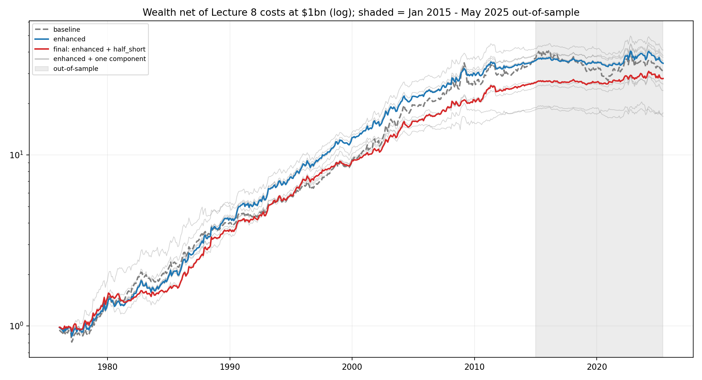

# Combined strategy: in-sample selection, out-of-sample evaluation

**Final combination:** `enhanced + half_short`.

## Protocol

- In-sample (IS) = Jan 1976 - Dec 2014; out-of-sample (OOS) = Jan 2015 - May 2025
  (`MonthlyReturns_FullSample.xlsx`).
- Forward stepwise from `enhanced`: each round adds the candidate with the highest IS net Sharpe if it
  improves the current IS net Sharpe by at least 0.05. Net = Lecture 8 cost model
  (`transaction_cost_model.py`) at $1bn, 5-day impact, drift-adjusted turnover.
- The selection ran on returns truncated at Dec 2014, so no 2015+ value was available to it. The OOS run
  was done once afterwards; the script asserts the IS numbers are identical with and without 2015+ data.
- All component parameters are those fixed in their original scripts on pre-2015 data; nothing was tuned
  here. Each rule is re-implemented on the monthly data and the enhanced construction, not on the
  `economic_trend.py` shared baseline (12-month vol with a 1% floor).
- Pipeline order (fixed in advance): core -> sleeves blended at 20% each and re-targeted to 10% with the
  EWMA covariance (4x gross, 2x scale caps) -> turning point -> half-short -> net cap -> smoothing ->
  4x gross cap -> execution (band_25 or monthly full rebalance).
- Rebalance frequency was not a candidate: weekly/daily trading needs daily closes after 2014, which are
  not available here, so it cannot be tested out of sample.

## Stepwise selection (in-sample only)

| Round | Candidate | IS net Sharpe | Change vs current | Added |
|---:|---|---:|---:|:---:|
| 0 | (start: enhanced) | 1.021 | +0.000 |  |
| 1 | half_short | 1.090 | +0.069 | yes |
| 1 | smooth_leverage | 1.050 | +0.029 |  |
| 1 | smooth_leverage_imbalance | 1.036 | +0.015 |  |
| 1 | band_25 | 1.033 | +0.013 |  |
| 1 | economic_trend | 1.032 | +0.011 |  |
| 1 | turning_point | 1.031 | +0.011 |  |
| 1 | factor_overlay | 0.950 | -0.071 |  |
| 1 | net_cap | 0.914 | -0.107 |  |
| 1 | risk_budget | 0.771 | -0.250 |  |
| 2 | smooth_leverage | 1.099 | +0.010 |  |
| 2 | turning_point | 1.098 | +0.008 |  |
| 2 | economic_trend | 1.092 | +0.003 |  |
| 2 | smooth_leverage_imbalance | 1.091 | +0.001 |  |
| 2 | band_25 | 1.072 | -0.018 |  |
| 2 | factor_overlay | 1.038 | -0.052 |  |
| 2 | net_cap | 0.970 | -0.120 |  |
| 2 | risk_budget | 0.833 | -0.257 |  |

Sharpe standard errors are about 0.19 over 39 IS years, so a 0.05 step is not statistically significant
on its own; the threshold only guards against adding near-zero improvements.

## In-sample vs out-of-sample (net of Lecture 8 costs at $1bn unless labelled gross)

Rows other than `baseline`, `enhanced` and `final` are `enhanced` plus that one component.
Turnover is annual drift-adjusted traded notional (x NAV).

| Strategy | IS Net CAGR | OOS Net CAGR | IS Gross ret | OOS Gross ret | IS Net ret | OOS Net ret | IS Vol | OOS Vol | IS Sharpe | OOS Sharpe | IS Max DD | OOS Max DD | IS Turnover | OOS Turnover | IS Cost drag | OOS Cost drag |
|---|---:|---:|---:|---:|---:|---:|---:|---:|---:|---:|---:|---:|---:|---:|---:|---:|
| baseline | 9.68% | -1.64% | 10.77% | -0.26% | 9.89% | -1.04% | 11.13% | 11.07% | 0.89 | -0.09 | -26.2% | -33.1% | 8.3 | 13.3 | 0.88% | 0.78% |
| enhanced | 9.59% | -0.33% | 10.53% | 0.52% | 9.63% | -0.09% | 9.44% | 7.06% | 1.02 | -0.01 | -14.2% | -15.0% | 9.6 | 12.8 | 0.90% | 0.60% |
| risk_budget | 7.82% | -0.65% | 10.54% | 1.04% | 8.10% | -0.51% | 10.51% | 5.34% | 0.77 | -0.10 | -13.1% | -15.5% | 25.6 | 33.9 | 2.44% | 1.55% |
| economic_trend | 10.05% | -0.20% | 11.03% | 0.71% | 10.09% | 0.07% | 9.78% | 7.31% | 1.03 | 0.01 | -13.8% | -17.3% | 11.3 | 14.5 | 0.94% | 0.64% |
| factor_overlay | 8.79% | -1.11% | 10.06% | -0.03% | 8.89% | -0.90% | 9.36% | 6.57% | 0.95 | -0.14 | -15.6% | -17.3% | 16.6 | 23.8 | 1.17% | 0.86% |
| turning_point | 9.64% | -0.20% | 10.58% | 0.65% | 9.67% | 0.05% | 9.38% | 7.04% | 1.03 | 0.01 | -14.2% | -14.6% | 9.9 | 13.1 | 0.91% | 0.61% |
| half_short † | 8.76% | 0.55% | 9.37% | 1.12% | 8.74% | 0.68% | 8.02% | 5.16% | 1.09 | 0.13 | -11.5% | -9.5% | 7.3 | 9.6 | 0.63% | 0.44% |
| net_cap | 7.75% | -0.87% | 8.68% | -0.19% | 7.86% | -0.72% | 8.60% | 5.57% | 0.91 | -0.13 | -14.2% | -13.9% | 9.4 | 12.6 | 0.83% | 0.53% |
| smooth_leverage † | 9.82% | -0.37% | 10.69% | 0.47% | 9.84% | -0.12% | 9.37% | 7.07% | 1.05 | -0.02 | -13.8% | -15.7% | 9.0 | 12.3 | 0.85% | 0.59% |
| smooth_leverage_imbalance † | 9.80% | -0.04% | 10.73% | 0.85% | 9.83% | 0.22% | 9.49% | 7.26% | 1.04 | 0.03 | -14.7% | -16.1% | 10.0 | 13.9 | 0.90% | 0.63% |
| band_25 | 8.58% | 0.47% | 9.20% | 1.07% | 8.60% | 0.65% | 8.32% | 6.10% | 1.03 | 0.11 | -12.8% | -10.8% | 6.1 | 8.4 | 0.60% | 0.42% |
| final | 8.76% | 0.55% | 9.37% | 1.12% | 8.74% | 0.68% | 8.02% | 5.16% | 1.09 | 0.13 | -11.5% | -9.5% | 7.3 | 9.6 | 0.63% | 0.44% |

† Designed after the 2015-2025 data had been examined (half-short rule, exposure smoothing): their OOS
columns are **not a clean out-of-sample test**. The final combination contains half_short, so its OOS result is not clean either.

## Caveats

- **Execution timing.** Main results fill at the signal close while impact costs assume 5-day execution;
  `alpha_decay_execution.py` shows this overstates IS net Sharpe by about 0.07-0.09.
- **Research look-ahead.** The repository had already analysed 2015-2025 for other strategies, so the OOS
  period is strategy-specific OOS, not a pristine holdout. The 58-market universe was chosen with hindsight.
- **Macro data.** FRED current vintages (INDPRO, CPIAUCSL, GS2, BAA10Y) include later revisions that were
  not known in real time. Publication lags: INDPRO and CPI usable one month after the reference month;
  GS2 and BAA10Y monthly averages of daily data, known at month-end.
- **Turning point.** Flags use only trailing 2- and 12-month return sums and the macro vote; no
  smoothing, filtering or ex-post peak/trough dating.
- **Costs after 2014.** Daily volume ends Dec 2014, so OOS liquidity uses the asset-class ADV constants.
- **Look-ahead test.** `python -m unittest test_lookahead.py` truncates returns and macro files at 1990-06,
  2014-12 and 2020-03 and checks that the final and all-components pipelines give identical weights and
  costs up to each cut.
