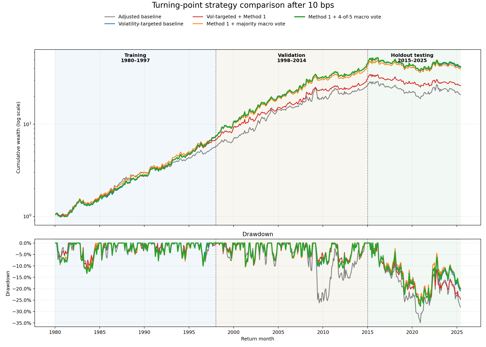

# Turning-point model

## Objective

The turning-point model tests whether short-horizon momentum disagreement and macro confirmation can reduce losses around trend reversals without giving up too much return during temporary corrections.

## Data and evaluation design

The experiment uses `MonthlyReturns_FullSample.xlsx` and the same futures universe as the baseline project. Signals and weights are formed at month-end and executed in the following month. Growth and inflation indicators include a one-month publication lag. The macro files contain revised histories rather than real-time vintages.

- **Training:** 1980–1997
- **Validation:** 1998–2014
- **Holdout testing:** 2015–2025

No model choice uses the holdout period.

## Methods

1. **Adjusted baseline:** the course-style 12-month TSMOM benchmark.
2. **Volatility-targeted baseline:** 12-month price trend, inverse trailing 12-month instrument volatility with a 1% floor, and trailing 36-month portfolio scaling toward 10% annual volatility.
3. **Unfiltered Method 1:** reduce each volatility-targeted position by 50% whenever its 2-month and 12-month momentum directions disagree.
4. **Majority macro vote:** apply the same reduction only when more than half of the available mapped macro themes oppose the baseline direction.
5. **4-of-5 macro vote:** apply the reduction only when at least four macro themes oppose. This is the preferred tested specification because it gives the most consistent numerical improvement over the volatility-targeted baseline.

All five strategies use a one-month execution lag and the same flat 10 bps turnover-cost assumption in the main comparison. Reduced portfolios are not re-targeted immediately after the exposure cut.

## Five-strategy comparison

### Performance after 10 bps

| Period | Strategy | Annual mean | Volatility | Sharpe | Maximum drawdown | Turnover | Cost drag |
|---|---|---:|---:|---:|---:|---:|---:|
| training_1980_1997 | Adjusted baseline | 10.17% | 8.94% | 1.138 | -12.21% | 7.17 | 0.72% |
| training_1980_1997 | Volatility-targeted baseline | 11.76% | 9.77% | 1.203 | -13.27% | 9.91 | 0.99% |
| training_1980_1997 | Vol-targeted + Method 1 | 11.16% | 9.00% | 1.241 | -11.27% | 12.42 | 1.24% |
| training_1980_1997 | Method 1 + majority macro vote | 11.67% | 9.68% | 1.205 | -12.77% | 10.89 | 1.09% |
| training_1980_1997 | Method 1 + 4-of-5 macro vote | 11.68% | 9.70% | 1.205 | -13.27% | 10.23 | 1.02% |
| validation_1998_2014 | Adjusted baseline | 9.70% | 12.32% | 0.787 | -26.26% | 10.40 | 1.04% |
| validation_1998_2014 | Volatility-targeted baseline | 11.09% | 10.63% | 1.044 | -11.00% | 11.87 | 1.19% |
| validation_1998_2014 | Vol-targeted + Method 1 | 9.33% | 9.81% | 0.951 | -9.85% | 16.04 | 1.60% |
| validation_1998_2014 | Method 1 + majority macro vote | 10.81% | 10.59% | 1.021 | -11.01% | 12.84 | 1.28% |
| validation_1998_2014 | Method 1 + 4-of-5 macro vote | 11.19% | 10.59% | 1.057 | -10.99% | 12.18 | 1.22% |
| holdout_testing_2015_2025 | Adjusted baseline | -1.59% | 11.05% | -0.144 | -34.94% | 13.32 | 1.33% |
| holdout_testing_2015_2025 | Volatility-targeted baseline | -0.29% | 10.60% | -0.027 | -27.65% | 14.40 | 1.44% |
| holdout_testing_2015_2025 | Vol-targeted + Method 1 | -1.20% | 9.14% | -0.131 | -27.17% | 18.97 | 1.90% |
| holdout_testing_2015_2025 | Method 1 + majority macro vote | -0.10% | 10.36% | -0.010 | -26.32% | 15.20 | 1.52% |
| holdout_testing_2015_2025 | Method 1 + 4-of-5 macro vote | -0.13% | 10.53% | -0.013 | -27.70% | 14.73 | 1.47% |

### Incremental return tests after 10 bps

| Period | Comparison | Annual increment | 95% HAC interval | HAC t |
|---|---|---:|---:|---:|
| training_1980_1997 | adjusted_vs_vol_targeted | -1.58% | [-3.48%, +0.31%] | -1.64 |
| training_1980_1997 | unfiltered_vs_vol_targeted | -0.59% | [-1.62%, +0.43%] | -1.13 |
| training_1980_1997 | majority_vs_vol_targeted | -0.09% | [-0.79%, +0.61%] | -0.25 |
| training_1980_1997 | 4of5_vs_vol_targeted | -0.07% | [-0.39%, +0.24%] | -0.46 |
| training_1980_1997 | 4of5_vs_majority | +0.02% | [-0.58%, +0.62%] | 0.05 |
| validation_1998_2014 | adjusted_vs_vol_targeted | -1.39% | [-4.25%, +1.46%] | -0.96 |
| validation_1998_2014 | unfiltered_vs_vol_targeted | -1.76% | [-2.83%, -0.70%] | -3.24 |
| validation_1998_2014 | majority_vs_vol_targeted | -0.28% | [-0.67%, +0.12%] | -1.39 |
| validation_1998_2014 | 4of5_vs_vol_targeted | +0.10% | [-0.14%, +0.35%] | 0.84 |
| validation_1998_2014 | 4of5_vs_majority | +0.38% | [+0.07%, +0.70%] | 2.38 |
| holdout_testing_2015_2025 | adjusted_vs_vol_targeted | -1.31% | [-3.37%, +0.76%] | -1.24 |
| holdout_testing_2015_2025 | unfiltered_vs_vol_targeted | -0.91% | [-2.52%, +0.70%] | -1.10 |
| holdout_testing_2015_2025 | majority_vs_vol_targeted | +0.18% | [-0.38%, +0.75%] | 0.64 |
| holdout_testing_2015_2025 | 4of5_vs_vol_targeted | +0.15% | [-0.15%, +0.46%] | 0.98 |
| holdout_testing_2015_2025 | 4of5_vs_majority | -0.03% | [-0.50%, +0.43%] | -0.13 |

## Main findings

- Volatility targeting is the largest improvement in validation: Sharpe rises from 0.787 for the adjusted baseline to 1.044.
- Unfiltered Method 1 lowers validation Sharpe to 0.951, showing that fast–slow disagreement alone creates substantial opportunity cost.
- The 4-of-5 model reaches validation and holdout Sharpes of 1.057 and -0.013, compared with 1.044 and -0.027 for volatility targeting alone.
- Its annual incremental return over the volatility-targeted baseline is +0.10% in validation and +0.15% in holdout testing. Both HAC confidence intervals include zero.
- The stricter macro gate reduces false alarms relative to the ordinary majority vote, but the improvement is economically small and not statistically reliable against the volatility-targeted baseline.

## Conclusion

The 4-of-5 macro vote with a 50% reduction is the preferred tested turning-point specification. It should be presented as a modest robustness enhancement rather than a proven source of incremental return. The volatility-targeted price strategy remains the appropriate primary benchmark.

## Output files

- `final_model/strategy_performance.csv`
- `final_model/monthly_returns_10bps.csv`
- `final_model/hac_incremental_tests_10bps.csv`
- `final_model/confirmation_coverage.csv`
- `final_model/five_strategy_periods.png`

Exploratory variants are stored locally under `sensitivity/` and excluded from Git.
