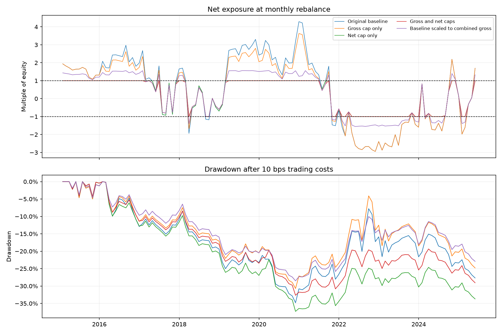

# Out-of-sample leverage and net exposure

**Archive.** This first run uses the expanding-volatility baseline and the original fixed-rate cost schedule. The current exposure comparison uses the team's rolling-volatility baseline and cost model. [Current results](../net_exposure_out_of_sample_aligned/out_of_sample_report.md)

January 2015 to May 2025, 125 monthly returns. The six strategies use the original 12-month momentum signal, expanding volatility sizing, 4× gross cap, and ±1× net cap where applicable. Limits and cost scenarios were fixed from the historical experiment.

The uploaded files provide prices for all 58 original tickers, with the latest quote dated 2025-06-13. The evaluation ends in the last complete month. The original monthly returns through December 2014 seed the expanding risk estimates and December formation weights. New returns use adjacent month-end closes from the uploaded files, including December 2014 closes for the January 2015 return. Positions execute with a one-month lag. Reported wealth starts at the sample boundary and turnover carries the preceding target weights.

The extension has 6,749 observed instrument-month returns out of 7,250. 8 instruments have incomplete histories. Missing observations use the existing backtest convention of zero realized P&L on held positions. No gap is bridged with a multi-month return. The baseline's average gross exposure with a missing realized return is 0.0119× of equity, with a maximum of 0.7257× in January 2022. The sensitivity requires a valid current monthly return at formation for a market to count toward the position-sizing divisor. This still leaves the possibility of a missing return after a position has been formed. Both variants use the existing target-weight turnover costs of 0, 5, 10, and 25 bps with no modeled roll, financing, or market impact.

## Main results at 10 bps

| Strategy | CAGR | Annual volatility | Sharpe | Max drawdown | Avg. gross | Avg. net |
|---|---:|---:|---:|---:|---:|---:|
| Original baseline | -2.28% | 10.32% | -0.17 | -34.81% | 4.20× | +0.52× |
| Gross cap only | -1.94% | 9.73% | -0.15 | -30.72% | 3.82× | +0.41× |
| Net cap only | -3.06% | 8.28% | -0.33 | -37.29% | 3.35× | +0.22× |
| Gross and net caps | -2.46% | 7.69% | -0.29 | -32.66% | 3.10× | +0.22× |
| Baseline scaled to net-only gross | -2.28% | 7.68% | -0.26 | -31.72% | 3.35× | +0.37× |
| Baseline scaled to combined gross | -1.92% | 7.29% | -0.23 | -28.51% | 3.10× | +0.31× |

## Net caps versus matched gross controls

- **Net cap only.** CAGR difference -0.78 percentage points and drawdown difference -5.57 points at the same monthly gross exposure. With the current-return eligibility check, the differences are -0.87 and -6.10 points. A positive drawdown difference corresponds to a shallower loss.
- **Gross and net caps.** CAGR difference -0.54 percentage points and drawdown difference -4.15 points at the same monthly gross exposure. With the current-return eligibility check, the differences are -0.48 and -4.15 points. A positive drawdown difference corresponds to a shallower loss.

The source uses continuous futures close prices. Some instrument-month moves are large. The experiment retains observed returns as supplied, and the coverage CSV reports each series' largest absolute monthly return for review.

