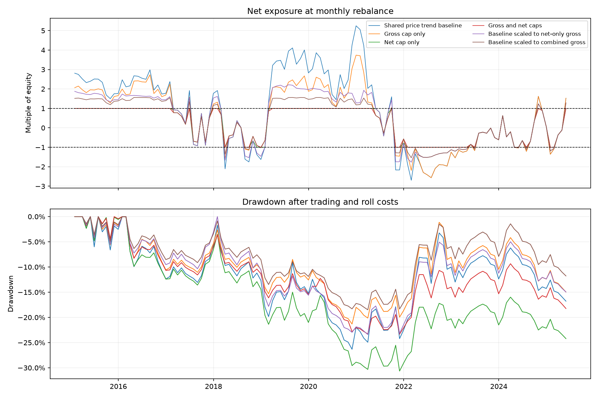

# Out-of-sample leverage and net exposure on the shared price trend baseline

January 2015 to May 2025, 125 monthly returns. All six variants start from the price trend baseline in economic_trend.py. It uses a 12-month sign signal, 12-month rolling instrument volatility with a 1% annualized floor, and a 10% portfolio volatility target based on a trailing 36-month window. The extension applies the 4× gross cap and ±1× net cap after baseline sizing. Matched controls retain baseline long and short proportions at the same monthly gross exposure as the corresponding net cap variants.

The uploaded files provide prices for all 58 original tickers, with the latest quote dated 2025-06-13. The evaluation ends in the last complete month. The original monthly returns through December 2014 seed the risk estimates and December formation weights. New returns use adjacent month-end closes from the uploaded files, including December 2014 closes for the January 2015 return. Positions execute with a one-month lag. Reported wealth starts at the sample boundary and turnover carries the preceding target weights.

The extension has 6,749 observed instrument-month returns out of 7,250. 8 instruments have incomplete histories. Missing observations use the existing backtest convention of zero realized P&L on held positions. No gap is bridged with a multi-month return. The baseline's average gross exposure with a missing realized return is 0.0110× of equity, with a maximum of 0.6052× in January 2022. All variants use economic_trend.py's cost convention of 2 bps per unit of target-weight turnover and 2 bps per roll at 4 rolls per year, prorated monthly by gross exposure.

## Results under the shared cost model

| Strategy | Gross CAGR | Net CAGR | Annualized mean net return | Annual volatility | Sharpe | Max drawdown | Avg. gross | Avg. net |
|---|---:|---:|---:|---:|---:|---:|---:|---:|
| Shared price trend baseline | 0.23% | -0.42% | 0.13% | 10.57% | 0.01 | -26.33% | 4.57× | +0.82× |
| Gross cap only | 0.05% | -0.47% | -0.11% | 8.48% | -0.01 | -21.32% | 3.59× | +0.56× |
| Net cap only | -0.72% | -1.31% | -0.90% | 9.18% | -0.10 | -30.65% | 3.65× | +0.22× |
| Gross and net caps | -0.34% | -0.82% | -0.56% | 7.37% | -0.08 | -23.33% | 3.02× | +0.21× |
| Baseline scaled to net-only gross | -0.04% | -0.63% | -0.29% | 8.26% | -0.04 | -23.40% | 3.65× | +0.47× |
| Baseline scaled to combined gross | 0.06% | -0.42% | -0.18% | 6.91% | -0.03 | -18.49% | 3.02× | +0.36× |

The shared baseline has a net cumulative return of -4.34%. Annualized mean return multiplies the monthly average by 12. CAGR compounds monthly wealth.

## Net caps versus matched gross controls

- **Net cap only.** Net CAGR difference -0.68 percentage points and drawdown difference -7.25 points at the same monthly gross exposure. A positive drawdown difference corresponds to a shallower loss.
- **Gross and net caps.** Net CAGR difference -0.41 percentage points and drawdown difference -4.84 points at the same monthly gross exposure. A positive drawdown difference corresponds to a shallower loss.

The source uses continuous futures close prices. Some instrument-month moves are large. The experiment retains observed returns as supplied, and the coverage CSV reports each series' largest absolute monthly return for review.

Run `python net_exposure_out_of_sample.py` from the project root to reproduce this report.
