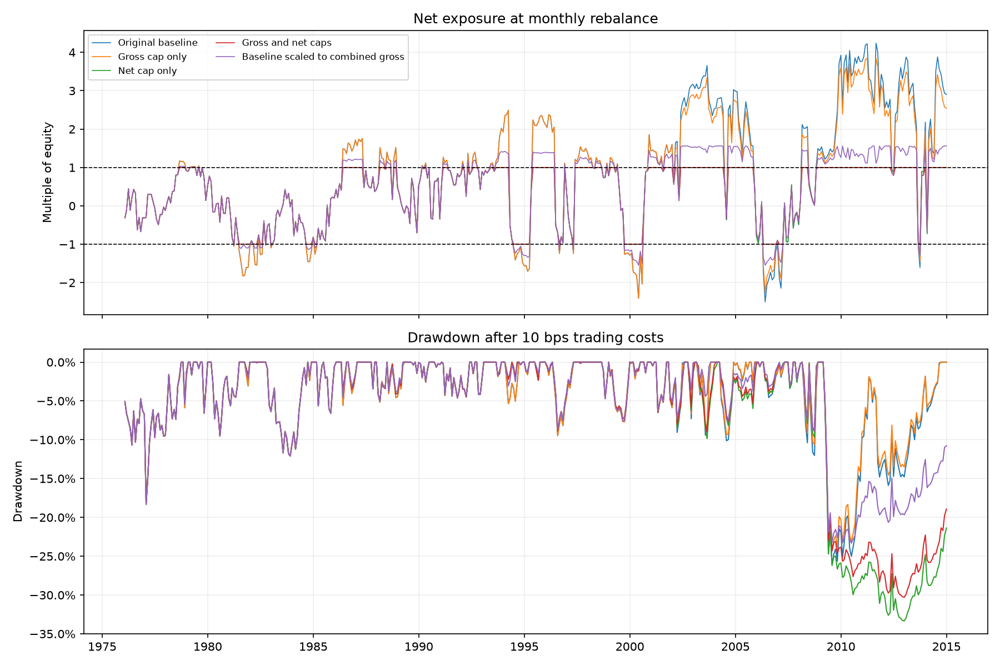

# Baseline leverage and net exposure

This experiment asks whether limiting the adjusted futures momentum strategy's net long or short exposure improves historical performance. All variants share the original monthly momentum signals and January 1976–December 2014 sample.

The net cap is ±1× account equity. When net exposure exceeds the limit, positions on the larger side are reduced proportionally. The smaller side retains its weights. The combined strategy first applies the 4× gross cap, then applies the net cap.

Each matched control scales all baseline weights by the same factor to match the corresponding capped strategy's gross exposure each month. This preserves the original long/short proportions and helps distinguish the effect of changing those proportions from the effect of reducing total exposure. The strategies can still have different turnover, risk concentrations, and trading costs.

## Results at 10 bps per one-way change in target weight

| Strategy | CAGR | Annual vol | Sharpe | Max drawdown | Annual turnover | Avg. gross | Avg. net | Avg. absolute net |
|---|---:|---:|---:|---:|---:|---:|---:|---:|
| Original baseline | 9.85% | 11.12% | 0.90 | -26.10% | 7.24× | 3.13× | +0.84× | 1.37× |
| Gross cap only | 9.56% | 10.66% | 0.91 | -24.25% | 6.93× | 2.99× | +0.79× | 1.30× |
| Net cap only | 7.43% | 9.90% | 0.78 | -33.34% | 8.12× | 2.55× | +0.38× | 0.79× |
| Gross and net caps | 7.37% | 9.58% | 0.79 | -30.29% | 7.78× | 2.47× | +0.38× | 0.78× |
| Baseline scaled to net-only gross | 7.98% | 9.69% | 0.84 | -24.67% | 8.17× | 2.55× | +0.51× | 0.98× |
| Baseline scaled to combined gross | 7.85% | 9.43% | 0.85 | -23.32% | 7.83× | 2.47× | +0.50× | 0.95× |

The baseline exceeds the ±1× net limit in 57.1% of execution months. After applying the gross cap alone, the fraction is 56.4%.

- **Net cap only versus its matched gross control.** CAGR difference -0.55 percentage points, annual volatility difference +0.21 points, and maximum drawdown difference -8.66 points. A positive drawdown difference corresponds to a smaller loss.
- **Gross and net caps versus its matched gross control.** CAGR difference -0.48 percentage points, annual volatility difference +0.15 points, and maximum drawdown difference -6.97 points. A positive drawdown difference corresponds to a smaller loss.

Weights are formed using data through the formation month and earn returns in the next month. Costs use the existing fixed-rate turnover model at 0, 5, 10 and 25 bps. Drawdowns use monthly wealth and Sharpe assumes zero risk-free yield. The exposure limits apply to target weights at rebalance. These historical comparisons use an already studied sample and omit funding, roll and market impact.

Run `python net_exposure_backtest.py` from the project root to reproduce the results.
