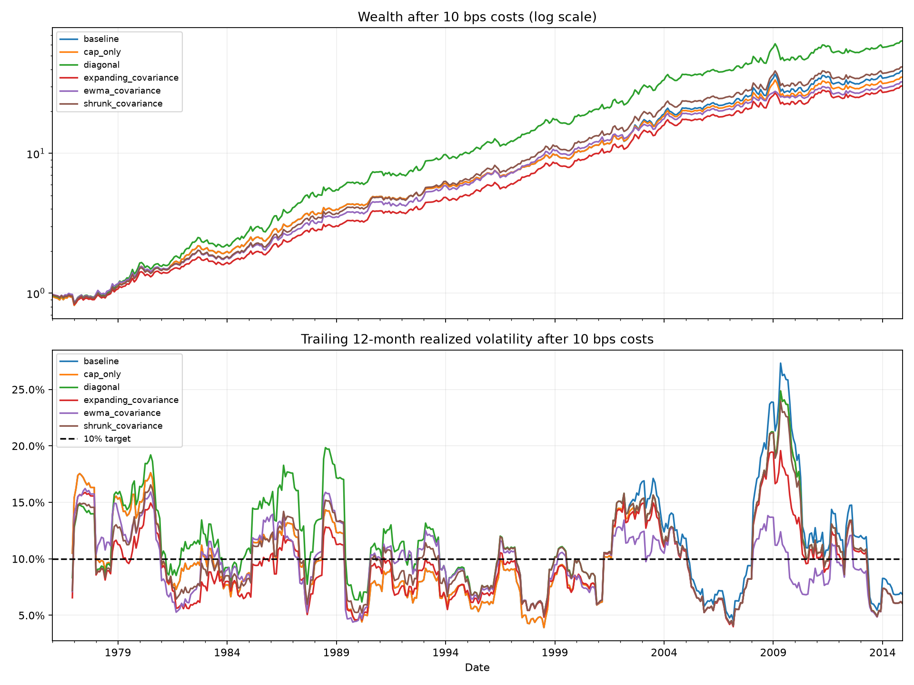

# ORIE 5260 — Group Update, October 27, 2026

This week, we extended the adjusted futures momentum baseline with covariance-aware risk forecasts and portfolio volatility targeting. We also added a cap-only control to check whether a simple exposure limit could explain the improvement. Trading signals and long/short directions remained unchanged.

## 1. Compared four portfolio risk models

We implemented `covariance_risk_validation.py` to compare the existing diagonal model, which ignores cross-market correlations, with expanding historical covariance, EWMA covariance with a six-month half-life, and fixed 50% shrinkage toward the expanding covariance diagonal.

Each model forecasts the risk of the same baseline positions using only information available through the formation month. Forecasts are compared with realized volatility of those positions held fixed over the next 3 or 12 months. All models use the same evaluation dates within each horizon.

The primary 12-month comparison contains 456 formation months, January 1976–December 2013. The final year is excluded because a complete 12-month forward window is required.

| Risk model | Average predicted volatility | Average realized volatility | Mean absolute forecast error | Forecast–realized correlation |
|---|---:|---:|---:|---:|
| Original diagonal | 6.82% | 9.78% | 3.64 percentage points | 0.13 |
| Expanding covariance | 10.70% | 9.78% | 3.01 percentage points | 0.56 |
| EWMA covariance | 10.68% | 9.78% | 2.81 percentage points | 0.62 |
| 50% shrinkage covariance | 9.03% | 9.78% | 2.72 percentage points | 0.50 |

The original model materially understates risk. Accounting for correlations reduces forecast error, although expanding and EWMA covariance overestimate average risk in this sample. Shrinkage has the lowest mean absolute error, approximately 25% below the diagonal model; expanding covariance has the lowest root mean squared error. There is no single winner across every metric.

Different markets have different history lengths. Estimates therefore use available paired observations and require at least 36 overlapping months to estimate a correlation; otherwise the initial correlation estimate is zero. Correlation matrices are repaired to be positive semidefinite and renormalized to preserve marginal variances. Matrix-repair diagnostics are exported.

## 2. Used the forecasts to control portfolio exposure

We implemented `portfolio_volatility_targeting.py` to scale the original baseline positions under each risk model. The fixed rules are:

- Target annual portfolio volatility: **10%**.
- Maximum gross exposure: **4 times capital**, measured as the sum of absolute weights.
- Maximum multiplier on baseline positions: **2 times**.

The requested multiplier is 10% divided by predicted portfolio volatility, reduced when either limit binds. Formation-month positions execute in the next month. These settings were fixed for the comparison rather than selected by maximizing backtest performance. The volatility target is a forecast-based objective, not a guarantee of realized risk.

We evaluated January 1976–December 2014 (468 months), using the same dates for all strategies. Transaction-cost scenarios are 0, 5, 10, and 25 basis points per one-way change in target weight.

## 3. Added a cap-only control

To distinguish the exposure limit from dynamic targeting, we added a strategy that only scales down baseline positions when gross exposure exceeds 4 times capital. It uses no risk forecast and never increases baseline positions. The cap reduces exposure in **33.1% of evaluation months**.

The following results include 10 bps transaction costs:

| Strategy | CAGR | Annual volatility | Sharpe, RF = 0 | Maximum drawdown | Annual turnover |
|---|---:|---:|---:|---:|---:|
| Original baseline | 9.85% | 11.12% | 0.903 | -26.10% | 7.24 |
| Cap only | 9.56% | 10.66% | 0.913 | -24.25% | 6.93 |
| Diagonal targeting + limits | 11.25% | 11.77% | 0.968 | -24.25% | 7.85 |
| Expanding covariance targeting + limits | 9.15% | 9.74% | 0.951 | -17.44% | 8.26 |
| EWMA covariance targeting + limits | 9.34% | 9.79% | 0.965 | -14.24% | 8.96 |
| Shrinkage covariance targeting + limits | 10.03% | 10.67% | 0.953 | -22.68% | 7.95 |

The cap alone improves maximum drawdown by **1.84 percentage points**, using unrounded results. EWMA targeting improves it by a further **10.02 percentage points** relative to cap-only. Its CAGR is modestly lower, but its volatility is closer to the 10% target and its drawdown is substantially smaller.

These results show that a gross exposure cap alone does not reproduce the full EWMA result. They do not establish that correlations alone cause the difference: EWMA changes marginal volatility estimates as well as correlations, and dynamic scaling changes exposure through time. Drawdown differences are descriptive comparisons, not an additive causal attribution.



## 4. Validation and deliverables

We checked covariance-matrix validity, historical and EWMA marginal variances, forecast invariance to changes in future returns, common forecast-evaluation dates, and agreement with the existing diagonal validation. The portfolio backtest also checks that original baseline returns are reproduced and controlled strategies respect the gross exposure limit.

Three automated tests cover position targeting and limits, next-month execution and turnover, and cap-only behavior, including unchanged positions below the cap and preserved long/short direction. All three pass.

The implementation, documentation, tests, and generated results were committed and pushed to `main`:

- [24949b5 — Covariance validation and portfolio targeting](https://github.com/xiayawen/ORIE-5260/commit/24949b5)
- [bfa60e1 — Gross exposure cap control](https://github.com/xiayawen/ORIE-5260/commit/bfa60e1)

Detailed results are in [risk forecast accuracy](../covariance_risk_validation_output/forecast_accuracy_summary.csv), [portfolio performance](performance_summary.csv), [exposure and limits](exposure_and_limits.csv), and the [cap-only comparison report](cap_ablation_report.md).

## Limitations and next steps

These are historical comparisons on data already examined, not untouched out-of-sample evidence. Forward risk windows overlap. Missing realized returns are filled with zero, matching the baseline. Costs omit financing, cash yield, margin constraints, contract-specific spreads, roll costs, position drift, and market impact. Sharpe ratios assume a zero risk-free rate.

Next, we should examine performance across distinct historical periods and inspect major drawdown episodes to understand when scaling helped or hurt. A useful additional control would retain EWMA marginal variances while setting correlations to zero, separating recent-volatility effects from correlation effects. A future evaluation on genuinely unseen data would be needed to assess generalization.

## Reproduce

From the project root:

```bash
python baseline_performance_analysis.py
python covariance_risk_validation.py
python portfolio_volatility_targeting.py
python -m unittest test_portfolio_volatility_targeting.py
```
