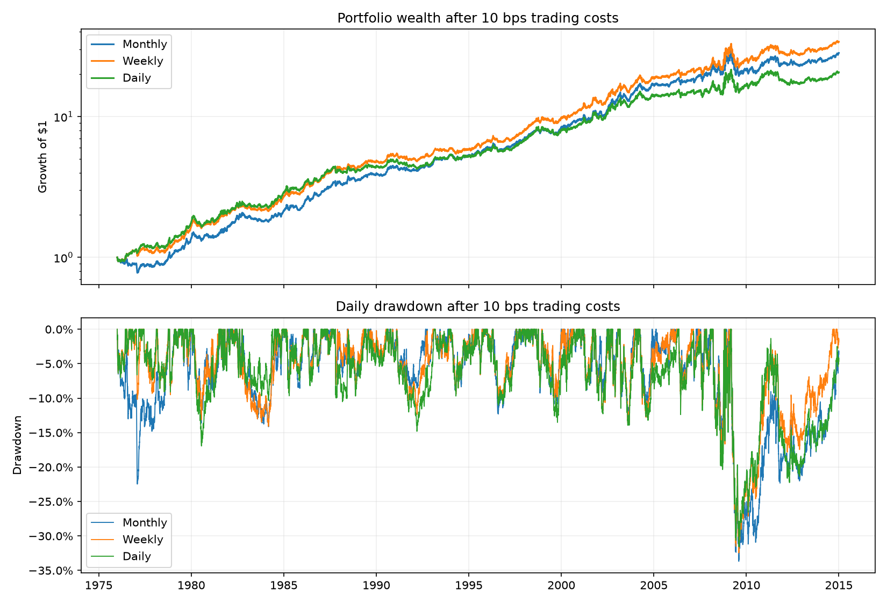

# Rebalance frequency experiment

The three strategies share a futures universe, the baseline 12-month momentum convention, expanding volatility sizing, and a January 1976 to December 2014 evaluation window. The adjusted baseline sizing has no portfolio volatility target or explicit gross exposure cap. The monthly control uses reconstructed daily-close data, so the primary comparisons are within this experiment.

Monthly signals form on the last weekday of the month, weekly signals on Fridays, and daily signals on weekdays. Within a month, the signal sums 11 completed monthly returns and the current month-to-date return. At month-end this equals the usual sum of 12 monthly returns. Instrument volatility updates only at month-end using at least 36 monthly observations. A quote in the last ten weekdays is required for eligibility, and signals with incomplete histories receive zero exposure.

Positions are marked and allowed to drift between rebalances. Instructions formed at a close fill at the next quoted close for each instrument, using the latest pending instruction. Missing quotes carry the last mark; an instrument with no further quotes remains marked at its last close. The output reports gross exposure in instruments without a quote that day. Synthetic cross-market marking and observed closes are approximations to executable futures prices.

Daily-close reconstruction overlaps the supplied monthly file in 20,915 instrument-months. The pooled mean absolute difference is 0.0002%. Differences in price histories, delayed close fills and weight drift limit direct comparison with the published baseline.

Costs are charged on drift-adjusted traded notional. The 2–25 bps scenarios are illustrative. They omit explicit futures roll, financing and size-dependent market impact. Returns compound daily, drawdowns use daily marks, and annual volatility and Sharpe use calendar-month returns.

## Full-period comparison

| Frequency | Cost (bps) | CAGR | Annual vol | Sharpe | Daily max drawdown | Annual turnover |
|---|---:|---:|---:|---:|---:|---:|
| monthly | 0 | 9.89% | 11.19% | 0.90 | -33.42% | 8.62 |
| monthly | 2 | 9.70% | 11.19% | 0.89 | -33.47% | 8.62 |
| monthly | 5 | 9.42% | 11.18% | 0.86 | -33.55% | 8.62 |
| monthly | 10 | 8.95% | 11.17% | 0.83 | -33.68% | 8.62 |
| monthly | 25 | 7.56% | 11.14% | 0.71 | -34.07% | 8.62 |
| weekly | 0 | 11.28% | 10.81% | 1.05 | -32.10% | 16.49 |
| weekly | 2 | 10.91% | 10.81% | 1.02 | -32.17% | 16.49 |
| weekly | 5 | 10.37% | 10.82% | 0.97 | -32.28% | 16.49 |
| weekly | 10 | 9.46% | 10.83% | 0.89 | -32.45% | 16.49 |
| weekly | 25 | 6.79% | 10.88% | 0.66 | -32.98% | 16.49 |
| daily | 0 | 11.55% | 10.92% | 1.06 | -30.90% | 31.72 |
| daily | 2 | 10.85% | 10.93% | 1.00 | -31.03% | 31.72 |
| daily | 5 | 9.80% | 10.94% | 0.91 | -31.23% | 31.72 |
| daily | 10 | 8.07% | 10.97% | 0.76 | -31.57% | 31.72 |
| daily | 25 | 3.04% | 11.14% | 0.32 | -39.30% | 31.74 |

Before costs, daily CAGR is 11.55% and weekly CAGR is 11.28%. At 10 bps, weekly CAGR is 9.46%, versus 8.95% for monthly and 8.07% for daily. Daily turnover reaches 31.72 times capital per year versus 16.49 for weekly. Monthly leads at 25 bps. At 10 bps, weekly leads in two of three subperiods by CAGR, with monthly ahead in the 1990s. These are historical comparisons under fixed cost assumptions.

## Subperiod checks at 10 bps

**1976–1989**

| Frequency | Cost (bps) | CAGR | Annual vol | Sharpe | Daily max drawdown | Annual turnover |
|---|---:|---:|---:|---:|---:|---:|
| monthly | 10 | 10.22% | 11.32% | 0.92 | -22.47% | 6.00 |
| weekly | 10 | 11.88% | 10.88% | 1.09 | -14.09% | 11.29 |
| daily | 10 | 11.20% | 11.08% | 1.02 | -16.94% | 20.90 |

**1990–1999**

| Frequency | Cost (bps) | CAGR | Annual vol | Sharpe | Daily max drawdown | Annual turnover |
|---|---:|---:|---:|---:|---:|---:|
| monthly | 10 | 8.02% | 7.69% | 1.05 | -12.29% | 8.63 |
| weekly | 10 | 7.45% | 7.29% | 1.02 | -12.35% | 16.90 |
| daily | 10 | 6.23% | 7.74% | 0.82 | -14.81% | 32.55 |

**2000–2014**

| Frequency | Cost (bps) | CAGR | Annual vol | Sharpe | Daily max drawdown | Annual turnover |
|---|---:|---:|---:|---:|---:|---:|
| monthly | 10 | 8.40% | 12.90% | 0.69 | -33.68% | 11.06 |
| weekly | 10 | 8.59% | 12.62% | 0.72 | -32.45% | 21.07 |
| daily | 10 | 6.44% | 12.60% | 0.56 | -31.57% | 41.26 |

