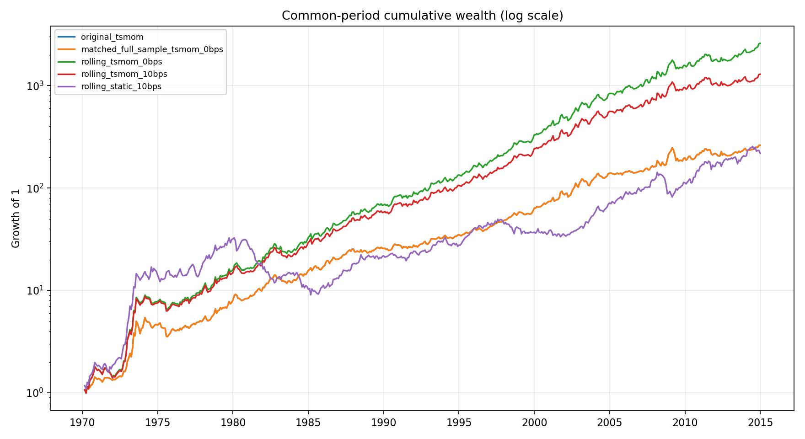
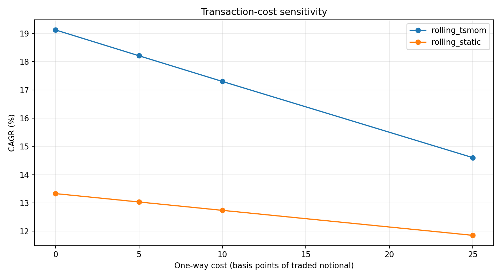

# Group update — October 7, 2026

## Method
12-month momentum and 12-month rolling sample standard deviation, annualized by sqrt(12). Both are known at month t; weights execute at t+1. TSMOM and Static share exactly the same eligibility mask, including the momentum-history requirement. No leverage cap is imposed. The original baseline and matched full-sample controls are retained to separate eligibility and volatility changes.

All headline comparisons use the same period starting 1970-02-27. Original baseline controls still contain full-sample look-ahead bias.

Costs are 0, 5, 10, or 25 bps per one-way absolute target-weight change, including initial entry and exits. This is an illustrative turnover model; it excludes position drift, contract rolls, contract multipliers, actual bid-ask spreads, financing and cash interest.

## Results
| Strategy | Cost bps | CAGR | Annual vol | Sharpe (zero RF) | Max drawdown |
|---|---:|---:|---:|---:|---:|
| original_tsmom | 0 | 13.20% | 15.87% | 0.859 | -34.55% |
| original_static | 0 | 9.80% | 18.38% | 0.601 | -63.05% |
| matched_full_sample_tsmom | 0 | 13.20% | 15.87% | 0.859 | -34.55% |
| matched_full_sample_static | 0 | 9.37% | 20.21% | 0.541 | -68.65% |
| rolling_tsmom | 0 | 19.12% | 18.05% | 1.060 | -27.58% |
| rolling_tsmom | 5 | 18.21% | 18.05% | 1.017 | -27.76% |
| rolling_tsmom | 10 | 17.30% | 18.06% | 0.973 | -27.93% |
| rolling_tsmom | 25 | 14.60% | 18.12% | 0.841 | -28.45% |
| rolling_static | 0 | 13.33% | 21.89% | 0.678 | -71.78% |
| rolling_static | 5 | 13.04% | 21.89% | 0.666 | -72.00% |
| rolling_static | 10 | 12.74% | 21.88% | 0.654 | -72.20% |
| rolling_static | 25 | 11.86% | 21.87% | 0.618 | -72.83% |

Sharpe uses annualized arithmetic mean / annual volatility, unlike the prior baseline report’s CAGR / volatility.

## Regression alpha
Exploratory OLS with Newey–West HAC standard errors (3 monthly lags). Static regression uses raw strategy and static returns; its intercept is not a risk-free-adjusted CAPM alpha. The six-factor regression subtracts the supplied RF from strategy returns and uses Mkt-RF, SMB, HML, Mom, RMW and CMA; its sample is 2000–2014. Equity factors are an exploratory model, not a complete risk model for futures. Annual alpha is 12 times the monthly intercept.

| Strategy | Model | Months | Annual alpha | HAC t | p-value |
|---|---|---:|---:|---:|---:|
| tsmom_0bps | static_raw_returns_HAC3 | 539 | 14.43% | 6.12 | 0.000 |
| tsmom_0bps | six_factors_excess_returns_HAC3 | 180 | 9.12% | 2.52 | 0.012 |
| tsmom_10bps | static_raw_returns_HAC3 | 539 | 13.05% | 5.52 | 0.000 |
| tsmom_10bps | six_factors_excess_returns_HAC3 | 180 | 6.38% | 1.72 | 0.086 |

## Limitations and course requirement
Rolling portfolios reach maximum gross exposure of 29.75 times capital. Low rolling volatility can create extreme leverage; results require a leverage-cap sensitivity study before practical use.
No course document specifying regression alpha was found in the workspace. The supplied slide asks to illustrate alpha without defining a regression model; confirmation remains pending. Regression results are supplementary, not proof that this requirement was assigned.
Missing realized returns for held instruments are zero-filled and counted in diagnostics.csv. This assumption can bias performance; matching eligibility does not eliminate this data issue. Prices/continuous-contract construction and extreme returns remain unverified. Cost assumptions are sensitivity scenarios, not measured execution costs.

## Reproduce
Run `python3 rolling_backtest.py`. Dependencies: numpy, pandas, matplotlib, openpyxl, statsmodels. Outputs: `outputs/rolling_backtest_output/`. The previous dated report is preserved.
