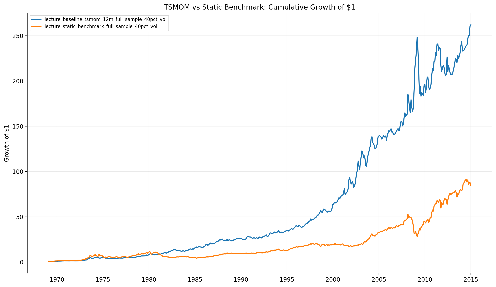
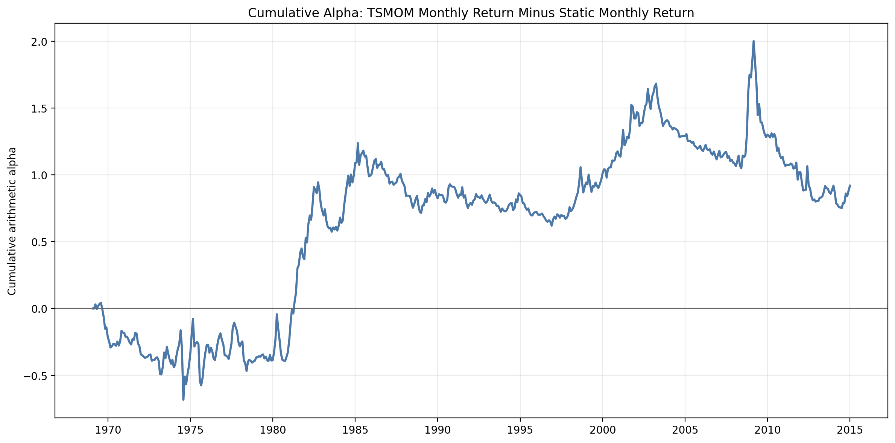
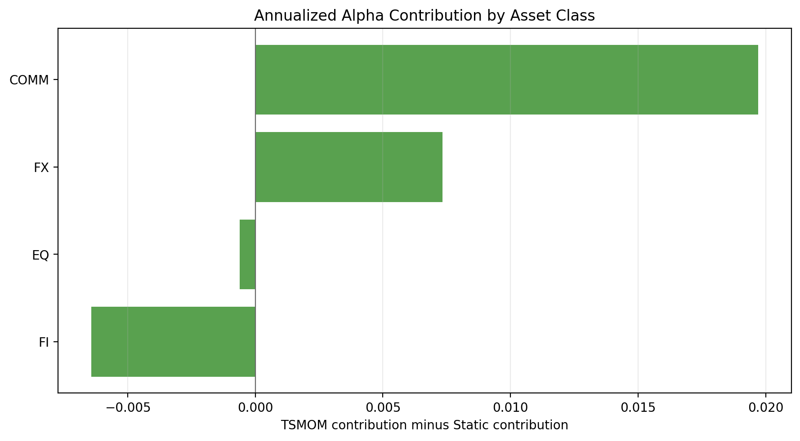

# ORIE 5260 — Group Update, October 6, 2026

## This week's progress
Implemented and documented a 12-month time-series momentum baseline, compared it
with an always-long static benchmark, calculated portfolio, asset-class and
instrument correlations, and generated performance and alpha illustrations.
No earlier baseline specification is available in the repository, so a change
relative to a previous version or exact agreement with the lecture cannot be established.

## Data
- `MonthlyReturns.csv`: 58 futures series, 552 monthly observations, January 1969–December 2014.
- Universe: 26 commodity, 14 equity, 10 fixed-income and 8 FX series.
- `FuturesUnderlyingData/`: 62 daily OHLC/volume/open-interest files. Not used by this backtest.
- `Lecture3_livedata.xlsx`: 180 monthly observations, 2000–2014, for SG Trend, GSCI, factors and RF. Not used by this backtest.
- Histories start at different dates; the first monthly row has no valid returns.

## Baseline and benchmark
At month t, the signal is the sign of compounded returns over the latest 12
valid consecutive months. Positive signals are long, negative signals are short,
and zero signals have zero exposure. Instruments without sufficient history are excluded.
Each signal is multiplied by 0.40 / full-sample annualized instrument volatility
and divided by the number of instruments with valid signals. Positions formed
at t earn returns at t+1. Rebalancing is monthly.
The static benchmark uses the same volatility scaling, always holds long positions,
and averages across instruments with available returns. The 40% parameter is
instrument-level scaling; it does not imply 40% portfolio volatility.

## Performance
Full sample: January 1969–December 2014, including initial zero-exposure months.

| Strategy | Annual return | Annual volatility | Return / volatility | Max drawdown |
|---|---:|---:|---:|---:|
| 12-month TSMOM | 12.87% | 15.70% | 0.820 | -34.55% |
| Always-long static | 10.13% | 18.28% | 0.554 | -63.05% |
| Return difference | 2.00% | 20.47% | 0.098 | -75.11% |

Strategy annual returns are compounded annual growth rates. The return-difference
row annualizes the monthly mean arithmetically, so it is not the difference of
the two strategy CAGRs. The code's `sharpe_0rf` uses CAGR / annual volatility
for the strategies, rather than the conventional annualized mean-excess-return Sharpe.

## Correlations
- full_sample: correlation **0.281**, 552 months (1969-01-31 to 2014-12-31).
- tsmom_active_months: correlation **0.284**, 539 months (1970-02-27 to 2014-12-31).
The active-month sample excludes TSMOM's initial zero-exposure months; it does
not force the two strategies to use identical instrument universes.

| Asset class | TSMOM–static contribution correlation | Annualized return-difference contribution |
|---|---:|---:|
| COMM | 0.426 | 1.97% |
| EQ | -0.178 | -0.06% |
| FI | 0.596 | -0.64% |
| FX | 0.051 | 0.73% |

## Alpha illustration and interpretation
Alpha is defined here as TSMOM monthly return minus static monthly return.
It is a descriptive return difference, not a regression alpha or evidence of
statistical significance. The asset-class contributions sum to the portfolio's
annualized mean return difference. Positive contributions show where TSMOM
outperformed the static exposure in this sample; low correlation measures different
return behavior, and alone does not imply superior performance.

The alpha curve sums monthly differences; it is not compounded investment wealth.

## Limitations and next steps
- Full-sample volatility includes future observations, creating look-ahead bias. Retain this result as the classroom baseline and compare a rolling, historically available volatility estimate next.
- The benchmarks have different availability rules: TSMOM requires 12 months of history, Static does not. Add a comparison using the same eligible universe.
- Missing realized returns are filled with zero; examine delisted or discontinued series before interpreting results.
- Transaction costs, slippage, financing and cash interest are omitted.
- Confirm the lecture's intended baseline and alpha definition. If regression alpha is required, use aligned monthly benchmark/factor data and report inference separately.
- Verify continuous-futures construction and price adjustments before interpreting the source returns economically.

## Reproduce
From the project directory, run `python3 strategy_backtest.py` with numpy,
pandas and matplotlib installed. Tables, figures and methodology are written
to `outputs/strategy_backtest_output/`; this dated report is regenerated from the results.

## Future weekly updates
Create a new dated report for each week using [the weekly template](weekly_update_template.md).
Keep previous dated reports and describe each change, its evidence and remaining limitations.
