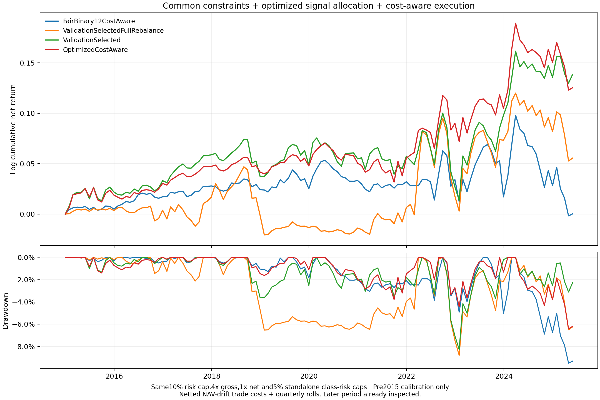

# Four-Sleeve Futures Portfolio Optimisation and Turning-Point Extension

## Abstract

This study develops a diversified futures portfolio around four complementary return sleeves: price trend, economic trend, negative skew, and machine-learning forecasts. All sleeves use a common covariance-aware risk model, portfolio constraints, and transaction-cost-aware execution. A chronological development and validation exercise selects a fixed 30%/20%/20%/30% allocation with an Extra Trees model and cost-aware execution.

During 2015-May 2025, the selected four-sleeve portfolio produces a 1.34% net CAGR, 3.96% volatility, a 0.356 Sharpe ratio, and an -8.28% maximum drawdown. We then test a state-dependent slow-fast trend extension intended to manage momentum turning points. The extension lowers volatility to 3.36%, improves the Sharpe ratio to 0.391, and reduces maximum drawdown to -7.83%, but it also lowers CAGR to 1.26%. It is therefore best interpreted as a risk-reducing variant rather than a new source of alpha.

## 1. Research objective and motivation

The course time-series momentum baseline is simple and interpretable, but its later-period results show three practical weaknesses:

- Performance deteriorates when established trends reverse.
- Inverse-volatility sizing can produce high leverage when instrument volatility is unusually low.
- Monthly full rebalancing creates substantial turnover and transaction costs.

The optimisation exercise asks whether these weaknesses can be reduced by combining independent signals under one consistent portfolio framework. The objective is not to select arbitrary weights across all 58 futures. Instead, it combines four economically distinct strategy sleeves while controlling covariance risk and implementation costs.

The research questions are:

1. Do macro, cross-sectional, and machine-learning signals add useful diversification to price trend?
2. Should the sleeve weights be fitted, or does a transparent fixed allocation perform better in validation?
3. Can cost-aware execution retain the target portfolio while reducing unnecessary turnover?
4. Can a state-dependent slow-fast trend signal reduce risk around turning points without materially sacrificing return?

## 2. Data and evaluation design

The strategies use monthly returns for the project's diversified futures universe. The complete historical results begin in 1976, while the Extra Trees forecasts become genuinely out of training sample only from 2005.

| Period | Purpose |
| --- | --- |
| Before 2005 | Estimate the initial Extra Trees model and the slow-fast turning-point parameters |
| 2005-2009 | Calibrate candidate sleeve-allocation utility parameters |
| January 2010-November 2014 | Select the allocation, ML feature set, and execution strength |
| January 2015-May 2025 | Later-period evaluation with the selected specification frozen |

The later period is chronological, but it has been inspected repeatedly during the wider project. It should therefore be described as a later-period evaluation rather than a completely untouched test set.

### Course baseline reference

The supplied course screenshots report the following baseline metrics:

| Metric | In sample, approximately 1973-2014 | Out of sample, 2015-2025 |
| --- | ---: | ---: |
| Average annual return | 13.2% | 3.0% |
| Annual volatility | 10.8% | 9.5% |
| Sharpe ratio | 1.22 | 0.31 |
| Annual turnover | 17.79 | 30.46 |
| Gross leverage | 4.62x | 7.94x |
| Average number of instruments | 41.4 | 56.3 |
| `Imbalance$`, as reported | 1.5 | 2.7 |

These are reference results from the screenshots, not metrics recomputed by this repository. The screenshots report average return rather than CAGR and do not report maximum drawdown. Differences in sample start date, leverage, futures construction, and cost accounting prevent a strict head-to-head comparison.

## 3. Construction and selection of the four-sleeve portfolio

### 3.1 Return sleeves

| Sleeve | Signal | Portfolio budget |
| --- | --- | ---: |
| Price trend | Continuous 12-month return divided by annual EWMA volatility and clipped to `[-1, 1]` | 30% |
| Economic trend | Directional mapping of growth, inflation, trade, monetary-policy, and risk-aversion themes | 20% |
| Negative skew | Within-asset-class cross-sectional ranking of `NegativeSkew_12m` | 20% |
| Machine learning | Frozen Extra Trees probability using the selected 66-feature specification | 30% |

The sleeves are designed to capture different information. Price trend measures persistence in each market. Economic trend maps macro conditions to economically consistent futures directions. The negative-skew sleeve is a cross-sectional factor rather than another time-series trend rule. Extra Trees combines price-path and class-relative predictors to forecast the probability of a positive next-month return.

The Extra Trees model uses 200 trees, maximum depth 6, minimum leaf size 30, `max_features=0.7`, and seed 5260. An initial model is trained using information available before 2005. The final model is refitted once using information available before 2015 and then frozen; it is not retrained annually.

### 3.2 Common covariance risk model

Every sleeve is placed on a comparable risk scale using the same six-month half-life EWMA covariance matrix. Each instrument pair requires at least 36 overlapping monthly observations. Correlations with insufficient history fall back to zero, and the correlation matrix is repaired to be positive semidefinite.

After the sleeves are combined, the portfolio is subject to the same controls:

- Forecast annual volatility no greater than 10%.
- Gross exposure no greater than 4x NAV.
- Absolute net exposure no greater than 1x NAV.
- Standalone predicted volatility for each asset class no greater than 5%.

The 30%/20%/20%/30% sleeve allocation is a signal-budget allocation. It does not imply that the four sleeves or asset classes contribute those exact percentages of realised risk.

### 3.3 Allocation and execution selection

The fitted-allocation objective balances expected return, covariance risk, cost, and distance from pure trend:

`50% * calibration gross return - c2/2 * forecast variance`

`- c1 * net trading and roll cost - 0.01 * ||allocation - pure trend||^2`

Expected returns are estimated only from the calibration period and shrunk by 50%. Allocations must be nonnegative and sum to one. Trend receives at least 30%, and every other sleeve is capped at 30%.

The study compares fitted allocations with pure trend and the transparent fixed 30%/20%/20%/30% allocation. It also compares full monthly rebalancing with cost-aware execution. The cost-aware rule trades along the feasible path from the drifted portfolio toward the target, balancing tracking risk against transaction costs. Costs are 2 bps per unit of net turnover plus four futures rolls per year.

Validation selects:

> **Extra Trees 66 + fixed 30%/20%/20%/30% allocation + cost-aware execution with gamma = 5.**

The selected validation Sharpe ratio is 1.337, compared with 0.926 for the same four-sleeve signals under full rebalancing. The fitted allocation does not win validation, so the project retains the simpler fixed allocation.

## 4. Four-sleeve portfolio results

### 4.1 Main performance

The return values below are annual arithmetic means so that the four-sleeve portfolio can be compared consistently with the slow-fast extension. The course baseline remains a reference because its return and sample conventions differ.

| Strategy | IS annual return | IS volatility | IS Sharpe | IS maximum drawdown | Later annual return | Later volatility | Later Sharpe | Later maximum drawdown |
| --- | ---: | ---: | ---: | ---: | ---: | ---: | ---: | ---: |
| Course slide baseline, reference only | 13.20% | 10.80% | 1.220 | Not reported | 3.00% | 9.50% | 0.310 | Not reported |
| **Selected four-sleeve** | **5.12%** | **5.21%** | **0.983** | **-9.96%** | **1.41%** | **3.96%** | **0.356** | **-8.28%** |

For the selected four-sleeve portfolio, the later-period annual return of 1.41% corresponds to a 1.34% net CAGR and a 14.85% cumulative net return.

### 4.2 Value of cost-aware execution

| Four-sleeve implementation | Later net CAGR | Sharpe | Maximum drawdown | Annual turnover | Annual cost |
| --- | ---: | ---: | ---: | ---: | ---: |
| Fixed Extra Trees 66, full rebalance | 0.53% | 0.144 | -8.80% | 12.35 | 0.42% |
| **Selected cost-aware execution** | **1.34%** | **0.356** | **-8.28%** | **3.09** | **0.19%** |

Cost-aware execution reduces turnover by approximately 75%. About 0.23 percentage points of the net-return difference comes directly from lower costs. The remaining difference reflects changes in the holdings path and trade timing, so it should not all be attributed to fee savings.

### 4.3 Conditional sleeve contribution

Removing one sleeve returns its budget to price trend without refitting the other weights:

| Portfolio | Validation Sharpe, 2010-November 2014 | Later Sharpe, 2015-2025 |
| --- | ---: | ---: |
| Complete selected portfolio | 1.337 | 0.356 |
| Without economic trend | 1.334 | 0.329 |
| Without negative skew | 0.894 | 0.491 |
| Without Extra Trees | 0.874 | 0.133 |

Extra Trees adds conditional value in both periods. Negative skew contributes strongly during validation but detracts later. The economic-trend sleeve has a smaller positive contribution. Because the ablation results vary by period, they should diagnose the selected portfolio rather than be used to redesign it after observing later outcomes.

## 5. Slow-fast turning-point extension

### 5.1 Motivation and mechanism

A 12-month trend signal can react slowly when a market reverses. A two-month signal responds faster, but following every short-term disagreement risks abandoning profitable long-term trends during temporary corrections. The extension therefore changes trend speed only when fast and slow directions disagree.

For each instrument and month:

- **Bull:** two- and 12-month signals are both positive.
- **Correction:** the 12-month signal is positive and the two-month signal is negative.
- **Bear:** both signals are negative.
- **Rebound:** the 12-month signal is negative and the two-month signal is positive.

Bull and Bear states retain the slow signal. Correction and Rebound states use:

`dynamic direction = (1 - a) * slow direction + a * fast direction`

The mixing parameter `a` is estimated separately for each instrument and separately for Correction and Rebound states using data through December 2004. At least 12 valid state observations are required. Estimates are clipped to `[0, 1]`; insufficient or undefined estimates use a fixed 0.5 fallback. The parameters are then frozen.

The extension replaces only the 30% price-trend sleeve. Economic trend, negative skew, Extra Trees, covariance risk controls, portfolio limits, transaction costs, and `gamma=5` execution remain unchanged. This isolates the effect of changing trend speed.

### 5.2 Performance and risk effect

| Strategy | IS annual return | IS volatility | IS Sharpe | IS maximum drawdown | Later annual return | Later volatility | Later Sharpe | Later maximum drawdown |
| --- | ---: | ---: | ---: | ---: | ---: | ---: | ---: | ---: |
| Selected four-sleeve | 5.12% | 5.21% | 0.983 | -9.96% | **1.41%** | 3.96% | 0.356 | -8.28% |
| **Four-sleeve + slow-fast/turning point** | **5.16%** | **5.12%** | **1.007** | **-9.96%** | 1.31% | **3.36%** | **0.391** | **-7.83%** |

During 2015-May 2025, the extension:

- Reduces volatility from 3.96% to 3.36%.
- Improves maximum drawdown from -8.28% to -7.83%.
- Raises the Sharpe ratio from 0.356 to 0.391.
- Reduces average gross exposure from 1.61x to 1.33x.
- Reduces annual cost from 0.191% to 0.182%.
- Lowers annual return from 1.41% to 1.31% and CAGR from 1.34% to 1.26%.
- Increases annual turnover from 3.09 to 3.78.

The result is consistent with a risk-reduction mechanism: the extension takes less effective exposure during uncertain trend transitions, reducing volatility more than return. It does not create higher absolute returns.

### 5.3 Stability and statistical evidence

| Period | Selected four-sleeve Sharpe | Slow-fast Sharpe | Selected maximum drawdown | Slow-fast maximum drawdown |
| --- | ---: | ---: | ---: | ---: |
| Development, 2005-2009 | 0.512 | **0.695** | -7.40% | **-5.28%** |
| Validation, 2010-November 2014 | **1.337** | 1.256 | -2.70% | **-2.33%** |
| Later evaluation, 2015-May 2025 | 0.356 | **0.391** | -8.28% | **-7.83%** |

The drawdown benefit appears in all three periods, but the Sharpe improvement does not: validation Sharpe declines. The later-period incremental annual return is approximately -0.10 percentage points, and its HAC 95% confidence interval includes zero. Many instrument-level mixing parameters also reach the zero or one boundaries, while some require the 0.5 fallback. These diagnostics suggest that the parameters are noisy even though the aggregate risk effect is economically intuitive.



## 6. Discussion

The four-sleeve result indicates that portfolio implementation matters at least as much as adding signals. The selected fixed allocation beats the fitted allocation in validation, and cost-aware execution accounts for a substantial part of the improvement over full rebalancing. This favours transparent portfolio rules over aggressively fitted sleeve weights.

The slow-fast extension addresses a different objective. It does not try to increase the unconditional expected return of the portfolio. It reduces the dependence of the trend sleeve on a single slow horizon during potential turning points. The lower later-period volatility, gross exposure, and drawdown are consistent with this mechanism. The higher turnover and lower absolute return show its cost: reacting more quickly can reduce exposure during profitable corrections as well as damaging reversals.

For presentation, the selected four-sleeve portfolio should remain the main strategy. The slow-fast/turning-point portfolio should be shown as a lower-risk alternative for investors who prefer smoother returns and smaller drawdowns.

## 7. Conclusion and limitations

The selected portfolio combines continuous price trend, economic trend, negative skew, and Extra Trees forecasts using fixed 30%/20%/20%/30% signal budgets. A shared EWMA covariance model controls portfolio and asset-class risk, while cost-aware execution materially reduces turnover. The resulting later-period Sharpe ratio is 0.356, with substantially lower volatility, drawdown, leverage, and turnover than the course baseline reference.

The state-dependent slow-fast extension further reduces volatility and drawdown and raises the later-period Sharpe ratio to 0.391. However, it lowers absolute return, fails to improve validation Sharpe, and has no statistically significant incremental return. It should therefore be interpreted as a risk-reducing variation rather than a proven enhancement to alpha.

The main limitations are:

- The 2015-2025 period has been examined repeatedly and is not a pristine holdout.
- The course baseline and repository portfolios do not share identical samples, leverage, accounting, or return definitions.
- Sleeve selection and fitted utility parameters rely on a relatively short 2010-2014 validation period.
- Slow-fast parameters are frozen from pre-2005 history and are unstable for some instruments and states.
- The monthly cost model does not capture every form of market impact, liquidity stress, or continuous-contract implementation risk.
- Risk limits are enforced at monthly formation dates and do not guarantee compliance within the month.
- Statistical uncertainty is large, and the observed improvements should not be presented as proof of persistent alpha.

Future work should test a genuinely new time period or a prespecified walk-forward protocol, examine shrinkage or pooled estimates for the slow-fast parameters, and evaluate whether the risk reduction survives more detailed liquidity and market-impact assumptions.

## Reproducibility

Run the portfolio experiment with:

```bash
OMP_NUM_THREADS=2 MPLCONFIGDIR=/private/tmp/orie-mpl python3 optimize_combined_portfolio.py
```

Relevant outputs are stored under `outputs/portfolio_optimization/`:

- `performance_summary.csv`: full performance comparison.
- `dynamic_speed_comparison.csv`: selected, static-slow, and dynamic-speed period results.
- `dynamic_speed_parameters.csv`: instrument- and state-level mixing parameters.
- `dynamic_speed_incremental_hac.csv`: HAC inference for incremental returns.
- `optimization_comparison.png`: cumulative-return and drawdown comparison.

Relevant tests:

```bash
python3 -m unittest turning_point_model.tests.test_dynamic_speed test_unified_portfolio test_combined_factor_models -v
```

## Collaborator contribution map

| Portfolio component | Role | Code contributor(s) | Main implementation |
| --- | --- | --- | --- |
| Continuous price trend | 30% return sleeve | **Minxi-Lin** for the continuous signal; **Betty Lyu** for volatility and risk-weighting utilities | `combined_strategy.py`, `strategy_backtest_adj.py`, `economic_trend.py` |
| Economic trend | 20% macro return sleeve | **Betty Lyu** | `economic_trend.py` |
| Negative-skew factor | 20% cross-sectional return sleeve | **xiayawen** | `futures_factor_backtest.py` |
| Extra Trees 66 | 30% ML return sleeve | **xiayawen** | `sign_return_prediction.py`, `fixed_2015_holdout.py`, `combined_factor_models.py` |
| EWMA covariance risk model | Common risk normalisation and portfolio constraints | **JodieeT** | `covariance_risk_validation.py` |
| Combined-strategy framework | Common pipeline for combining team modules | **Minxi-Lin** | `combined_strategy.py` |
| Final selection and cost-aware execution | Fixed allocation selection, validation, and implementation comparison | **xiayawen** | `optimize_combined_portfolio.py`, `unified_portfolio.py` |
| Slow-fast/turning-point extension | Risk-reducing trend variant and comparison with the selected portfolio | **carlyhcy** | `turning_point_model/dynamic_speed.py`, its tests, and integration in `optimize_combined_portfolio.py` |

Contributor labels refer to Git commit authorship for the code used by the current implementation, not ownership of the underlying academic ideas.
