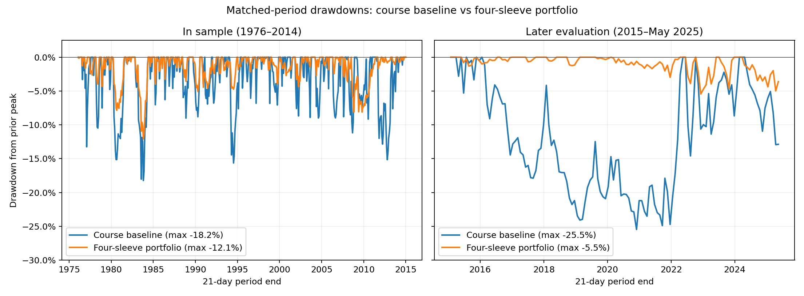

# A Daily-Signal Four-Sleeve Futures Portfolio

## Abstract

We evaluate a diversified futures portfolio against a daily-data implementation of the course time-series momentum baseline. The enhancement combines a 252-trading-day price-trend signal (30% signal budget), five economic themes (20%), a cross-sectional negative-skewness signal (20%) and a frozen Extra Trees forecast (30%). The blended book is scaled to 10% ex-ante volatility with a 252-day daily covariance matrix and fully rebalanced every 21 business days; like the baseline, it has no exposure caps. On matched 21-business-day periods, the enhancement has a higher net Sharpe ratio than the baseline in both 1976–2014 (1.285 vs 1.222) and 2015–May 2025 (0.343 vs 0.243), with lower volatility and a higher later-period net return (3.57% vs 3.24%). The in-sample difference is small relative to its standard error, and the enhancement's in-sample drawdown is deeper than the baseline's. 

## 1. Research question and data

The course baseline applies a long or short position to each market according to its own trailing return. Its simplicity makes it a useful reference, but each market's position depends on one signal only. We ask whether complementary signals, combined in one covariance-aware portfolio, improve its risk-adjusted performance.

We use the 58 futures markets in `data/MonthlyReturns_FullSample.xlsx`, daily back-adjusted closes from `data/FuturesUnderlyingData_FullSample.zip`, the corresponding asset map and four economic time series. The backtest starts reporting results in January 1976, after a signal and risk-model warm-up, and ends in May 2025. Market prices are daily; decisions occur on a fixed 21-business-day grid anchored at 31 December 2014. A weight formed at a trading day's close starts earning returns on the following trading day. Monthly non-price observations enter only after their month-end date.

The economic-trend sleeve uses the following four macroeconomic data files in `data/`:

| File | Economic series | Use in the economic-trend sleeve |
|---|---|---|
| `INDPRO.csv` | US industrial production index | Growth trend. |
| `CPIAUCSL.csv` | US consumer price index (CPI) | Inflation trend. |
| `GS2.csv` | US two-year Treasury yield | Monetary-policy trend. |
| `BAA10Y.csv` | Baa corporate bond yield spread over the ten-year Treasury yield | Credit-spread component of the risk-environment theme. |

The trade theme is constructed from currency-futures returns in `data/MonthlyReturns_FullSample.xlsx`; equity-futures returns from the same file also contribute to the risk-environment theme.

The historical assessment is 1976–2014. Within it, 2005–2009 was used to assess implementation alternatives and 2010–2014 to validate the fixed four-sleeve signal budgets. Extra Trees fits use labels observed before the relevant 2005 or 2015 boundary. January 2015–May 2025 is the later evaluation interval. Because that interval has been viewed during the team's broader research, and the final construction stage was chosen after its results were known (Appendix A), it is not a wholly untouched out-of-sample test.

## 2. Benchmark: course daily time-series momentum

The course daily baseline takes the sign of each market's trailing 252-day compounded return at each 21-day formation close, scales by that market's trailing 252-day annualized standard deviation, and divides across eligible markets. The full book is scaled to 11% ex-ante annual volatility using a trailing 252-day sample covariance matrix. An instrument needs at least 200 valid daily observations. The benchmark has no gross, net or asset-class exposure caps. The primary comparison uses its 58-market sample-covariance version; the 66-market and alternative covariance/realized-volatility versions remain in the baseline outputs as robustness checks.

## 3. Enhancement objectives and design

The baseline provides one directional view of each market: the sign of its trailing price trend. Our design asks whether three additional sources of information improve the *portfolio's* risk-adjusted performance when all positions share the same risk model. The four sleeves receive fixed **signal budgets**: 30% daily price trend, 20% economic trend, 20% negative skew and 30% Extra Trees. These percentages specify how the proposed weights are combined; they are not equal-risk allocations or estimated return contributions.

### 3.1 Daily price trend: preserve the benchmark's core idea

**Objective.** Retain direct exposure to persistent trends so that the enhancement remains anchored to the course's time-series momentum hypothesis. Daily observations also let the position reflect the latest available price at each decision close.

**Design.** For each eligible future, we take the sign of its compounded return over the previous 252 trading days and divide that direction by its trailing 252-day annualized return volatility. At least 200 valid daily observations are required, and the market must have traded within the most recent five days. The resulting inverse-volatility weights are averaged across eligible markets and brought to a common predicted risk scale. This sleeve is the baseline's construction scaled to 10% rather than 11% ex-ante volatility (Appendix A, step 1).

### 3.2 Economic trend: add information about the market environment

**Objective.** Test whether broad economic conditions provide a useful directional view beyond an instrument's own price history. This is intended to diversify the sources of signals, not to replace the observed price trend.

**Design.** Five predefined themes are translated into long or short directions for equity, fixed-income, currency and commodity futures:

| Theme | Dated input used to form the theme |
|---|---|
| Growth | Change in 12-month industrial-production growth. |
| Inflation | Change in 12-month CPI inflation. |
| Trade | Average trailing 12-month return of the eligible currency futures. |
| Monetary policy | 12-month change in the US two-year Treasury yield. |
| Risk environment | Equity-futures trend combined with the opposite of the 12-month change in the Baa–Treasury credit spread. |

Industrial production and CPI are delayed one additional month in the implementation. Theme directions are smoothed over three months, mapped to asset classes using fixed signs, and adjusted for the currency quote convention. Each available theme first forms inverse-volatility positions and is scaled to comparable predicted risk; the five theme portfolios are then averaged and scaled again. The mapping is a predetermined economic hypothesis rather than a set of weights fitted to the later returns. `macro_trend.py` contains the exact sign table and instrument eligibility rules.

### 3.3 Negative skew: compare markets with their asset-class peers

**Objective.** Examine whether the shape of recent returns contains cross-sectional information that a trend signal misses. This sleeve tests whether markets with more negative trailing skewness have a different subsequent payoff from peers in the same asset class; the premise is a hypothesis, not an assumed result.

**Design.** At each month-end, we calculate skewness from the latest 12 monthly returns and rank *negative* skewness within each asset class. Ranks are centered within the class, producing long weights for relatively more negatively skewed markets and short weights for relatively less negatively skewed markets. A class needs at least four eligible markets for a signal. The scores are divided by instrument volatility, averaged across available positions and normalized to the common predicted risk scale. Centering aims to emphasize within-class selection rather than a broad long or short asset-class bet.

### 3.4 Extra Trees: allow nonlinear combinations of return information

**Objective.** Test whether relationships among momentum, reversal, volatility, tail behavior and peer-market returns contain predictive information that fixed single-factor rules do not capture.

**Design.** An Extra Trees classifier estimates each instrument's probability of a *positive next-month return*. Its 66 inputs consist of 31 trailing price-path and peer-market measures, 31 corresponding within-class ranks and four asset-class indicators. The predicted probability is converted to a continuous direction, `2 × probability − 1`, then divided by instrument volatility and normalized to the common risk scale. A forecast near 50% therefore produces a small proposed position rather than a forced full long or short.

The model uses 200 trees, maximum depth 6, minimum leaf size 30, `max_features=0.7` and seed 5260. It is first fitted using labels known before 2005, then refitted once using labels known before 2015; each fit is held fixed during its subsequent evaluation block. Its training dates and sample sizes are saved in `outputs/final_strategy/extra_trees_training_audit.csv`. There is no active out-of-training Extra Trees sleeve before 2005, so its budget goes to price trend in those years.

### 3.5 Combining the sleeves and scaling portfolio risk

**Objective.** Turn four potentially conflicting signals into one portfolio and run it at a fixed predicted risk level, so that the comparison with the baseline is about the signals rather than about a smaller risk budget.

**Design.** The three non-price sleeves are calculated at month-end and carried to each subsequent 21-business-day formation using the most recent available value. A missing sleeve's budget goes to daily price trend. Each active sleeve is first normalized to 10% *predicted* volatility using information available at formation, and the proposed portfolio is the fixed 30/20/20/30 weighted sum of these sleeve weights.

At each formation close, the portfolio risk model estimates an annualized covariance matrix from the preceding 252 daily returns and repairs negative eigenvalues that can arise with incomplete observations. The blended weights are then scaled, up or down, so that the portfolio's predicted volatility is exactly 10%. Because the sleeves are imperfectly correlated, their blend has a lower predicted volatility than any one sleeve, so this step usually scales the book up. There are **no gross, net or asset-class exposure caps**, matching the baseline; Appendix A reports the variant with caps. Scaling uses `risk_normalize` in `portfolio_engine.py`.

### 3.6 Execution and transaction costs

**Design.** At every formation close the portfolio trades fully to its new target weights. The assumed cost is **2 basis points per unit of traded notional**, plus an allowance for **four annual rolls at 2 basis points each** on held gross notional. Trades formed at a close begin earning returns on the next trading day; returns and costs are marked daily. This simplified convention does not estimate bid-ask variation or market impact. A cost-aware execution rule (γ=5) was evaluated and is reported in Appendix A; it was not selected.

The results below measure the *combined* effect of the added signals and the common risk scaling. Appendix A separates the price-trend sleeve alone from the four-sleeve blend.

## 4. Matched-period results

The following statistics use **the same 21-business-day period endpoints and the same 58-market universe** for both strategies. Annual net return is the arithmetic mean period return multiplied by 12; volatility is period standard deviation multiplied by √12; Sharpe uses a zero cash hurdle. Maximum drawdown is measured at period endpoints, and CAGR compounds the observed periods.

| Period | Strategy | Annual net return | CAGR | Annual volatility | Net Sharpe | Maximum endpoint drawdown |
|---|---|---:|---:|---:|---:|---:|
| 1976–2014 (476 periods) | Course daily baseline | **15.40%** | **15.64%** | 12.60% | 1.222 | **−18.24%** |
| 1976–2014 (476 periods) | Four-sleeve enhancement | 14.12% | 14.39% | **10.99%** | **1.285** | −21.34% |
| 2015–May 2025 (128 periods) | Course daily baseline | 3.24% | 2.39% | 13.34% | 0.243 | −25.48% |
| 2015–May 2025 (128 periods) | Four-sleeve enhancement | **3.57%** | **3.07%** | **10.41%** | **0.343** | **−13.58%** |

In 1976–2014 the enhancement earns slightly less (the baseline targets 11% rather than 10% ex-ante risk) with lower volatility, and its Sharpe ratio is 0.063 higher. With 39 years of data a Sharpe estimate has a standard error of roughly 0.19, so this in-sample gain is not statistically significant. During the later interval the enhancement improves Sharpe by 0.100, lowers volatility by 2.93 percentage points and earns 0.33 percentage points more arithmetic annual net return. Over about ten years the Sharpe standard error is roughly 0.3, so this difference is also within sampling noise.

### Drawdown from prior wealth peaks

Drawdown is the percentage decline from the highest wealth reached earlier in the same evaluation interval, starting from $1. The following curves use the **same 21-day period endpoints** as the table above; each interval starts a new wealth path.

In sample, the enhancement's maximum endpoint drawdown is **deeper** than the baseline's: **21.34%** against **18.24%**. In the later period it is roughly half as deep, **13.58%** against **25.48%**. Diversifying across four signals therefore did not protect against the worst historical episode, while it did reduce the later-period losses.

Daily marking gives the enhancement a later-period volatility of **11.15%**, a Sharpe ratio of **0.327** and a maximum *daily* drawdown of **−16.73%** (−23.10% in 1976–2014). Endpoint drawdowns above are less severe because they omit losses between 21-day reporting dates. The baseline implementation presently saves returns at 21-day endpoints, so a directly comparable maximum daily drawdown for the baseline is unavailable.

## 5. Trading costs and exposure

| Period | Strategy | Annual turnover | Annual cost drag | Average gross exposure | Average absolute net exposure |
|---|---|---:|---:|---:|---:|
| 1976–2014 | Course daily baseline | **21.33** | 0.92% | 6.19× | 2.04× |
| 1976–2014 | Four-sleeve enhancement | 25.56 | **0.91%** | **4.92×** | 2.39× |
| 2015–May 2025 | Course daily baseline | **43.47** | **1.79%** | 11.54× | **3.46×** |
| 2015–May 2025 | Four-sleeve enhancement | 50.22 | 1.93% | **11.30×** | 6.66× |

The enhancement trades more than the baseline, because four signals change more often than one, and its cost drag is similar. Both strategies scale positions in low-volatility interest-rate futures to reach their risk targets, so both carry high gross exposure after 2015. The enhancement also runs a larger net long position: about 6.7× NAV on average after 2015, and 7.1× in 2010–2014. Its returns therefore depend on leverage and on a persistent long bias in rate futures that a real fund would find hard to finance. Appendix A shows that capping exposure removes most of this, at the cost of a lower Sharpe ratio in both periods when the portfolio is fully rebalanced.

## 6. Limitations and conclusion

The back-adjusted daily series omit exact contract-selection and roll-date implementation. The cost convention abstracts from bid-ask variation, financing and market impact; the latter matters more at the leverage reported in Section 5. Sample covariance can be unstable when cross-market correlations change quickly, and scaling to a fixed ex-ante target magnifies forecast errors when predicted volatility is low. Rebalance-grid sensitivity is material for the baseline: the 58-market benchmark's later-period Sharpe ranges from roughly 0.05 to 0.24 across tested grid offsets, with the chosen anchor at the upper end. The four-sleeve enhancement has not yet had an equivalent staggered-grid evaluation.

The Extra Trees sleeve has no active out-of-training forecasts before 2005; its absent 30% budget returns to price trend. Consequently, the long 1976–2014 row describes the specified implementation, including its early reduced-sleeve years, rather than 39 years of all four sleeves operating simultaneously. The final construction stage was selected by in-sample Sharpe among the stages in Appendix A, after all their later-period results had been seen. Statistical evidence for a persistent improvement is therefore limited.

The selected four-sleeve portfolio has a slightly higher Sharpe ratio than the baseline in both periods, lower volatility, and a smaller later-period drawdown, at similar turnover and cost and with a larger net long exposure. This is the final enhancement presented here. The executable files and dated outputs allow reviewers to reproduce both strategies and inspect the model's information timing, risks and costs.

## Appendix A. Construction stages: exposure limits and cost-aware execution

`decompose_steps.py` rebuilds the portfolio in stages with the same signals, dates and cost convention, marked daily and measured on the same 21-day endpoints as Section 4. Step 2 is the selected final strategy. Step 2b shows the same blend without re-scaling to 10%; Sharpe ratios are scale-invariant only for a constant scale, so 2b separates the effect of the re-scaling from the effect of the limits in step 3.

| Step | Construction | IS Sharpe | IS net return | IS max DD | OOS Sharpe | OOS net return | OOS max DD | OOS turnover | OOS gross | OOS \|net\| |
|---|---|---:|---:|---:|---:|---:|---:|---:|---:|---:|
| 1 | Price-trend sleeve only, 10% scaling, no limits, full rebalance | 1.222 | 14.0% | −16.6% | 0.243 | 2.9% | −23.2% | 39.4 | 10.47× | 5.51× |
| **2** | **Four-sleeve blend, 10% scaling, no limits, full rebalance (final)** | **1.285** | **14.1%** | −21.3% | 0.343 | 3.6% | −13.6% | 49.0 | 11.30× | 6.66× |
| 2b | Four-sleeve blend, not re-scaled, no limits, full rebalance | 1.248 | 9.6% | −17.1% | 0.317 | 2.0% | −8.2% | 31.9 | 7.52× | 4.63× |
| 3 | Blend + four limits, full rebalance | 1.124 | 6.4% | −12.5% | 0.115 | 0.5% | −7.7% | 11.4 | 2.17× | 0.73× |
| 4 | Blend + four limits + γ=5 cost-aware execution | 0.964 | 5.0% | −12.1% | 0.501 | 2.1% | −5.5% | 2.4 | 1.30× | 0.61× |

The four limits in steps 3 and 4 are at most 10% predicted portfolio volatility, 4× gross exposure, 1× absolute net exposure and 5% standalone predicted volatility per asset class, applied by one common scale factor. On average they shrink the blend to 0.70× in 1976–2014 and 0.55× after 2015. The binding limit is usually the ±1× net-exposure cap (51% of in-sample and 59% of later formation dates), followed by the commodity-class and gross caps; the 10% volatility ceiling never binds because the un-scaled blend is already below it.

**Step 3, limits with full rebalancing.** The limits lower in-sample Sharpe from 1.248 (step 2b) to 1.124 and later-period Sharpe to 0.115, while cutting gross exposure to about 2× and absolute net exposure below 1×. The net cap removes much of the long rate-futures exposure that earned high returns before 2015.

**Step 4, limits with cost-aware execution.** At each formation the portfolio moves only part of the way to its capped target, trading off a tracking-error penalty (γ=5) against trading and roll costs. Turnover falls from 11.4 to 2.4 a year after 2015. Later-period Sharpe rises from 0.115 to 0.501, but in-sample Sharpe falls from 1.124 to 0.964, so the rule has opposite effects in the two periods. The cost saving explains little of the later gain: about 9 units of annual turnover at 2 bps is roughly 0.2% a year, whereas annual net return rises by about 1.6 percentage points. Most of the difference therefore comes from holding a slower-moving portfolio during 2015–2025, not from lower costs, and it should not be read as a reliable benefit of cost-aware execution.

## Appendix B. Exposure-limit sensitivity of the capped variant

To examine how much the capped, cost-aware variant (step 4) depends on its exposure controls, we adapt the gross/net-limit comparison and gross-matched-control idea contributed by [JodieeT](https://github.com/xiayawen/ORIE-5260/commit/3c340c5). The `exposure_sensitivity.py` replay keeps all four signals, the 10% portfolio-volatility ceiling, the 5% asset-class risk ceiling, formation dates, γ=5 execution and costs fixed. It removes the **4× gross cap**, the **±1× net cap**, or both. The figures below use daily returns and daily drawdowns, so they should be compared within this table rather than with the 21-day endpoint drawdowns above.

| Period | Exposure rules (step 4 variant) | Net CAGR | Net Sharpe | Max daily drawdown | Avg. gross | Avg. absolute net | Annual turnover |
|---|---|---:|---:|---:|---:|---:|---:|
| 1976–2014 | Both caps | 5.08% | 1.004 | −12.90% | 1.47× | 0.62× | 3.55× |
| 1976–2014 | Without gross cap | 5.19% | 1.004 | −12.90% | 1.57× | 0.64× | 3.92× |
| 1976–2014 | Without net cap | 7.19% | 1.104 | −12.90% | 2.20× | 1.10× | 5.01× |
| 1976–2014 | Without both caps | 7.89% | 1.138 | −12.90% | 2.48× | 1.19× | 5.78× |
| 2015–May 2025 | Both caps | 2.04% | 0.522 | −7.41% | 1.30× | 0.61× | 2.49× |
| 2015–May 2025 | Without gross cap | 1.56% | 0.378 | −8.19% | 1.64× | 0.67× | 4.03× |
| 2015–May 2025 | Without net cap | 1.80% | 0.381 | −9.30% | 2.26× | 1.48× | 3.91× |
| 2015–May 2025 | Without both caps | 1.53% | 0.269 | −9.52% | 4.21× | 2.56× | 7.26× |

Removing the gross cap changes the proposed target on **20.3%** of later-period formation dates; removing the net cap changes it on **58.6%**. In the later period, Sharpe and drawdown are worse under each removal. In sample, removing caps raises return and Sharpe, while the worst *daily* drawdown happens to be the same across the variants. The apparent benefit of the caps is therefore period-dependent.

The gross-matched no-net-cap control exactly reproduces the capped weights and returns. This is a structural result: the net cap reduces all instrument weights by a common factor rather than trimming only the larger side, so matching the uncapped-net target's gross exposure recovers the same portfolio. The cap changes **scale**, not the long–short composition. Full results and the target-change audit are in `outputs/exposure_sensitivity/`.

## Reproduction

Run `python daily_baseline.py`, `python run_final_strategy.py`, `python compare_baseline.py`, `python decompose_steps.py`, then `python exposure_sensitivity.py` from the repository root. Full daily results are in `outputs/final_strategy/`; aligned 21-day returns and statistics are in `outputs/comparison/`; the construction stages are in `outputs/decomposition/`; baseline and anchor-sensitivity results are in `outputs/baseline/`; exposure-limit comparisons are in `outputs/exposure_sensitivity/`.
