# Enhancing Time-Series Momentum with Macro, Cross-Sectional, and Nonlinear Signals: Evidence from 58 Futures Markets

## Abstract

We investigate whether combining time-series momentum with macroeconomic, cross-sectional, and nonlinear signals improves the risk-adjusted performance of a diversified futures portfolio. Our strategy allocates signal budgets to daily price trends (30%), economic trends (20%), within-asset-class negative-skew rankings (20%), and a 42-input Extra Trees classifier (30%). We evaluate the strategy against the course's daily time-series momentum (TSMOM) benchmark across 58 futures markets from January 1976 through May 2025. Both strategies target **11% annualized ex-ante volatility**, rebalance every 21 business days, and are compared at identical reporting endpoints. The enhanced strategy records a net Sharpe ratio of **1.283 versus 1.222** in 1976–2014 and **0.356 versus 0.243** in 2015–May 2025. In the out-of-sample period, maximum endpoint drawdown is **−15.12% versus −25.48%**; however, historical drawdown is deeper for the enhanced strategy. The observed differences are descriptive rather than evidence of statistically established superiority: the earlier sample includes years before the machine-learning sleeve was active, and the out-of-sample period was examined during model development. High notional exposure and simplified trading-cost assumptions further limit practical conclusions.

## 1. Introduction and research question

Time-series momentum (TSMOM) takes positions according to each market's own historical price trend. Although this approach provides a transparent, diversified starting point, reliance on a single price-trend signal may leave the portfolio sensitive to noisy trends, changing economic conditions, and concentration in common risk exposures. We investigate whether additional information can improve its realized return per unit of risk without removing the core momentum allocation.

Our four-sleeve construction tests three complementary hypotheses. **Economic trend** signals may convey information about growth, inflation, trade, monetary policy, and risk conditions that is not fully summarized by recent prices. **Within-class negative-skew** rankings test whether return-distribution asymmetry helps discriminate opportunities across futures within the same asset class; this is an exploratory predictive hypothesis, not an assumed established premium. **Extra Trees** tests whether nonlinear combinations of price and peer characteristics can provide additional directional information. A daily price-trend sleeve anchors the portfolio to the course benchmark.

The central question is: **Does combining these signal families improve net risk-adjusted performance relative to a daily TSMOM benchmark when the two portfolios use the same ex-ante volatility target and reporting dates?** We also examine turnover, transaction costs, drawdowns, and exposure to assess whether any measured gains are practically meaningful.

## 2. Data and evaluation design

### 2.1 Futures universe and information sources

The investment universe comprises **58 futures markets** across equities, fixed income, commodities, and foreign exchange (FX). The project uses [`data/FuturesUnderlyingData_FullSample.zip`](data/FuturesUnderlyingData_FullSample.zip) for daily back-adjusted prices, [`data/MonthlyReturns_FullSample.xlsx`](data/MonthlyReturns_FullSample.xlsx) for monthly returns, and [`data/AssetMapCsv.csv`](data/AssetMapCsv.csv) for instrument mapping. Macroeconomic inputs include industrial production (`INDPRO.csv`), consumer prices (`CPIAUCSL.csv`), the two-year Treasury yield (`GS2.csv`), and the Baa–Treasury spread (`BAA10Y.csv`); currency and equity futures returns supply additional economic-theme information.

The reported evaluation spans **January 1976–May 2025**, after the required signal and risk-estimation warm-up. Eligibility depends on available historical observations; the price-trend benchmark requires at least 200 valid observations within its trailing 252-trading-day window.

### 2.2 Trading protocol and research chronology

Portfolio weights are formed at the close **every 21 business days** and begin earning returns on the following trading day. Holdings and transaction costs are marked daily, while the primary comparison uses identical 21-business-day reporting endpoints: **476 periods in 1976–2014** and **128 periods in January 2015–May 2025**. With 252 trading days per year, 21-day returns are annualized using 12 periods per year.

The **1976–2014 historical interval is not a single homogeneous fully active four-sleeve test**. The Extra Trees sleeve is not applied out of training before 2005; its unavailable signal budget is reassigned to price momentum. The machine-learning feature set was screened using pre-2005 information and subsequently used in chronological model fitting, including a refit with labels available before 2015. The **2015–May 2025 interval is an out-of-sample historical evaluation**, not a pristine holdout, because its results were viewed while the team examined alternative model and portfolio configurations. We retain the chronological distinction throughout the interpretation.

## 3. Strategy methodology

### 3.1 Course TSMOM benchmark

At each formation date, the baseline takes the sign of each eligible market's **trailing 252-trading-day compounded return**, scales it inversely by that market's trailing 252-day annualized volatility, and averages across eligible instruments. A trailing **252-day daily sample covariance** is then used to scale the overall portfolio to **11% annualized ex-ante volatility**. The baseline imposes **no gross, net, or asset-class exposure caps**. Its primary implementation is [`daily_baseline.py`](daily_baseline.py).

### 3.2 Four complementary signal sleeves

The enhanced strategy combines the following sleeves. The percentages represent **budgets applied to normalized sleeve weights**, not realized risk contributions.

| Sleeve | Signal budget | Economic rationale and implementation |
|---|---:|---|
| **Daily price trend** | **30%** | Retains the benchmark's 252-day directional signal, inverse-volatility construction, and market eligibility rules. |
| **Economic trend** | **20%** | Maps growth, inflation, trade, monetary-policy, and risk-environment themes into asset-class directions. Industrial production and CPI are lagged one additional month; theme directions are smoothed over three months and combined as equal-risk theme portfolios. |
| **Negative skew** | **20%** | Ranks trailing 12-month return skewness within each asset class, buying markets with relatively more negative skew and selling peers with relatively less negative skew. Ranks are centered; at least four eligible markets are required per class. This direction is an empirical hypothesis rather than a presumed risk premium. |
| **Extra Trees** | **30%** | Estimates the probability of a positive next-month return and maps it to a continuous directional score, `2 × predicted probability − 1`; positions are then inverse-volatility weighted and normalized. |

Each available sleeve is normalized to a common predicted-risk scale. **If a non-price sleeve is unavailable, its assigned budget is returned to the daily price-trend sleeve.** Thus, effective sleeve allocations can differ from the nominal 30/20/20/30 budgets at some dates.

Let $\bar w_t^{(s)}$ denote the risk-normalized proposed weights for sleeve $s$, after reallocating unavailable budgets to price trend. The combined signal portfolio is

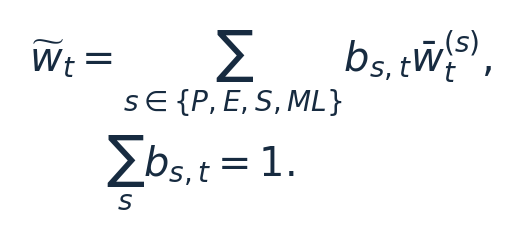

The available-sleeve budgets $b_{s,t}$ correspond to the nominal allocations above except when reallocation is required. The portfolio is then scaled to the **same 11% ex-ante risk target as the benchmark**:

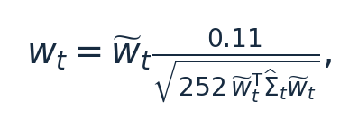

where $\widehat\Sigma_t$ is the trailing daily covariance estimate over eligible markets. The implementation repairs negative covariance eigenvalues arising from incomplete observations. No notional-exposure caps are imposed.

### 3.3 Factor construction, train-only screening and Extra Trees

This section documents the factor and model research shown on **slides 6–12** of [the presentation](ppt/ORIE5260%20Presentation.pptx). The final specification uses **42 inputs**, selected from 66 candidates; the original unfiltered 66-input implementation remains available as a historical comparison.

#### 3.3.1 Constructing the candidate library

All features are computed from monthly returns available at the formation date. The library contains **31 raw factors: 25 price-path measures and six same-asset-class peer/residual measures**. The names below match [the feature implementation](orie5260/factors/features.py).

| Family | Count | Candidate raw factors |
|---|---:|---|
| Trend and price path | 10 | `TSMOM`, `XSMOM_12_1`, `ReturnPersistence_12m`, `TrendEfficiency_12m`, `TrendAcceleration_3m`, `MeanToVol_12m`, `NearWealthHigh_12m`, `ShallowDrawdown_12m`, `PositiveMonthShare_12m`, `MedianReturn_12m` |
| Reversal | 3 | `Reversal_1m`, `Reversal_3m`, `LongReversal_36_12` |
| Volatility and downside | 5 | `LowVol_12m`, `LowDownside_12m`, `LowUpsideRisk_12m`, `VolCompression_3_12`, `LowVolOfVol_12m` |
| Tail shape | 6 | `NegativeSkew_12m`, `LowKurtosis_12m`, `LowMaxReturn_12m`, `MildWorstReturn_12m`, `LowTailLoss_12m`, `RiskAsymmetry_12m` |
| Seasonality | 1 | `Seasonality_5y` |
| Peer and residual information | 6 | `LowPeerBeta_36m`, `LowPeerCorrelation_36m`, `LowResidualVol_12m`, `ResidualMomentum_12m`, `PeerRelativeReversal_1m`, `PeerRelativeMomentum_12m` |

For example, skip-month momentum sums months t−11 through t−1 and divides by an expanding annualized volatility estimate with at least 36 observations. Trend efficiency divides the trailing 12-month cumulative log return by the sum of absolute monthly log returns. Distance to the wealth high and maximum drawdown are calculated from the same trailing log-wealth path. Seasonality averages the five preceding observations for the calendar month being forecast. These are return-history features rather than fundamental valuation measures.

For peer features, the reference return is the equal-weight return of **other markets in the same asset class**, excluding the instrument itself and requiring at least three observed peers. Peer beta is estimated over 36 months with at least 24 observations. Residual momentum and residual volatility summarize the resulting trailing residual return series. This adds information about relative performance beyond the instrument's own trend.

Each raw feature also generates a centered within-class percentile rank:

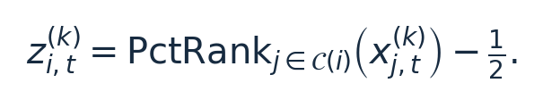

The candidate representation is therefore **31 raw values + 31 class ranks + four class indicators = 66 inputs**. Raw values retain absolute magnitudes; ranks describe relative standing among class peers. They are related representations, not 62 independent alpha discoveries. Missing values are handled by training-only median imputation.

#### 3.3.2 Screening on IC strength and directional evidence

Screening uses **1976–2004 observations whose next-month return labels are already known before the first December 2004 formation**. It never uses 2015-onward returns. For each numeric input k, monthly Rank IC is the cross-sectional Spearman correlation between its formation-time score and the next monthly return, requiring at least ten valid score/return pairs:

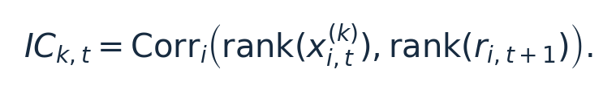

IC observations are dated by **return realization**, so a label beyond the training cutoff cannot enter the screen. The 62 numeric inputs are screened separately, while the four class indicators are retained as controls. Define the training direction and signed IC series as

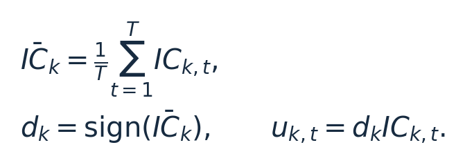

To allow serial dependence, we use a six-lag Newey–West/Bartlett estimate of the standard error of the signed mean:

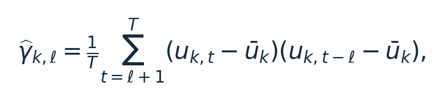

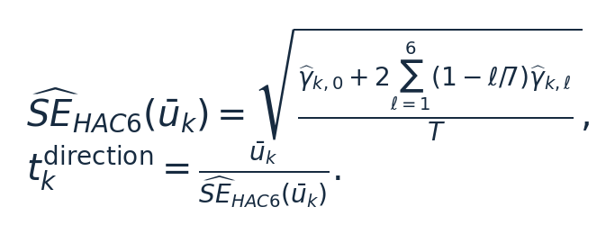

The retained set satisfies **both** conditions:

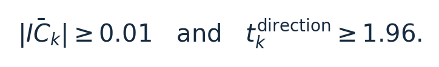

Equivalently, a positive-IC input needs HAC t ≥ 1.96 and a negative-IC input needs HAC t ≤ −1.96. A negative IC can still carry information; the classifier receives the original feature and learns its relationship to the label. The signed series is a diagnostic, not a manual sign flip applied to model inputs. The nominal two-sided threshold is **not adjusted for testing 62 related candidates**, and choosing direction from the same training sample does not establish independent evidence of stability.

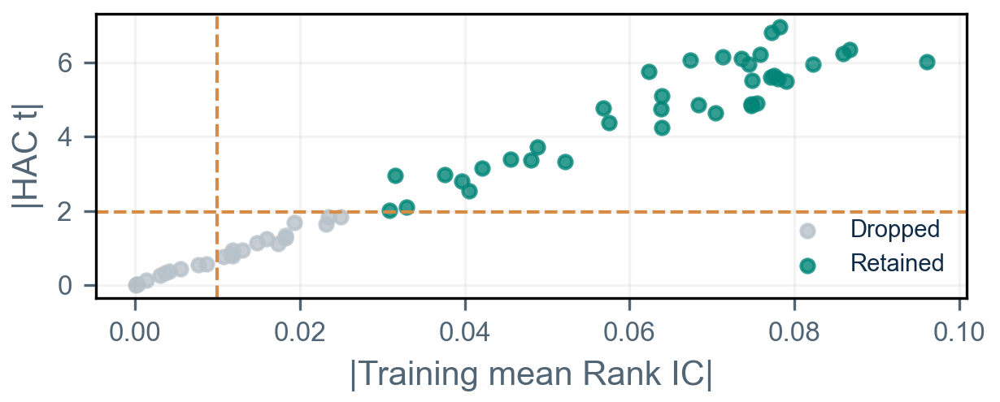

The screen retains **20 raw factors + 18 within-class ranks + four class indicators = 42 inputs**. The 20 raw factors are:

| Retained family | Raw factors |
|---|---|
| Trend and price path | `TSMOM`, `XSMOM_12_1`, `TrendEfficiency_12m`, `MeanToVol_12m`, `NearWealthHigh_12m`, `ShallowDrawdown_12m`, `PositiveMonthShare_12m`, `MedianReturn_12m` |
| Reversal | `Reversal_1m`, `Reversal_3m` |
| Volatility and downside | `LowVol_12m`, `LowDownside_12m` |
| Tail shape | `MildWorstReturn_12m`, `LowTailLoss_12m`, `RiskAsymmetry_12m` |
| Peer and residual | `LowPeerBeta_36m`, `LowResidualVol_12m`, `ResidualMomentum_12m`, `PeerRelativeReversal_1m`, `PeerRelativeMomentum_12m` |

Raw and ranked versions are tested independently, so retaining a raw factor does not automatically retain its rank. The complete 42-name list and chronological fitting audits are in [frozen_selection.json](outputs/ic_t_feature_filter/frozen_selection.json); the raw-factor statistics are in [selected20_factor_evidence.csv](outputs/ppt_factor_model_evidence/selected20_factor_evidence.csv). The final model **keeps this pre-2005 list**, rather than adopting the separately studied pre-2015 re-screened list.

#### 3.3.3 What persists in validation?

The training direction is fixed before evaluating 2005–2014. **16 of the 20 retained raw factors keep that direction** in validation. The equal-weight average of their signed monthly IC series has training mean 0.0656 and HAC t 6.84; its validation mean falls to **0.0185 with HAC t 1.08** and a 95% interval of approximately **[−0.0152, 0.0522]**.

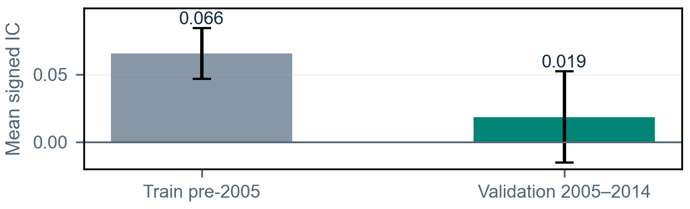

This is evidence of partial directional persistence, with considerable uncertainty. The validation interval crosses zero. Averaging factor IC series is neither the IC of the nonlinear Extra Trees forecast nor the return of a tradable equal-weight factor portfolio. It cannot establish that every retained factor contributes incremental portfolio alpha. Screening only changes ML inputs: the **independent 20% negative-skew sleeve in Section 3.2 stays unchanged**, even though `NegativeSkew_12m` is not among the 20 retained raw ML features.

#### 3.3.4 From screened features to a next-month forecast

The supervised target is **the sign of next month's return**, not its magnitude:

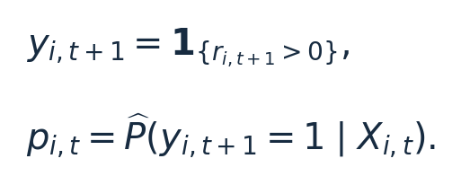

Missing and exactly zero target returns are excluded from fitting. The panel pools dated instrument observations with their class indicators. Extra Trees combines **200 randomized classification trees**, with maximum depth 6, minimum leaf size 30, `max_features=0.7` and random seed 5260. Candidate feature subsets and randomized cut points create conditional splits, allowing combinations of trend, risk and relative performance to affect the forecast. Median imputation is fitted only on the training rows.

For tree b, the terminal leaf estimates the fraction of positive training labels among observations in that leaf. Averaging the tree probabilities gives

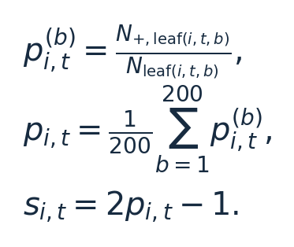

The continuous score is divided by the instrument's formation-time volatility and normalized to the common predicted risk scale. For example, p = 0.65 gives direction +0.30, p = 0.50 gives zero, and p = 0.35 gives −0.30. **The probability is not an expected return, and the direction score is not a final NAV weight.**


The blend remains **30% trend + 20% macro + 20% negative skew + 30% ML**. Learned module weights and cost-aware partial execution were investigated separately and are not part of this selected specification.

#### 3.3.5 Chronological fitting and model comparison

| Stage | Information and action |
|---|---|
| Before 2005 | Screen features on realized 1976–2004 IC; train the initial 42-input model using only labels known before the first formation on 31 December 2004. The last training label is 30 November 2004. |
| 2005–2014 validation | Freeze the input list, fitted imputer and initial classifier. Evaluate forecasts without fitting on validation labels. |
| Before 2015 | Keep the same 42 inputs and refit once using labels known before the 31 December 2014 formation. The last training label is 28 November 2014. |
| January 2015–May 2025 | Freeze the refitted model and input list; later realized returns do not enter screening or fitting. |

There is no active out-of-training ML sleeve before 2005, so its 30% budget returns to price trend. Chronological fitting controls label leakage, but **the later interval has already been inspected during research and is not an untouched holdout**.

**Risk-target convention.** Slides 6–12 and the saved candidate-model comparison were prepared for the earlier **10%** portfolio-risk specification. The final portfolio results in Sections 4–7 retain the updated **11%** target used by both strategies. The validation table below is reproduced from that original 10% experiment; it is not a new 11% candidate-model comparison.

The slide-12 comparison fits all four candidate classifiers before 2005 and freezes them through 2005–2014. Only the 30% ML sleeve changes: inputs, other sleeves, budgets, the original 10% risk target, trading calendar and costs are held fixed. The curves show **net wealth for the complete four-sleeve portfolios**, not standalone classifier returns.

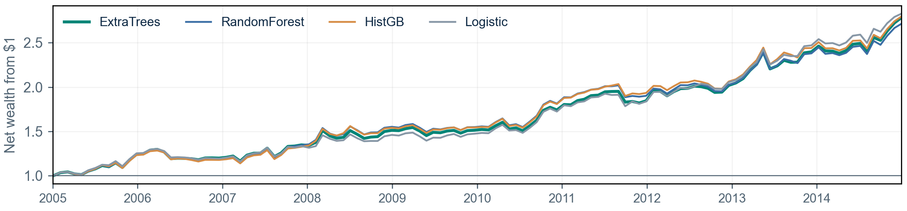

| Model | Validation portfolio net Sharpe | Maximum endpoint drawdown | Prediction AUC |
|---|---:|---:|---:|
| Extra Trees | 1.0112 | −10.24% | 0.5500 |
| Random Forest | 0.9728 | −11.05% | 0.5435 |
| Histogram gradient boosting | 1.0019 | −11.27% | 0.5430 |
| Logistic regression | **1.0353** | −10.94% | 0.5491 |

Extra Trees is retained as the nonlinear specification: it has the highest sample AUC and the smallest validation drawdown among these candidates, with competitive portfolio Sharpe. **Logistic regression has the highest validation Sharpe**, so the evidence does not support calling Extra Trees a universal winner. The differences are small and no significance claim is made. These validation statistics cover neither the full 1976–2014 history nor the 2015-onward interval. [Portfolio metrics](outputs/ppt_factor_model_evidence/validation_model_performance.csv), [classification metrics](outputs/ppt_factor_model_evidence/validation_classification.csv) and [training audits](outputs/ppt_factor_model_evidence/model_training_audit.json) provide the underlying evidence.

The team also examined an IC-only feature filter, IC-plus-HAC filtering, pre-2015 re-screened alternatives, sleeve-budget learning, and cost-aware execution. Those experiments did **not establish a statistically reliable advantage** for a more complex alternative over the selected fixed **42-input, 30/20/20/30, full-rebalance** specification. Historical selection experiments used their own risk-target conventions; the **final results in this report are uniformly evaluated at 11% ex-ante volatility**. The selection process is documented in the [screening report](reports/research/IC_T_FILTER_REPORT.md) and [portfolio-design experiment](reports/research/ICT42_PORTFOLIO_OPTIMIZATION_REPORT.md).

### 3.4 Rebalancing and implementation costs

Every 21 business days, the selected strategy trades from its **price-drifted holdings** to the newly formed target weights. Positions drift between formations; the strategy does **not** reset weights each day. Transaction costs are charged at **2 basis points per unit of traded notional**, plus a rolling allowance equivalent to **four annual rolls at 2 basis points on held gross notional**. Financing, time-varying bid–ask spreads, market impact, and exact contract-level rolling mechanics are not modeled. Both the benchmark and enhanced portfolio are evaluated net of their modeled costs.

## 4. Empirical results

### 4.1 Net performance at matched reporting endpoints

Annual net mean return is $12$ times the mean 21-business-day return; annualized volatility is $\sqrt{12}$ times its standard deviation. Net Sharpe uses a zero cash hurdle, and CAGR compounds reported period returns. Maximum drawdown in Table 1 is measured **only at the common 21-day endpoints**, ensuring that the reported drawdown definitions are comparable across strategies.

**Table 1. Performance comparison, 11% ex-ante risk targets**

| Period | Strategy | Annual net mean | CAGR | Annual volatility | Net Sharpe | Maximum endpoint drawdown |
|---|---|---:|---:|---:|---:|---:|
| **1976–2014** | Course TSMOM baseline | 15.40% | 15.64% | 12.60% | 1.222 | **−18.24%** |
| **1976–2014** | Enhanced four-sleeve | **15.50%** | **15.82%** | **12.08%** | **1.283** | −23.31% |
| **2015–May 2025** | Course TSMOM baseline | 3.24% | 2.39% | 13.34% | 0.243 | −25.48% |
| **2015–May 2025** | Enhanced four-sleeve | **4.02%** | **3.44%** | **11.27%** | **0.356** | **−15.12%** |


In **1976–2014**, the enhanced strategy achieves a **0.061 higher net Sharpe** with similar annual net mean return and slightly lower realized volatility. Nevertheless, its maximum endpoint drawdown is **5.07 percentage points deeper** than the baseline's. This period therefore does **not** support a uniform claim of superior downside protection. Moreover, its aggregate performance includes the years before the Extra Trees sleeve was active; a separate **2005–2014** comparison would be needed to isolate the fully active allocation.

In **2015–May 2025**, the enhanced strategy earns **0.78 percentage points more annual net mean return**, shows **2.07 percentage points less realized volatility**, and records a **0.113 higher net Sharpe**. Its endpoint maximum drawdown improves by **10.36 percentage points**. These are economically relevant descriptive differences, but the enhanced strategy's Sharpe remains modest in absolute terms, and the out-of-sample period has influenced research decisions.

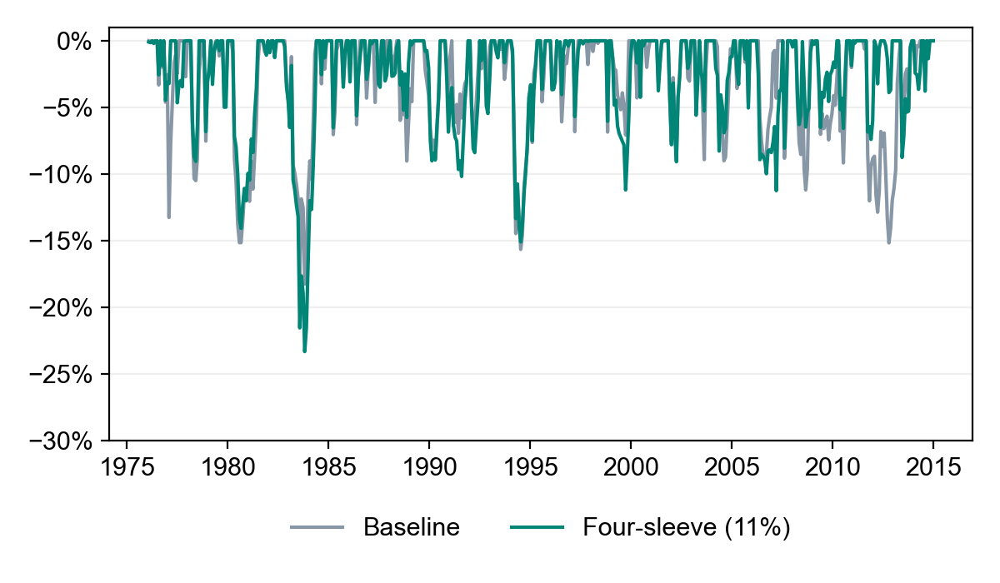


Daily marking of the enhanced strategy produces maximum drawdowns of **−25.19%** in 1976–2014 and **−19.17%** in 2015–May 2025. The corresponding daily baseline drawdowns are not available in the saved comparison, so these figures should **not** be compared directly with the endpoint baseline drawdowns in Table 1. No formal confidence intervals for Sharpe differences are supplied in the current report; the observed improvements should not be characterized as statistically established.

### 4.2 Exposure, turnover, and cost trade-offs

Turnover is measured as the sum of absolute differences between target portfolio weights and drifted pretrade weights, $\sum_i|w^{target}_{i,t}-w^{drift}_{i,t}|$. Gross exposure is $\sum_i|w_{i,t}|$; absolute net exposure is $|\sum_i w_{i,t}|$. Both exposures are expressed relative to portfolio NAV. A large gross notional is not an equivalent upfront cash outlay, but it entails operational, margin, and financing considerations.

**Table 2. Turnover, modeled costs, and notional exposures**

| Period | Strategy | Annual turnover | Annual transaction cost / NAV | Average gross exposure | Average absolute net exposure |
|---|---|---:|---:|---:|---:|
| **1976–2014** | Course TSMOM baseline | 21.33× | 0.922% | 6.19× | 3.07× |
| **1976–2014** | Enhanced four-sleeve | 27.33× | 0.979% | 5.42× | 2.67× |
| **2015–May 2025** | Course TSMOM baseline | 43.47× | 1.793% | 11.54× | 6.08× |
| **2015–May 2025** | Enhanced four-sleeve | 53.80× | 2.073% | 12.44× | 7.25× |

In the out-of-sample period, the enhanced portfolio trades **10.33× NAV more annually** and incurs **0.280 percentage points more modeled cost** than the benchmark. It also has higher average gross and absolute net exposure. Because there are **no gross, net, or class exposure caps**, these large notional positions are part of the selected strategy rather than artifacts of an alternative constrained backtest.

**Measurement qualification:** Baseline exposure is averaged at its 21-day formation endpoints, whereas enhanced-strategy exposure is averaged over daily marked holdings. These statistics describe each saved backtest but are not perfectly time-aligned. A definitive exposure comparison would measure both strategies on the same dates. Annualized turnover and costs are drawn from the corresponding saved simulations.

## 5. Interpretation and robustness considerations

The equal **11% ex-ante volatility target** eliminates one major specification difference between the benchmark and enhanced portfolio. It does not guarantee equal **realized** volatility: risk forecasts, covariance structures, and portfolio compositions differ. Thus, the lower out-of-sample realized volatility and drawdown are meaningful observed outcomes, but they cannot yet be attributed to a particular sleeve, improved forecasting, or exposure management without a controlled attribution exercise.

The four-sleeve construction also adds implementation complexity. Extra Trees undergoes historical feature screening, the skew and macro sleeves depend on additional signal assumptions, and a fully rebalanced portfolio trades more frequently. The fixed 42-input choice simplifies the model relative to larger screened alternatives, but its incremental value is not statistically established by the selection exercises. The 2015–2025 results should be read as **out-of-sample historical performance influenced by research decisions**, not an independent prospective test.

Two analyses would substantially strengthen the evidence if they can be produced using the existing code and stored data:

1. **Fully active-period and sleeve ablations.** Present 2005–2014 alongside the 1976–2014 aggregate and compare price-only, price-plus-one-sleeve, and full four-sleeve portfolios under the same 11% risk and cost assumptions. This would clarify which signal families contribute to the measured gain. **No such attribution results are assumed or reported here.**
2. **Matched-date risk and statistical uncertainty.** Recompute baseline and enhanced exposures on identical dates, and report confidence intervals for paired net-return differences and, where feasible, Sharpe differences using dependence-aware time-series methods. The current tables alone do not establish statistical significance.

## 6. Limitations

Several limitations restrict the interpretation of the backtest. **First**, back-adjusted prices do not reproduce contract selection, precise rolling schedules, or contract-level implementation. **Second**, the fixed transaction-cost convention omits financing, variable spreads, and market impact; these costs may be material given average gross exposure above 12× NAV for the selected strategy in the out-of-sample period. **Third**, a trailing sample covariance and ex-ante risk target cannot guarantee future realized volatility, particularly during market stress. **Fourth**, selection from multiple correlated Extra Trees features was not corrected for multiple hypothesis testing. **Finally**, the out-of-sample period was repeatedly examined during project development, introducing research-selection bias.

These issues do not negate the reported historical results, but they prevent a strong claim that the enhanced portfolio will outperform prospectively.

## 7. Conclusion

The selected 42-input, four-sleeve futures portfolio delivers **higher measured net Sharpe in both reported periods** than the course TSMOM benchmark when both target **11% ex-ante volatility**. In the out-of-sample historical interval, it also earns a higher annual net return and experiences a substantially smaller maximum drawdown at matched reporting endpoints. However, the historical maximum drawdown is worse, the out-of-sample Sharpe remains moderate, and higher turnover and notional exposures create practical costs and risk. Because performance attribution and formal statistical uncertainty are not established here, the evidence supports a **promising but provisional diversification-of-signals result**, rather than a proven incremental premium from any specific sleeve.

The selected portfolio **does not include a turning-point overlay**; that research is separate from the final four-sleeve strategy described here.

## Appendix A. Reproduction and research artifacts

From the repository root, install [`requirements.txt`](requirements.txt), then run:

```bash
python run.py baseline
python run.py selected-42
```

The selected 11%-target tables, aligned returns, daily results, and figures are saved under [`outputs/selected42_target11/`](outputs/selected42_target11/). The enhanced simulation uses saved chronological 42-input forecasts from [`outputs/ic_t_feature_filter/`](outputs/ic_t_feature_filter/).

To regenerate the screening and frozen model forecasts first, run:

```bash
python run.py factor-ic
python run.py ic-filter
python run.py ic-filter-oos
python run.py ic-t-filter
python run.py selected-42
```

The final selected portfolio is constructed in [`orie5260/presentation/prepare_results.py`](orie5260/presentation/prepare_results.py). The command `python run_final_strategy.py` reconstructs the **original 66-input comparison**, not the selected 42-input portfolio.

The factor-screening and candidate-model figures reused from PPT slides 8 and 12 can be regenerated with `python run.py model-evidence`. Their original 10% candidate-model convention is described in Section 3.3.5; this command does not change the selected 11% strategy or edit the PPT.

Further methodological detail is available in the [screening report](reports/research/IC_T_FILTER_REPORT.md) and [portfolio-design experiment](reports/research/ICT42_PORTFOLIO_OPTIMIZATION_REPORT.md).

Display equations are embedded as static images for GitHub compatibility. Editable [equation sources](docs/report_equations/equations.json) and the [rendering script](docs/report_equations/render.py) are retained.
