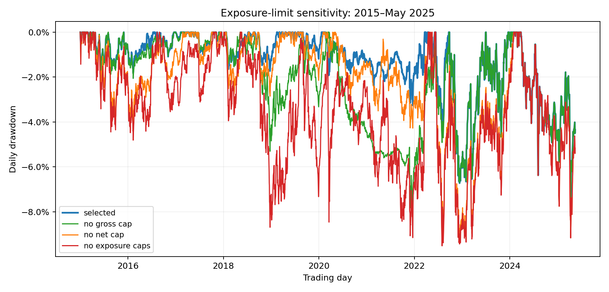

# A Daily-Signal Four-Sleeve Futures Portfolio

## Abstract

We evaluate a diversified futures portfolio against a daily-data implementation of the course time-series momentum baseline. The enhancement combines a 252-trading-day price-trend signal (30% signal budget), five economic themes (20%), a cross-sectional negative-skewness signal (20%) and a frozen Extra Trees forecast (30%). All sleeves enter one covariance-aware portfolio with explicit exposure limits and cost-aware execution. On matched 21-business-day periods during 2015–May 2025, the enhancement has a 0.501 net Sharpe ratio versus 0.243 for the baseline, with annual volatility of 4.10% versus 13.34%. It earns a lower annual net return, 2.05% versus 3.24%. The result is a risk-efficiency improvement, not evidence of higher absolute return or an isolated effect of any one sleeve. Earlier-sample results favor the baseline in both return and Sharpe. The later interval has been inspected during the wider project and is therefore a chronological evaluation rather than a pristine holdout.

## 1. Research question and data

The course baseline applies a long or short position to each market according to its own trailing return. Its simplicity makes it a useful reference, but inverse-volatility sizing can generate large exposure and the strategy reacts only after the established trend changes. We ask whether complementary signals, a common covariance risk model and an execution rule can produce a more stable implementable portfolio.

We use the 58 futures markets in `data/MonthlyReturns_FullSample.xlsx`, daily back-adjusted closes from `data/FuturesUnderlyingData_FullSample.zip`, the corresponding asset map and four economic time series. The backtest starts reporting results in January 1976, after a signal and risk-model warm-up, and ends in May 2025. Market prices are daily; decisions occur on a fixed 21-business-day grid anchored at 31 December 2014. A weight formed at a trading day's close starts earning returns on the following trading day. Monthly non-price observations enter only after their month-end date.

The historical assessment is 1976–2014. Within it, 2005–2009 was used to assess implementation alternatives and 2010–2014 to validate the fixed four-sleeve specification. Extra Trees fits use labels observed before the relevant 2005 or 2015 boundary. January 2015–May 2025 is the later evaluation interval. Because that interval has been viewed during the team's broader research, it is not a wholly untouched out-of-sample test.

## 2. Benchmark: course daily time-series momentum

The course daily baseline takes the sign of each market's trailing 252-day compounded return at each 21-day formation close, scales by that market's trailing 252-day annualized standard deviation, and divides across eligible markets. The full book is scaled to 11% ex-ante annual volatility using a trailing 252-day sample covariance matrix. An instrument needs at least 200 valid daily observations. The benchmark has no gross, net or asset-class exposure caps. The primary comparison uses its 58-market sample-covariance version; the 66-market and alternative covariance/realized-volatility versions remain in the baseline outputs as robustness checks.

## 3. Enhancement objectives and design

The baseline provides one directional view of each market: the sign of its trailing price trend. Our design asks whether three additional sources of information improve the *portfolio's* risk-adjusted performance when all positions share the same risk and execution rules. The four sleeves receive fixed **signal budgets**, chosen before the later evaluation: 30% daily price trend, 20% economic trend, 20% negative skew and 30% Extra Trees. These percentages specify how the proposed weights are combined; they are not equal-risk allocations or estimated return contributions.

### 3.1 Daily price trend: preserve the benchmark's core idea

**Objective.** Retain direct exposure to persistent trends so that the enhancement remains anchored to the course's time-series momentum hypothesis. Daily observations also let the position reflect the latest available price at each decision close.

**Design.** For each eligible future, we take the sign of its compounded return over the previous 252 trading days and divide that direction by its trailing 252-day annualized return volatility. At least 200 valid daily observations are required, and the market must have traded within the most recent five days. The resulting inverse-volatility weights are averaged across eligible markets and brought to a common predicted risk scale. This sleeve uses the baseline's *directional signal*, although its final portfolio weight is subject to the shared controls below.

### 3.2 Economic trend: add information about the market environment

**Objective.** Test whether broad economic conditions provide a useful directional view beyond an instrument's own price history. This is intended to diversify the sources of signals, not to replace the observed price trend.

**Design.** Five predefined themes are translated into long or short directions for equity, fixed-income, currency and commodity futures:

| Theme | Dated input used to form the theme |
|---|---|
| Growth | Change in 12-month industrial-production growth. |
| Inflation | Change in 12-month CPI inflation. |
| Trade | Average trailing 12-month return of the eligible currency futures. |
| Monetary policy | 12-month change in the US two-year Treasury yield. |
| Risk environment | Equity-futures trend combined with the opposite of the 12-month change in the Baa–Treasury credit spread. |

Industrial production and CPI are delayed one additional month in the implementation. Theme directions are smoothed over three months, mapped to asset classes using fixed signs, and adjusted for the currency quote convention. Each available theme first forms inverse-volatility positions and is scaled to comparable predicted risk; the five theme portfolios are then averaged and scaled again. The mapping is a predetermined economic hypothesis rather than a set of weights fitted to the later returns. `macro_trend.py` contains the exact sign table and instrument eligibility rules.

### 3.3 Negative skew: compare markets with their asset-class peers

**Objective.** Examine whether the shape of recent returns contains cross-sectional information that a trend signal misses. This sleeve tests whether markets with more negative trailing skewness have a different subsequent payoff from peers in the same asset class; the premise is a hypothesis, not an assumed result.

**Design.** At each month-end, we calculate skewness from the latest 12 monthly returns and rank *negative* skewness within each asset class. Ranks are centered within the class, producing long weights for relatively more negatively skewed markets and short weights for relatively less negatively skewed markets. A class needs at least four eligible markets for a signal. The scores are divided by instrument volatility, averaged across available positions and normalized to the common predicted risk scale. Centering aims to emphasize within-class selection rather than a broad long or short asset-class bet.

### 3.4 Extra Trees: allow nonlinear combinations of return information

**Objective.** Test whether relationships among momentum, reversal, volatility, tail behavior and peer-market returns contain predictive information that fixed single-factor rules do not capture.

**Design.** An Extra Trees classifier estimates each instrument's probability of a *positive next-month return*. Its 66 inputs consist of 31 trailing price-path and peer-market measures, 31 corresponding within-class ranks and four asset-class indicators. The predicted probability is converted to a continuous direction, `2 × probability − 1`, then divided by instrument volatility and normalized to the common risk scale. A forecast near 50% therefore produces a small proposed position rather than a forced full long or short.

The model uses 200 trees, maximum depth 6, minimum leaf size 30, `max_features=0.7` and seed 5260. It is first fitted using labels known before 2005, then refitted once using labels known before 2015; each fit is held fixed during its subsequent evaluation block. Its training dates and sample sizes are saved in `outputs/final_strategy/extra_trees_training_audit.csv`. There is no active out-of-training Extra Trees sleeve before 2005, so its budget goes to price trend in those years.

### 3.5 Combining the sleeves and controlling risk

**Objective.** Turn four potentially conflicting signals into one portfolio while limiting portfolio-wide volatility and concentration. The risk controls are part of the proposed enhancement and can themselves affect the comparison with the baseline.

**Design.** The three non-price sleeves are calculated at month-end and carried to each subsequent 21-business-day formation using the most recent available value. A missing sleeve's budget goes to daily price trend. Each active sleeve is first normalized to a comparable *predicted* volatility using information available at formation. The proposed portfolio is the fixed 30/20/20/30 weighted sum of these sleeve weights.

At each formation close, the portfolio risk model estimates an annualized covariance matrix from the preceding 252 daily returns. It repairs negative eigenvalues that can arise with incomplete observations. The proposed weights are scaled down if necessary to meet all four limits simultaneously: at most 10% predicted portfolio volatility, 4× gross exposure, 1× absolute net exposure and 5% standalone predicted volatility for each asset class. These are ceilings, so realized volatility may be well below 10%. The common limits are implemented in `risk_model.py` and `portfolio_engine.py`.

### 3.6 Execution and transaction costs

**Objective.** Avoid assuming that every change in target weights can be implemented without cost. The execution rule asks whether moving closer to the target is worth the additional trading implied by that move.

**Design.** At a formation close, the strategy first repairs any drifted holdings that breach the limits, then chooses how far to move along the feasible path toward the new target. A fixed tracking-error penalty, γ=5, trades off target deviation against expected turnover and roll costs. The assumed cost is **2 basis points per unit of traded notional**, plus an allowance for **four annual rolls at 2 basis points each** on held gross notional. Trades formed at a close begin earning returns on the next trading day; returns and costs are marked daily. This simplified convention does not estimate bid-ask variation or market impact.

The results below measure the *combined* effect of the added signals, shared risk limits and execution design. They do not identify a separate causal contribution from each component.

## 4. Matched-period results

The following statistics use **the same 21-business-day period endpoints and the same 58-market universe** for both strategies. Annual net return is the arithmetic mean period return multiplied by 12; volatility is period standard deviation multiplied by √12; Sharpe uses a zero cash hurdle. Maximum drawdown is measured at period endpoints, and CAGR compounds the observed periods.

| Period | Strategy | Annual net return | CAGR | Annual volatility | Net Sharpe | Maximum endpoint drawdown |
|---|---|---:|---:|---:|---:|---:|
| 1976–2014 (476 periods) | Course daily baseline | **15.40%** | **15.64%** | 12.60% | **1.222** | −18.24% |
| 1976–2014 (476 periods) | Four-sleeve enhancement | 5.02% | 4.99% | **5.20%** | 0.964 | **−12.10%** |
| 2015–May 2025 (128 periods) | Course daily baseline | **3.24%** | **2.39%** | 13.34% | 0.243 | −25.48% |
| 2015–May 2025 (128 periods) | Four-sleeve enhancement | 2.05% | 1.99% | **4.10%** | **0.501** | **−5.45%** |

The historical benchmark earned substantially more return and a higher Sharpe. During the later interval, the four-sleeve portfolio improved Sharpe by 0.258 and reduced annual volatility by 9.25 percentage points, while giving up 1.19 percentage points of arithmetic annual net return. Thus the evidence supports greater risk efficiency and smaller realized swings, rather than a universal return improvement.

### Drawdown from prior wealth peaks

Drawdown is the percentage decline from the highest wealth reached earlier in the same evaluation interval, starting from $1. The following curves use the **same 21-day period endpoints** as the table above; each interval starts a new wealth path.

In sample, maximum endpoint drawdown falls from **18.24%** for the baseline to **12.10%** for the enhancement. In the later period it falls from **25.48%** to **5.45%**, a 20.03-percentage-point reduction. The chart shows how long and how deeply each strategy stayed below its previous peak, rather than only the single worst observation. This is a portfolio risk result; the lower volatility target and exposure caps also contribute, so it should not be attributed to the added signals alone.

Daily marking makes the final portfolio's later-period volatility **3.92%**, Sharpe **0.522** and maximum *daily* drawdown **−7.41%**. The endpoint drawdown above is less severe because it omits losses between 21-day reporting dates. The baseline implementation presently saves returns at 21-day endpoints, so a directly comparable maximum daily drawdown for the baseline is unavailable.

## 5. Trading costs, exposure and interpretation

| Period | Strategy | Annual turnover | Annual cost drag | Average gross exposure |
|---|---|---:|---:|---:|
| 1976–2014 | Course daily baseline | 21.33 | 0.92% | 6.19× |
| 1976–2014 | Four-sleeve enhancement | **3.55** | **0.19%** | **1.47×** |
| 2015–May 2025 | Course daily baseline | 43.47 | 1.79% | 11.54× |
| 2015–May 2025 | Four-sleeve enhancement | **2.49** | **0.16%** | **1.30×** |

The enhancement trades less and carries markedly less gross exposure in both periods. The reduced cost drag is consistent with cost-aware execution and smaller exposures, but the table does not isolate the causal effect of execution from changes in signals and risk limits. The baseline targets 11% ex-ante portfolio risk without exposure caps; the enhancement uses a 10% ceiling and caps. Their different risk budgets partly explain the absolute-return gap. An equal-risk comparison would be needed to attribute the remaining difference to signal quality alone.

### Sensitivity to leverage and long–short imbalance limits

To examine how much the final portfolio depends on its exposure controls, we adapt the gross/net-limit comparison and gross-matched-control idea contributed by [JodieeT](https://github.com/xiayawen/ORIE-5260/commit/3c340c5). The separate `exposure_sensitivity.py` replay keeps all four signals, the 10% portfolio-volatility ceiling, the 5% asset-class risk ceiling, formation dates and execution costs fixed. It removes the **4× gross cap**, the **±1× net cap**, or both. Gross exposure is the sum of absolute weights; imbalance is the absolute sum of signed weights. The figures below use daily returns and daily drawdowns, so they should be compared within this table rather than to the 21-day endpoint drawdowns in Section 4.

| Period | Exposure rules | Net CAGR | Net Sharpe | Max daily drawdown | Avg. gross | Avg. absolute net | Annual turnover |
|---|---|---:|---:|---:|---:|---:|---:|
| 1976–2014 | Selected: both caps | 5.08% | 1.004 | −12.90% | 1.47× | 0.62× | 3.55× |
| 1976–2014 | Without gross cap | 5.19% | 1.004 | −12.90% | 1.57× | 0.64× | 3.92× |
| 1976–2014 | Without net cap | 7.19% | 1.104 | −12.90% | 2.20× | 1.10× | 5.01× |
| 1976–2014 | Without both caps | 7.89% | 1.138 | −12.90% | 2.48× | 1.19× | 5.78× |
| 2015–May 2025 | **Selected: both caps** | **2.04%** | **0.522** | **−7.41%** | **1.30×** | **0.61×** | **2.49×** |
| 2015–May 2025 | Without gross cap | 1.56% | 0.378 | −8.19% | 1.64× | 0.67× | 4.03× |
| 2015–May 2025 | Without net cap | 1.80% | 0.381 | −9.30% | 2.26× | 1.48× | 3.91× |
| 2015–May 2025 | Without both caps | 1.53% | 0.269 | −9.52% | 4.21× | 2.56× | 7.26× |

Removing the gross cap changes the proposed target on **20.3%** of later-period formation dates; removing the net cap changes it on **58.6%**. The later-period drawdown and Sharpe are worse under each removal, with the largest turnover increase when both are removed. In sample, removing caps raises return and Sharpe, while the worst *daily* drawdown happens to be the same across the variants. Thus the apparent benefit of limits is period-dependent; the later-period results are descriptive, not a fresh rule-selection exercise.

The gross-matched no-net-cap control exactly reproduces the selected weights and returns. This is a structural result: our net cap reduces all instrument weights by a common factor rather than trimming only the larger side. Matching the uncapped-net target's gross exposure to the selected target therefore recovers the same portfolio. The cap changes **scale**, not the long–short composition. This distinction prevents us from attributing its effect to a better balance of long and short signals. Full results and the target-change audit are in `outputs/exposure_sensitivity/`.

## 6. Limitations and conclusion

The back-adjusted daily series omit exact contract-selection and roll-date implementation. The cost convention abstracts from bid-ask variation, financing and market impact. Sample covariance can be unstable when cross-market correlations change quickly. Rebalance-grid sensitivity is material for the baseline: the 58-market benchmark's later-period Sharpe ranges from roughly 0.05 to 0.24 across tested grid offsets, with the chosen anchor at the upper end. The four-sleeve enhancement has not yet had an equivalent staggered-grid evaluation in this final submission.

The Extra Trees sleeve has no active out-of-training forecasts before 2005; its absent 30% budget returns to price trend. Consequently, the long 1976–2014 row describes the specified implementation, including its early reduced-sleeve years, rather than 39 years of all four sleeves operating simultaneously. The later evaluation has also been observed in the broader research process. Statistical evidence for a persistent improvement in expected return is therefore limited.

The selected four-sleeve portfolio has a lower absolute return than the baseline but a higher later-period Sharpe, substantially lower volatility, lower gross exposure and lower turnover. This is the final enhancement presented here. The executable files and dated outputs allow reviewers to reproduce both strategies and inspect the model's information timing, risks and costs.

## Reproduction

Run `python daily_baseline.py`, `python run_final_strategy.py`, `python compare_baseline.py`, then `python exposure_sensitivity.py` from the repository root. Full daily results are in `outputs/final_strategy/`; aligned 21-day returns and statistics are in `outputs/comparison/`; baseline and anchor-sensitivity results are in `outputs/baseline/`; exposure-limit comparisons are in `outputs/exposure_sensitivity/`.
