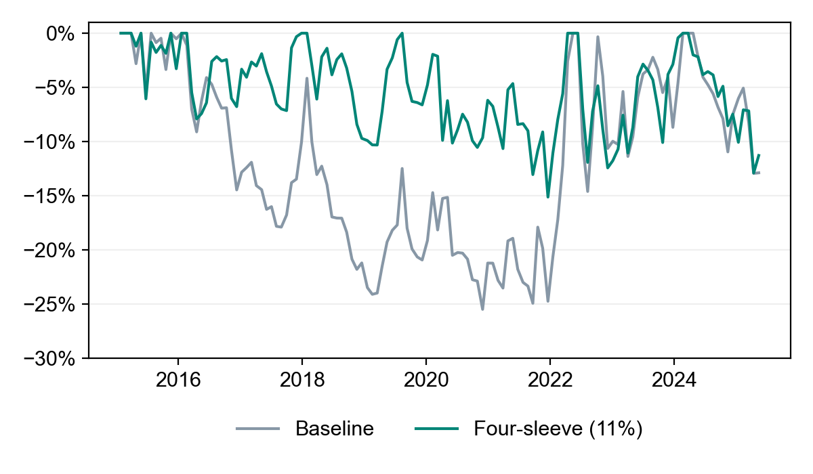

# A Daily-Signal Four-Sleeve Futures Portfolio

## Abstract

We compare a diversified four-sleeve futures strategy with the course's daily time-series momentum baseline across 58 markets. The selected strategy combines daily price trend (30% signal budget), economic trend (20%), within-class negative skew (20%) and a **fixed 42-input Extra Trees** signal (30%). Both portfolios target **11% annualized ex-ante volatility** and rebalance every 21 business days. On identical 21-day reporting endpoints, the selected strategy's net Sharpe is **1.283 versus 1.222** for the baseline in 1976–2014 and **0.356 versus 0.243** in January 2015–May 2025. Its out-of-sample maximum endpoint drawdown is **−15.12% versus −25.48%**. These results come with substantial gross and net exposure, and the out-of-sample period was examined during research rather than remaining an untouched holdout.

## 1. Objective, data and evaluation design

The baseline uses each future's own trailing price direction. We ask whether economic, cross-sectional and nonlinear information improves the portfolio's return per unit of risk while preserving a transparent price-trend core.

The universe contains **58 futures markets** across equity, fixed income, commodities and FX. [`data/MonthlyReturns_FullSample.xlsx`](data/MonthlyReturns_FullSample.xlsx) supplies monthly returns and the instrument mapping; [`data/FuturesUnderlyingData_FullSample.zip`](data/FuturesUnderlyingData_FullSample.zip) supplies daily back-adjusted prices. Industrial production (`INDPRO.csv`), consumer prices (`CPIAUCSL.csv`), the two-year Treasury yield (`GS2.csv`) and the Baa–Treasury spread (`BAA10Y.csv`) supply external macroeconomic series. Currency and equity futures returns provide the remaining economic-theme inputs. The reported backtest spans **January 1976–May 2025**, after the required signal and risk-model warm-up.

Weights are formed at the close every **21 business days** and start earning returns on the following trading day. Positions and costs are marked daily. We compare strategies on the same 21-day endpoints: 476 periods in 1976–2014 and 128 in 2015–May 2025. The in-sample period contains the pre-2005 training history and subsequent validation. Extra Trees features and model parameters are set using information available before the 2005 and 2015 boundaries; the 2015–2025 out-of-sample period was repeatedly viewed during project development.

## 2. Course baseline

At each formation, the benchmark takes the sign of each eligible market's trailing **252-trading-day** compounded return, divides by its trailing 252-day annualized volatility and averages over eligible markets. At least 200 valid daily observations are required. It scales the whole book to **11% ex-ante annual volatility** using a trailing 252-day daily sample covariance. There are no gross, net or asset-class exposure caps. The primary comparison uses the 58-market baseline generated by [`daily_baseline.py`](daily_baseline.py); alternative baseline settings remain in [`outputs/baseline/`](outputs/baseline/).

## 3. Selected enhancement

The four percentages below are **signal budgets** used to blend proposed sleeve weights; they are not realized risk contributions. Each available sleeve is normalized to a common predicted-risk scale before blending. When a non-price sleeve is unavailable, its budget returns to the daily price trend.

| Sleeve | Budget | Objective and construction |
|---|---:|---|
| Daily price trend | 30% | Preserve the benchmark's 252-day direction, inverse-volatility weighting and recent-trading eligibility. |
| Economic trend | 20% | Map growth, inflation, trade, monetary policy and risk-environment themes into asset-class directions. Lag industrial production and CPI one extra month, smooth theme directions over three months, then combine equal-risk theme portfolios. |
| Negative skew | 20% | Rank trailing 12-month return skewness within each asset class. Center ranks so relatively more negatively skewed markets are long and peers with less negative skew are short; require at least four eligible markets per class. |
| Extra Trees | 30% | Convert the predicted probability of a positive next-month return into the continuous direction `2 × probability − 1`, then inverse-volatility weight and normalize. |

The Extra Trees classifier uses **42 fixed inputs: 20 raw price/peer features, 18 within-class ranks and four asset-class indicators**. These were screened before 2005 from 62 numerical candidates: a feature needed absolute mean monthly rank IC of at least **0.01** and a directionally consistent **Newey–West HAC t-statistic of at least 1.96 in absolute value**, using six lags. The four class indicators were retained as controls. This is a nominal screen across correlated features, without a multiple-testing correction. The model has 200 trees, maximum depth 6, minimum leaf size 30, `max_features=0.7` and seed 5260. The same feature list is used when the model is refitted with labels available before 2015; it is frozen thereafter. It does not provide an active out-of-training sleeve before 2005, so that budget goes to price trend. The exact list and model timing are in [`frozen_selection.json`](outputs/ic_t_feature_filter/frozen_selection.json) and the [IC and HAC screening report](reports/research/IC_T_FILTER_REPORT.md).

At each formation, the portfolio estimates covariance from the preceding **252 daily returns** of eligible markets, repairs negative eigenvalues from incomplete observations, and scales the 30/20/20/30 blend to **11% annualized ex-ante volatility**, matching the baseline's target. The selected book has **no gross, net or class exposure cap** and trades fully to its target. The assumed cost is **2 basis points per unit of traded notional**, plus four rolls per year at 2 basis points on held gross notional. It omits financing, variable spreads and market impact. The selected construction is implemented in [`orie5260/presentation/prepare_results.py`](orie5260/presentation/prepare_results.py), invoked by `python run.py selected-42`; its saved probabilities come from the chronological screening run.

## 4. Performance versus the baseline

The following table uses **matched 21-business-day endpoints**. Annual net return is 12 times the mean period return; annual volatility is the period standard deviation times √12; Sharpe assumes a zero cash hurdle. CAGR compounds the period returns. Drawdown is measured at those same endpoints.

| Period | Strategy | Annual net return | CAGR | Annual volatility | Net Sharpe | Maximum endpoint drawdown |
|---|---|---:|---:|---:|---:|---:|
| 1976–2014 | Course baseline | **15.40%** | **15.64%** | 12.60% | 1.222 | **−18.24%** |
| 1976–2014 | Selected four-sleeve, 11% target | **15.50%** | **15.82%** | **12.08%** | **1.283** | −23.31% |
| 2015–May 2025 | Course baseline | 3.24% | 2.39% | 13.34% | 0.243 | −25.48% |
| 2015–May 2025 | Selected four-sleeve, 11% target | **4.02%** | **3.44%** | **11.27%** | **0.356** | **−15.12%** |

The selected strategy has a higher Sharpe in both periods and a smaller out-of-sample endpoint drawdown. Its 1976–2014 drawdown is **deeper** than the baseline's, so the risk benefit is not uniform across history. Daily marking gives the selected strategy a maximum drawdown of **−25.19%** in 1976–2014 and **−19.17%** in 2015–May 2025. A directly comparable daily drawdown for the baseline is unavailable in the saved comparison; the table uses common endpoints for both.

These Sharpe differences are modest relative to sampling uncertainty. The in-sample summary also includes years before the Extra Trees sleeve was active. The out-of-sample comparison is descriptive because the team has examined that period while selecting model and portfolio alternatives.

## 5. Exposure, turnover and transaction costs

**Transaction costs and turnover.** At each 21-business-day formation, turnover is the sum across instruments of the absolute change from the holdings after price drift to the new target weights: `Σ |target weight − drifted weight|`. A one-way trade of 1× portfolio NAV therefore contributes 1× turnover. The backtest charges **2 basis points per unit of turnover**, plus a roll allowance of **four rolls per year at 2 basis points each** on held gross notional. Annual cost is the annualized sum of trade and roll costs, expressed as a percentage of NAV; it is deducted from gross returns to obtain net returns. This simplified model excludes financing, variable bid–ask spreads and market impact.

**Exposure.** Gross exposure is `Σ |weight|`: total futures notional relative to NAV, counting longs and shorts positively. Net exposure is `Σ weight`: long notional minus short notional. We report the **absolute value of net exposure** before averaging so that long and short directional bets do not cancel. For example, 11× gross and 6× absolute net mean that substantial long and short notional is outstanding, with a large directional imbalance; they do not imply that 11× NAV was paid upfront. High notional exposure can nevertheless increase margin, financing and execution demands.

| Period | Strategy | Annual turnover | Annual transaction cost | Average gross exposure | Average absolute net exposure |
|---|---|---:|---:|---:|---:|
| 1976–2014 | Course baseline | 21.33× | 0.922% | 6.19× | 3.07× |
| 1976–2014 | Selected four-sleeve, 11% target | 27.33× | 0.979% | 5.42× | 2.67× |
| 2015–May 2025 | Course baseline | 43.47× | 1.793% | 11.54× | 6.08× |
| 2015–May 2025 | Selected four-sleeve, 11% target | 53.80× | 2.073% | 12.44× | 7.25× |

The baseline's exposure figures are averaged at its 21-day formation endpoints; the selected portfolio's figures are averaged across daily marked holdings. Their turnover and cost figures are annualized from their respective saved backtests. Baseline absolute net exposure was recalculated from [`periods_exante_11_sample_u58.csv`](outputs/baseline/periods_exante_11_sample_u58.csv), because its summary table reports the *signed* mean net exposure.

**Full rebalancing** means that, at every formation close, the selected portfolio trades the entire gap between its drifted current weights and its newly calculated target weights. It then holds those positions, allowing them to drift with prices, until the next formation; it does **not** reset targets every day. This keeps holdings aligned with current signals and the 11% predicted-volatility target at each decision date, but can generate more turnover than moving only partway toward the target. After 2015, the selected strategy trades **53.80× NAV per year**, versus **43.47×** for the baseline, and incurs higher modeled cost. Its average gross exposure is also higher (**12.44× versus 11.54×**), as is its average absolute net exposure (**7.25× versus 6.08×**). These large notionals are an important practical limitation of both strategies.

## 6. Why this configuration was selected

The factor research tested an IC-only filter and an IC-plus-directional-HAC filter, with pre-2015 re-screened alternatives. The selected **fixed 42-input** list is a simpler specification, but the research did not establish a statistically reliable advantage over the other screened lists. Separate allocation and execution experiments did not support replacing the fixed **30/20/20/30**, full-rebalance design. Those selection experiments used their own historical risk-target convention; this report evaluates only the final 42-input portfolio at the course baseline's **11% target**. Because the out-of-sample interval was examined during model selection, the current comparison is descriptive rather than an untouched prospective test. Methodology and candidate results are documented in the [screening report](reports/research/IC_T_FILTER_REPORT.md) and [portfolio experiment](reports/research/ICT42_PORTFOLIO_OPTIMIZATION_REPORT.md).

The selected portfolio has no gross, net or asset-class limits. The large exposures in Section 5 are therefore part of its actual backtest, not an artifact of a separate constrained variant.

## 7. Limitations and conclusion

Back-adjusted futures prices omit contract-selection and exact roll-date mechanics. The fixed 2-basis-point cost convention excludes financing and market impact, which may be material at the observed leverage. Sample covariance and the 11% ex-ante scale can misstate future risk when volatilities or correlations change. The 42-input screen tests many correlated features without a multiple-testing correction, and the out-of-sample period has been seen during research. These constraints limit any claim of generalizable out-of-sample improvement.

Within those limits, the selected 42-input four-sleeve strategy at the baseline's 11% ex-ante target has higher measured net Sharpe and a substantially smaller out-of-sample endpoint drawdown. Its higher turnover and exposure remain central trade-offs. The selected strategy has **no turning-point overlay**.

## Reproduction

From the repository root, install [`requirements.txt`](requirements.txt), then run `python run.py baseline` and `python run.py selected-42`. The latter uses the saved chronological 42-input probabilities in [`outputs/ic_t_feature_filter/`](outputs/ic_t_feature_filter/). To regenerate the screening and frozen forecasts first, run `python run.py factor-ic`, `python run.py ic-filter`, `python run.py ic-filter-oos`, and `python run.py ic-t-filter` in that order, then `python run.py selected-42`. The selected 11%-target results, aligned returns, daily returns and figures are in [`outputs/selected42_target11/`](outputs/selected42_target11/). `python run_final_strategy.py` reconstructs the **original 66-input comparison**, not the selected portfolio.
