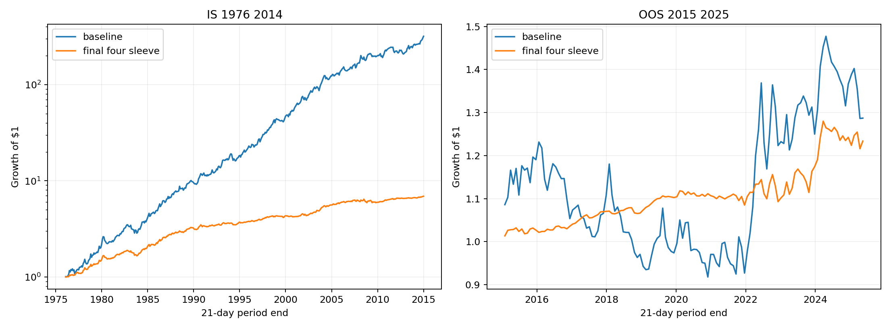

# A Daily-Signal Four-Sleeve Futures Portfolio

## Abstract

We evaluate a diversified futures portfolio against a daily-data implementation of the course time-series momentum baseline. The enhancement combines a 252-trading-day price-trend signal (30% signal budget), five economic themes (20%), a cross-sectional negative-skewness signal (20%) and a frozen Extra Trees forecast (30%). All sleeves enter one covariance-aware portfolio with explicit exposure limits and cost-aware execution. On matched 21-business-day periods during 2015–May 2025, the enhancement has a 0.501 net Sharpe ratio versus 0.243 for the baseline, with annual volatility of 4.10% versus 13.34%. It earns a lower annual net return, 2.05% versus 3.24%. The result is a risk-efficiency improvement, not evidence of higher absolute return or an isolated effect of any one sleeve. Earlier-sample results favor the baseline in both return and Sharpe. The later interval has been inspected during the wider project and is therefore a chronological evaluation rather than a pristine holdout.

## 1. Research question and data

The course baseline applies a long or short position to each market according to its own trailing return. Its simplicity makes it a useful reference, but inverse-volatility sizing can generate large exposure and the strategy reacts only after the established trend changes. We ask whether complementary signals, a common covariance risk model and an execution rule can produce a more stable implementable portfolio.

We use the 58 futures markets in `data/MonthlyReturns_FullSample.xlsx`, daily back-adjusted closes from `data/FuturesUnderlyingData_FullSample.zip`, the corresponding asset map and four economic time series. The backtest starts reporting results in January 1976, after a signal and risk-model warm-up, and ends in May 2025. Market prices are daily; decisions occur on a fixed 21-business-day grid anchored at 31 December 2014. A weight formed at a trading day's close starts earning returns on the following trading day. Monthly non-price observations enter only after their month-end date.

The historical assessment is 1976–2014. Within it, 2005–2009 was used to assess implementation alternatives and 2010–2014 to validate the fixed four-sleeve specification. Extra Trees fits use labels observed before the relevant 2005 or 2015 boundary. January 2015–May 2025 is the later evaluation interval. Because that interval has been viewed during the team's broader research, it is not a wholly untouched out-of-sample test.

## 2. Benchmark: course daily time-series momentum

The benchmark is Minxi-Lin's daily implementation of the Lecture 11 baseline, introduced in [commit 5838b70](https://github.com/xiayawen/ORIE-5260/commit/5838b706cf5b71a1926424fd4751fec679e9af94). At each 21-day formation close it takes the sign of each market's trailing 252-day compounded return, scales by that market's trailing 252-day annualized standard deviation, and divides across eligible markets. The full book is scaled to 11% ex-ante annual volatility using a trailing 252-day sample covariance matrix. An instrument needs at least 200 valid daily observations. The benchmark has no gross, net or asset-class exposure caps. The primary comparison uses its 58-market sample-covariance version; the 66-market and alternative covariance/realized-volatility versions remain in the baseline outputs as robustness checks.

## 3. Enhanced strategy construction

Each sleeve first maps dated observations into instrument weights and is brought to a comparable predicted risk scale. The final signal budgets are fixed at 30/20/20/30; they do not imply equal realized risk contributions.

| Sleeve | Signal and interpretation | Budget |
|---|---|---:|
| Daily price trend | Same 252-day direction and instrument-risk estimate as the benchmark; measured at each 21-day decision close. | 30% |
| Economic trend | Growth, inflation, trade, monetary policy and risk aversion map into futures directions; publication lags are applied to INDPRO and CPI. | 20% |
| Negative skew | A 12-month skewness score ranks instruments within each asset class; positions are centered within class. | 20% |
| Extra Trees | A 66-feature model forecasts next-month return direction using trailing price-path and peer-market information. | 30% |

The macro, skew and model forecasts are calculated at month-end and carried to the next 21-day formation using the latest available values. When a sleeve is unavailable, its budget is assigned to price trend. The Extra Trees model has 200 trees, depth 6, minimum leaf size 30, `max_features=0.7` and seed 5260. The initial fit uses only labels known before 2005; a single later refit uses labels known before 2015. Its feature construction and training audit are included in the submission.

At each formation date, the common risk model estimates annual covariance from the previous 252 daily returns and repairs negative eigenvalues caused by incomplete observations. The final book is scaled down where necessary to satisfy a 10% predicted portfolio-volatility ceiling, 4× gross-exposure ceiling, ±1× net-exposure ceiling and 5% standalone predicted volatility ceiling for each asset class. A cost-aware rule with γ=5 moves from drifted holdings toward the target along a feasible path. Transactions cost 2 basis points per unit of turnover, and four annual contract rolls are charged at 2 basis points. These are the costs used for the results below; they are a simplified futures implementation model, not a measured bid-ask or market-impact estimate.

## 4. Matched-period results

The following statistics use **the same 21-business-day period endpoints and the same 58-market universe** for both strategies. Annual net return is the arithmetic mean period return multiplied by 12; volatility is period standard deviation multiplied by √12; Sharpe uses a zero cash hurdle. Maximum drawdown is measured at period endpoints, and CAGR compounds the observed periods.

| Period | Strategy | Annual net return | CAGR | Annual volatility | Net Sharpe | Maximum endpoint drawdown |
|---|---|---:|---:|---:|---:|---:|
| 1976–2014 (476 periods) | Course daily baseline | **15.40%** | **15.64%** | 12.60% | **1.222** | −18.24% |
| 1976–2014 (476 periods) | Four-sleeve enhancement | 5.02% | 4.99% | **5.20%** | 0.964 | **−12.10%** |
| 2015–May 2025 (128 periods) | Course daily baseline | **3.24%** | **2.39%** | 13.34% | 0.243 | −25.48% |
| 2015–May 2025 (128 periods) | Four-sleeve enhancement | 2.05% | 1.99% | **4.10%** | **0.501** | **−5.45%** |

The historical benchmark earned substantially more return and a higher Sharpe. During the later interval, the four-sleeve portfolio improved Sharpe by 0.258 and reduced annual volatility by 9.25 percentage points, while giving up 1.19 percentage points of arithmetic annual net return. Thus the evidence supports greater risk efficiency and smaller realized swings, rather than a universal return improvement.

Daily marking makes the final portfolio's later-period volatility **3.92%**, Sharpe **0.522** and maximum *daily* drawdown **−7.41%**. The endpoint drawdown above is less severe because it omits losses between 21-day reporting dates. The baseline implementation presently saves returns at 21-day endpoints, so a directly comparable maximum daily drawdown for the baseline is unavailable.

## 5. Trading costs, exposure and interpretation

| Period | Strategy | Annual turnover | Annual cost drag | Average gross exposure |
|---|---|---:|---:|---:|
| 1976–2014 | Course daily baseline | 21.33 | 0.92% | 6.19× |
| 1976–2014 | Four-sleeve enhancement | **3.55** | **0.19%** | **1.47×** |
| 2015–May 2025 | Course daily baseline | 43.47 | 1.79% | 11.54× |
| 2015–May 2025 | Four-sleeve enhancement | **2.49** | **0.16%** | **1.30×** |

The enhancement trades less and carries markedly less gross exposure in both periods. The reduced cost drag is consistent with cost-aware execution and smaller exposures, but the table does not isolate the causal effect of execution from changes in signals and risk limits. The baseline targets 11% ex-ante portfolio risk without exposure caps; the enhancement uses a 10% ceiling and caps. Their different risk budgets partly explain the absolute-return gap. An equal-risk comparison would be needed to attribute the remaining difference to signal quality alone.

## 6. Limitations and conclusion

The back-adjusted daily series omit exact contract-selection and roll-date implementation. The cost convention abstracts from bid-ask variation, financing and market impact. Sample covariance can be unstable when cross-market correlations change quickly. Rebalance-grid sensitivity is material for the baseline: the 58-market benchmark's later-period Sharpe ranges from roughly 0.05 to 0.24 across tested grid offsets, with the chosen anchor at the upper end. The four-sleeve enhancement has not yet had an equivalent staggered-grid evaluation in this final submission.

The Extra Trees sleeve has no active out-of-training forecasts before 2005; its absent 30% budget returns to price trend. Consequently, the long 1976–2014 row describes the specified implementation, including its early reduced-sleeve years, rather than 39 years of all four sleeves operating simultaneously. The later evaluation has also been observed in the broader research process. Statistical evidence for a persistent improvement in expected return is therefore limited.

The selected four-sleeve portfolio has a lower absolute return than the baseline but a higher later-period Sharpe, substantially lower volatility, lower gross exposure and lower turnover. This is the final enhancement presented here. The executable files and dated outputs allow reviewers to reproduce both strategies and inspect the model's information timing, risks and costs.

## Reproduction

Run `python daily_baseline.py`, `python run_final_strategy.py`, then `python compare_baseline.py` from the repository root. Full daily results are in `outputs/final_strategy/`; aligned 21-day returns and statistics are in `outputs/comparison/`; baseline and anchor-sensitivity results are in `outputs/baseline/`.
