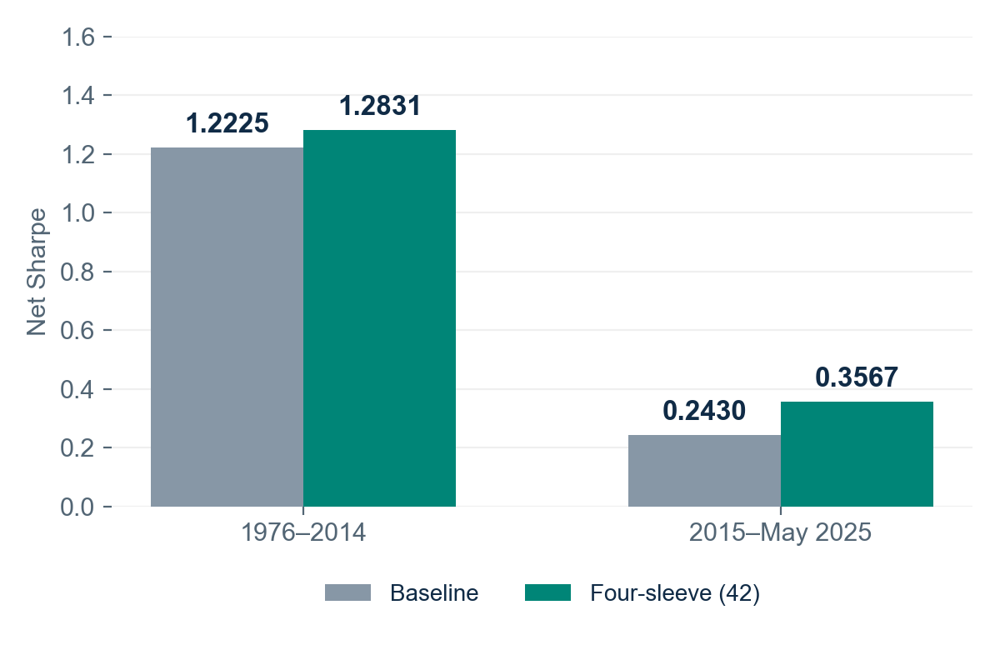
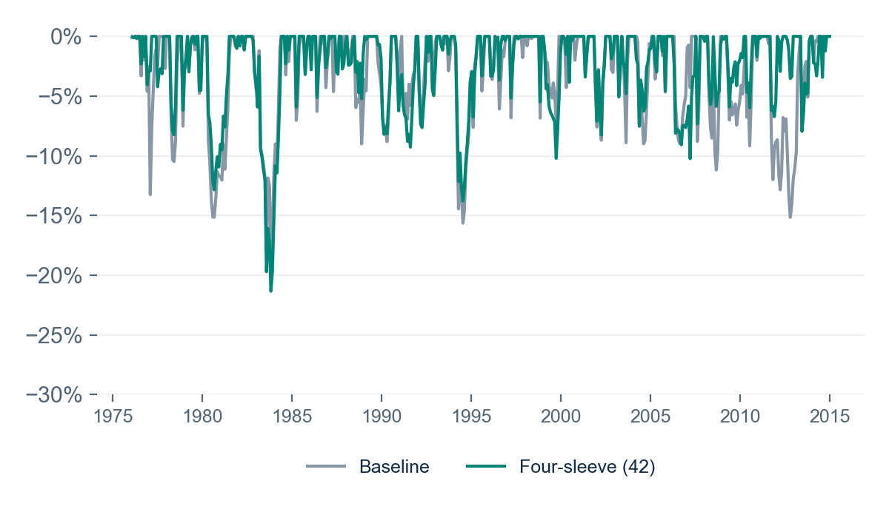
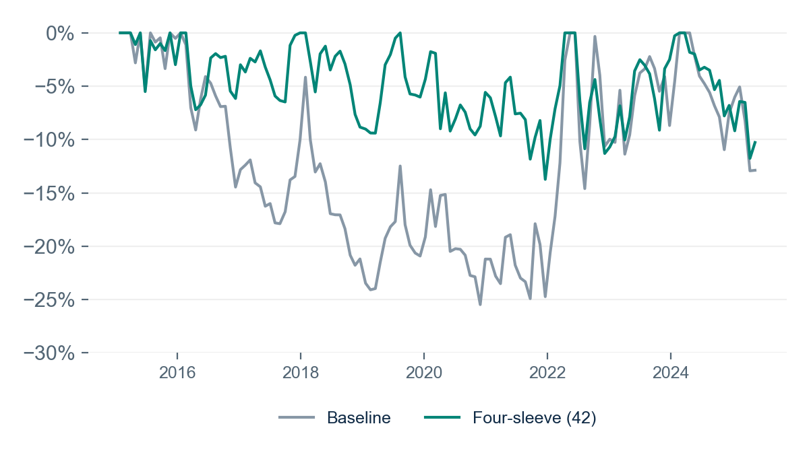

# A Daily-Signal Four-Sleeve Futures Portfolio

## Abstract

We compare a diversified four-sleeve futures strategy with the course's daily time-series momentum baseline across 58 markets. The selected strategy combines daily price trend (30% signal budget), economic trend (20%), within-class negative skew (20%) and a **fixed 42-input Extra Trees** signal (30%). It targets 10% annualized ex-ante volatility and fully rebalances every 21 business days. On identical 21-day reporting endpoints, its net Sharpe is **1.283 versus 1.222** for the baseline in 1976–2014 and **0.357 versus 0.243** in January 2015–May 2025. The later-period maximum endpoint drawdown is **−13.74% versus −25.48%**. These gains come with substantial gross and net exposure, and the later sample has been examined during research rather than remaining an untouched holdout.

## 1. Objective, data and evaluation design

The baseline uses each future's own trailing price direction. We ask whether economic, cross-sectional and nonlinear information improves the portfolio's return per unit of risk while preserving a transparent price-trend core.

The universe contains **58 futures markets** across equity, fixed income, commodities and FX. [`data/MonthlyReturns_FullSample.xlsx`](data/MonthlyReturns_FullSample.xlsx) supplies monthly returns and the instrument mapping; [`data/FuturesUnderlyingData_FullSample.zip`](data/FuturesUnderlyingData_FullSample.zip) supplies daily back-adjusted prices. Industrial production (`INDPRO.csv`), consumer prices (`CPIAUCSL.csv`), the two-year Treasury yield (`GS2.csv`) and the Baa–Treasury spread (`BAA10Y.csv`) supply external macroeconomic series. Currency and equity futures returns provide the remaining economic-theme inputs. The reported backtest spans **January 1976–May 2025**, after the required signal and risk-model warm-up.

Weights are formed at the close every **21 business days** and start earning returns on the following trading day. Positions and costs are marked daily. We compare strategies on the same 21-day endpoints: 476 periods in 1976–2014 and 128 in 2015–May 2025. The early period contains the pre-2005 training history and subsequent validation. Extra Trees features and model parameters are set using information available before the 2005 and 2015 boundaries; the 2015–2025 period is a later evaluation, but was repeatedly viewed during project development.

## 2. Course baseline

At each formation, the benchmark takes the sign of each eligible market's trailing **252-trading-day** compounded return, divides by its trailing 252-day annualized volatility and averages over eligible markets. At least 200 valid daily observations are required. It scales the whole book to **11% ex-ante annual volatility** using a trailing 252-day daily sample covariance. There are no gross, net or asset-class exposure caps. The primary comparison uses the 58-market baseline generated by [`daily_baseline.py`](daily_baseline.py); alternative baseline settings remain in [`outputs/baseline/`](outputs/baseline/).

## 3. Selected enhancement

The four percentages below are **signal budgets** used to blend proposed sleeve weights; they are not realized risk contributions. Each available sleeve is normalized to a common predicted-risk scale before blending. When a non-price sleeve is unavailable, its budget returns to the daily price trend.

| Sleeve | Budget | Objective and construction |
|---|---:|---|
| Daily price trend | 30% | Preserve the benchmark's 252-day direction, inverse-volatility weighting and recent-trading eligibility. |
| Economic trend | 20% | Map growth, inflation, trade, monetary policy and risk-environment themes into asset-class directions. Lag industrial production and CPI one extra month, smooth theme directions over three months, then combine equal-risk theme portfolios. |
| Negative skew | 20% | Rank trailing 12-month return skewness within each asset class. Center ranks so relatively more negatively skewed markets are long and peers with less negative skew are short; require at least four eligible markets per class. |
| Extra Trees | 30% | Convert the predicted probability of a positive next-month return into the continuous direction `2 × probability − 1`, then inverse-volatility weight and normalize. |

The Extra Trees classifier uses **42 fixed inputs: 20 raw price/peer features, 18 within-class ranks and four asset-class indicators**. These were screened before 2005 from 62 numerical candidates: a feature needed absolute mean monthly rank IC of at least **0.01** and a directionally consistent **Newey–West HAC t-statistic of at least 1.96 in absolute value**, using six lags. The four class indicators were retained as controls. This is a nominal screen across correlated features, without a multiple-testing correction. The model has 200 trees, maximum depth 6, minimum leaf size 30, `max_features=0.7` and seed 5260. The same feature list is used when the model is refitted with labels available before 2015; it is frozen thereafter. It does not provide an active out-of-training sleeve before 2005, so that budget goes to price trend. The exact list and model timing are in [`frozen_selection.json`](outputs/ic_t_feature_filter/frozen_selection.json) and the [IC and HAC screening report](reports/research/IC_T_FILTER_REPORT.md).

At each formation, the portfolio estimates covariance from the preceding **252 daily returns** of eligible markets, repairs negative eigenvalues from incomplete observations, and scales the 30/20/20/30 blend to **10% annualized ex-ante volatility**. The selected book has **no gross, net or class exposure cap** and trades fully to its target. The assumed cost is **2 basis points per unit of traded notional**, plus four rolls per year at 2 basis points on held gross notional. It omits financing, variable spreads and market impact. The selected construction is implemented in [`orie5260/presentation/prepare_results.py`](orie5260/presentation/prepare_results.py), invoked by `python run.py selected-42`; its saved probabilities come from the chronological screening run.

## 4. Performance versus the baseline

The following table uses **matched 21-business-day endpoints**. Annual net return is 12 times the mean period return; annual volatility is the period standard deviation times √12; Sharpe assumes a zero cash hurdle. CAGR compounds the period returns. Drawdown is measured at those same endpoints.

| Period | Strategy | Annual net return | CAGR | Annual volatility | Net Sharpe | Maximum endpoint drawdown |
|---|---|---:|---:|---:|---:|---:|
| 1976–2014 | Course baseline | **15.40%** | **15.64%** | 12.60% | 1.222 | **−18.24%** |
| 1976–2014 | Selected four-sleeve | 14.09% | 14.36% | **10.98%** | **1.283** | −21.34% |
| 2015–May 2025 | Course baseline | 3.24% | 2.39% | 13.34% | 0.243 | −25.48% |
| 2015–May 2025 | Selected four-sleeve | **3.65%** | **3.18%** | **10.25%** | **0.357** | **−13.74%** |

The selected strategy has a higher Sharpe in both periods and a smaller later-period endpoint drawdown. Its 1976–2014 drawdown is **deeper** than the baseline's, so the risk benefit is not uniform across history. Daily marking gives the selected strategy a maximum drawdown of **−23.10%** in 1976–2014 and **−17.49%** in 2015–May 2025. A directly comparable daily drawdown for the baseline is unavailable in the saved comparison; the table uses common endpoints for both.

These Sharpe differences are modest relative to sampling uncertainty. The historical summary also includes years before the Extra Trees sleeve was active. The later-period comparison is descriptive because the team has examined that period while selecting model and portfolio alternatives.

## 5. Exposure, turnover and transaction costs

| Period | Selected annual turnover | Selected annual cost | Average gross exposure | Average absolute net exposure |
|---|---:|---:|---:|---:|
| 1976–2014 | 24.84× | 0.890% | 4.93× | 2.43× |
| 2015–May 2025 | 48.83× | 1.883% | 11.31× | 6.59× |

The full-rebalance design responds quickly to signals but trades substantially, especially after 2015. Volatility targeting can scale a low-volatility blend to very high notional exposure. The later average absolute net exposure of **6.59× NAV** and gross exposure of **11.31× NAV** make financing, margin and market impact important implementation limitations; those costs are not modeled here.

## 6. Why this configuration was selected

The factor research tested an IC-only filter (fixed 56 inputs) and an IC-plus-directional-HAC filter (fixed 42 inputs), with pre-2015 re-screened alternatives. The fixed 42-input model achieved later-period Sharpe **0.3567**, versus **0.3550** for fixed 56 inputs and **0.3429** for the original 66 inputs. Its full historical Sharpe (**1.2831**) and 2005–2014 Sharpe (**1.0112**) were slightly below those of the fixed 56-input candidate. Thus the 42-input choice is a modest simplification with a **very small** later-period gain, not evidence of a statistically meaningful improvement from the additional t screen. A separate 42-input portfolio experiment found that learned sleeve budgets and cost-aware execution did not improve the relevant validation ranking or later-period Sharpe; the fixed **30/20/20/30**, full-rebalance design remained selected. See the [screening report](reports/research/IC_T_FILTER_REPORT.md) and [42-input portfolio experiment](reports/research/ICT42_PORTFOLIO_OPTIMIZATION_REPORT.md).

As a risk diagnostic, the same 42-input blend was also run with gross, net, class-risk and volatility limits, with and without cost-aware execution. These are **appendix comparisons**, not components of the selected strategy. The capped, cost-aware variant reduced later daily maximum drawdown to **−7.09%** and annual cost to **0.157%**, but operated at far lower exposure (average gross **1.39×**) and is not the selected full-rebalance portfolio. It should not be used as the selected strategy's performance estimate.

## 7. Limitations and conclusion

Back-adjusted futures prices omit contract-selection and exact roll-date mechanics. The fixed 2-basis-point cost convention excludes financing and market impact, which may be material at the observed leverage. Sample covariance and the 10% ex-ante scale can misstate future risk when volatilities or correlations change. The 42-input screen tests many correlated features without a multiple-testing correction, and the later evaluation has been seen during research. These constraints limit any claim of generalizable out-of-sample improvement.

Within those limits, the selected 42-input four-sleeve strategy has higher measured net Sharpe and a substantially smaller later-period endpoint drawdown than the course baseline. Its larger net exposure and high turnover are central trade-offs. The selected strategy has **no turning-point overlay**; that separate experiment is documented in [`turning_point_analysis.md`](turning_point_analysis.md).

## Reproduction

From the repository root, install [`requirements.txt`](requirements.txt), then run `python run.py baseline` and `python run.py selected-42`. The latter uses the saved chronological 42-input probabilities in [`outputs/ic_t_feature_filter/`](outputs/ic_t_feature_filter/). To regenerate the screening and frozen forecasts first, run `python run.py factor-ic`, `python run.py ic-filter`, `python run.py ic-filter-oos`, and `python run.py ic-t-filter` in that order, then `python run.py selected-42`. Main performance, aligned returns, daily returns and figures are in [`outputs/ppt42_update/`](outputs/ppt42_update/). `python run_final_strategy.py` reconstructs the **original 66-input comparison**, not the selected portfolio.
